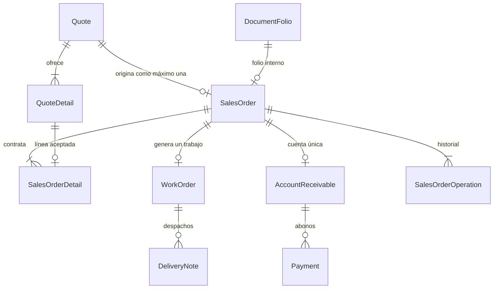

# Hito Orden de Compra Cliente

**Estado: OCC1–OCC5 completos; hito validado funcionalmente y cerrado por el usuario.** Actualización: 13-10-2026. Fuente vigente para este desarrollo, por solicitud del usuario. Los checks de revisión documental no representan funcionalidades terminadas; las evidencias técnicas se detallan abajo.

## 1. Objetivo y límites

Registrar el compromiso del cliente sobre una cotización, incluyendo sólo las líneas y cantidades que acepte. La orden tendrá su propio folio, detalle, importes e historial, y será el origen comercial de la futura Orden de Trabajo y de la cuenta por cobrar.

La denominación visible es **Orden de Compra Cliente**; se conserva `SalesOrder` como identificador técnico y `/ventas/ordenes` como ruta. Compras a proveedores permanece como proceso independiente.

El usuario establece ahora que **una cotización se relaciona con una sola Orden de Compra Cliente**, que puede no incluir todo lo cotizado. Mientras no se acepte, la cotización tendrá cero órdenes. Esta decisión reemplaza la indefinición anterior sobre varias órdenes por cotización.

Este documento planifica estructura, servicios, interfaz y validación. La solicitud posterior del usuario autoriza avanzar en estructura y módulos resolviendo decisiones técnicas autónomamente; las dudas comerciales que impidan continuar deben consultarse y esperar respuesta. D1–D10 fueron respondidas expresamente y están registradas en las secciones 4 y 14; el registro, la consulta y la anulación ya están implementados. El envío por correo del PDF permanece en espera de SMTP/contraseña de aplicación, según [HITO-PDF-COTIZACIONES.md](HITO-PDF-COTIZACIONES.md); no bloquea este plan.

## 2. Base revisada al planificar (antes de OCC1)

| Componente | Estado real en el código | Consecuencia para este hito |
| --- | --- | --- |
| `Quote` / `QuoteDetail` | Folio, versión, copias históricas, sucursal, condición/banco, IVA, descuento, líneas de materia prima/producto/servicio, texto enriquecido | Reutilizar reglas y tomar una revisión identificada como origen |
| Aprobación de cotización | `resolverCotizacion` pasa Pendiente a Aprobada, incrementa versión y registra `QuoteOperation`; rechaza aprobación vencida | Hoy no genera orden; hay que coordinar ambos procesos |
| Protección SQL de cotización | Documento terminal inmutable; no se cambia contenido al aprobar; una orden existente también impide editar | La aceptación parcial debe guardarse en la orden, sin recortar la cotización original |
| PDF | Emisiones y snapshots inmutables por revisión; generación validada por el usuario | Conservar el documento ofrecido y vincularlo cuando corresponda; no reescribirlo con el total aceptado |
| `SalesOrder` | Sólo `id`, `date`, `quoteId`, `pdfUrl` y timestamps; relación a trabajos/cuenta | Falta detalle, folio, versión, estado, referencias externas, snapshots e importes propios |
| Relación cotización/orden | `Quote.salesOrders[]` y `SalesOrder.quoteId` con índice no único | Hoy admite varias; auditar datos y migrar a uno opcional por cotización |
| `WorkOrder` | `salesOrderId` opcional no único; `productName` singular y `WorkOrderDetail` de materiales/bodega | Hoy admite varios trabajos por orden; no representa aún todas las líneas comerciales mixtas |
| Numeración | Tipo `ORDEN_COMPRA_CLIENTE` y `asignarFolio(tx, tipo, UUID)` operativos | Asignar al confirmar dentro de la misma transacción; comprobar configuración, sin inventar inicio |
| Cobranza | `AccountReceivable.salesOrderId` único, pagos vinculados con UUID; vencimiento opcional | Preparar cuenta por el importe aceptado y permitir anticipos en el módulo posterior |
| Productos/inventario | Catálogo, receta, imágenes, stock inicial y ajustes de terminado; inventario de materias primas operativo | Registrar la orden no fabrica ni consume; producción y salidas tienen hitos posteriores |
| Interfaz de órdenes | `/ventas/ordenes` es provisional; menú aún dice «Órdenes de venta» | Implementar listado/formularios y actualizar textos/breadcrumbs |

Fuentes revisadas: `prisma/schema.prisma`, migración `20261012120000_cotizaciones_documento`, `src/lib/servicios/{cotizaciones,numeracion,importes-cotizacion}.ts`, `src/lib/consultas/cotizaciones.ts`, `src/lib/validaciones/{cotizacion,importes-cotizacion}.ts`, `src/config/navegacion.ts` y ruta provisional. Referencias de interfaz y etapas: [GUIA-INTERFAZ.md](GUIA-INTERFAZ.md), [HITO-COTIZACIONES.md](HITO-COTIZACIONES.md), [HITO-PRODUCTOS.md](HITO-PRODUCTOS.md).

**Durante la planificación no se consultaron conteos ni duplicados.** La auditoría posterior de OCC1 sí los comprobó; los resultados y el cambio de cardinalidad se registran a continuación. Las demás carencias de la tabla anterior continúan pendientes.

### 2.1 OCC1 — auditoría y cardinalidades, 12-10-2026

- Auditoría real mediante [scripts/auditar-ordenes-compra-cliente.ts](../scripts/auditar-ordenes-compra-cliente.ts), en una transacción `RepeatableRead` con `SET TRANSACTION READ ONLY`. Consultas secuenciales; informe con IDs, conteos y presencia de referencias, sin contactos, credenciales ni URLs de archivos.
- Resultado: cero órdenes, trabajos, obras propias, cuentas, abonos y guías; una cotización Pendiente (ID 1, revisión 4) y una emisión PDF. Sin duplicados ni órdenes heredadas que conciliar. Los campos históricos revisados están presentes; esto no sustituye validación de RUT, editor o importes al confirmar.
- Numeración de Orden de Compra Cliente y Orden de Trabajo sin inicio/dígitos configurados. No se inventó ningún número; configurar la numeración será requisito del futuro registro.
- `SalesOrder.quoteId` y `WorkOrder.salesOrderId` pasan a únicos. Relaciones inversas `Quote.salesOrder?` y `SalesOrder.workOrder?`. Varias obras propias con `salesOrderId = null` siguen permitidas.
- Migración `20261013021125_cardinalidad_orden_compra_cliente`, generada con Prisma y ampliada con transacción, bloqueo y precondiciones explícitas. Duplicados detienen la migración antes de retirar índices; no se fusionan/reasignan registros. Se conservan FK y protecciones previas.
- Respaldo previo de archivos y PostgreSQL: `backups/20261012_230813_auditoria_orden_compra_cliente/`. Pruebas en copia local `mtx_validacion_occ_20261012_230813`: duplicados de órdenes/trabajos bloquean migración; después de aplicar, ambas unicidades rechazan duplicados y permiten obras propias múltiples. Fixtures revertidos; copia retirada al finalizar.
- Migración aplicada a la base local tras validar copia y repetir auditoría. Las 47 tablas de dominio conservan conteos/huellas antes y después, tanto en copia como en base local. Cliente generado y 19 migraciones al día; `prisma validate`, `pnpm lint` y `pnpm build` correctos. No se iniciaron servidores de aplicación.
- Las consultas/servicios de cotizaciones ya buscan órdenes por `quoteId`; el seed no crea órdenes/trabajos y no requirió cambios. No se modifican stock, PDF, aprobación, fechas antiguas ni importes. El resto de OCC1 y OCC2–OCC5 sigue pendiente.

Comando reutilizable de auditoría: `NODE_ENV=production pnpm exec tsx scripts/auditar-ordenes-compra-cliente.ts`. Repetir antes de cualquier migración posterior; el informe refleja sólo su instantánea. La prueba inicial de cardinalidad (sólo esquema anterior al registro comercial) se ejecuta con el mismo comando sobre `tests/ordenes-cardinalidad.integration.ts`, exclusivamente en una copia cuyo nombre empiece por `mtx_validacion_occ_`; `--antes-migracion` comprueba las precondiciones sobre el esquema anterior.

Recuperación: conservar el dump y los recursos locales existentes. Si fuera necesaria, restaurar primero en una base separada y verificar integridad antes de sustituir el destino. No ejecutar reset, borrar documentos ni retirar las unicidades automáticamente una vez que haya órdenes reales.

## 3. Definiciones confirmadas

- [x] Una orden procede de una única cotización; una cotización origina como máximo una orden.
- [x] La orden puede aceptar sólo parte del contenido cotizado.
- [x] Una Orden de Compra Cliente genera una sola Orden de Trabajo; obra propia conserva `salesOrderId = null`.
- [x] Cotizaciones pueden mezclar materia prima, producto terminado y servicios/trabajos a medida.
- [x] Precios finales con desglose de IVA, descuento global y totales en pesos enteros; cantidades con hasta tres decimales.
- [x] Los abonos pertenecen a la orden mediante su cuenta por cobrar; el trabajo consulta esa misma cuenta.
- [x] Plazo de pago desde fecha de factura, registrada junto a su folio al finalizar el trabajo. No inventar vencimiento previo ni cambiarlo por recibir un abono.
- [x] Folio interno del ERP, número externo de la orden del cliente y folio de factura son referencias distintas.
- [x] Producción consume materia prima e ingresa terminado; vender terminado rebaja sólo terminado.
- [x] PDF de cotización validado; envío por correo pendiente de configuración SMTP por decisión expresa.

## 4. Decisiones comerciales aprobadas

Respuestas expresas del usuario en este chat. D5 se precisó en una respuesta adicional; la normalización sólo afecta la clave interna, nunca el texto original.

| Código | Regla vigente |
| --- | --- |
| D1 | Seleccionar líneas y cantidades positivas hasta lo cotizado, sin agregar ítems ni alterar precios/unidades. Ampliaciones requieren corregir la cotización |
| D2 | Lo excluido no genera entrega ni cobro; contratación posterior requiere otra cotización. Anular conserva el vínculo único y el folio |
| D3 | Conservar porcentaje histórico; monto fijo prorrateado por subtotal aceptado/ofrecido y redondeado al peso |
| D4 | Aprobar y crear orden atómicamente al confirmar. Cancelar no aprueba. Aprobadas previas sin orden admitidas aunque haya vencido la oferta; Pendientes vencidas deben corregirse antes |
| D5 | Número/fecha externos opcionales. Conservar número literal y ceros; impedir equivalentes por espacios/mayúsculas para el mismo cliente, sin reinicio anual ni liberación al anular |
| D6 | Contenido confirmado inmutable. Anular con motivo sólo sin trabajo, abonos (incluso anulados) ni hitos posteriores de la cuenta; sin edición, ocultación ni borrado inicial |
| D7 | Cuenta automática por el total aceptado, incluso cero, sin vencimiento ni pagos. No crear trabajo automáticamente |
| D8 | Aceptación actual/pasada de Santiago y no anterior a la cotización; fecha externa independiente. Heredar identidades/condiciones históricas completas sin refrescar mantenedores |
| D9 | Alcance propio revisado antes de confirmar; original conservado. No inferir ni eliminar párrafos/imágenes automáticamente según las líneas excluidas |
| D10 | Primera entrega con registro/consulta, sin adjunto externo ni PDF propio. Emisión de la revisión ofrecida opcional, sin regeneración obligatoria |

## 5. Aceptación parcial y cálculos implementados

La oferta conserva todas sus líneas y cantidades. La orden guarda únicamente las aceptadas, vinculando cada una con su `QuoteDetail`. No usar el stock disponible como cantidad contratada: fabricar/comprar faltantes corresponde a otros procesos.

Ejemplo de D1: una cotización contiene 10 productos a $100.000 y 1 instalación a $200.000. El cliente podría aceptar 4 productos y excluir instalación. Subtotal aceptado: $400.000; los otros 6 productos y la instalación quedan como no contratados. Esta diferencia no es recepción parcial ni pendiente de entrega de la orden. Las entregas futuras se medirán sobre las 4 unidades aceptadas.

Ejemplo de D3 sobre la misma oferta, subtotal original $1.200.000:

| Descuento ofrecido | Resultado aprobado para subtotal aceptado $400.000 |
| --- | --- |
| Sin descuento | Total $400.000 |
| 10% global | Descuento $40.000; total $360.000 |
| Monto global $120.000 | Prorrateo $120.000 × $400.000 / $1.200.000 = $40.000; total $360.000 |

El usuario aprueba expresamente el prorrateo de D3. Estos casos se comprobaron con pruebas puras e integración.

- Calcular en servidor con `Prisma.Decimal`, manteniendo precisión ampliada de `calcularImportesCotizacion`; ningún cálculo monetario mediante `number`.
- Redondear cada `cantidad aceptada × precio final unitario` al peso con empate hacia arriba; sumar líneas, aplicar descuento aprobado y desglosar neto/IVA desde el total final.
- `neto = redondear(total / (1 + tasa / 100))`; `IVA = total - neto`. Guardar modo/valor de descuento, importe aplicado, tasa, subtotal, neto, IVA y total de la orden.
- Guardar además base/descuento originales cuando se prorratee un monto; no convertirlo a un porcentaje aproximado que pierda trazabilidad.
- Aceptación completa debe reproducir exactamente los importes ofrecidos; parcial debe conservar precios y calcular sus propios totales. Rechazar inconsistencias del origen, no repararlas silenciosamente.
- Evitar división por cero en una oferta de subtotal cero: descuento aplicable cero; admitir orden total cero conforme D7. Rechazar descuentos superiores al subtotal, negativos, `NaN`, infinitos y desbordamientos.
- Mantener `Decimal(14,2)` para importes almacenados con fracción `.00` y `Decimal(14,3)` para cantidades. Etiqueta TOTAL/PARCIAL derivada comparando líneas/cantidades, sin duplicar un saldo mutable.

## 6. Modelo y diseño de referencia

La estructura vigente está en `prisma/schema.prisma` y las migraciones OCC. El diseño siguiente conserva contexto; las diferencias concretas implementadas son: campos nuevos opcionales exclusivamente para legado; `acceptanceDate @db.Date` como fecha de la aceptación nueva sin convertir el timestamp `date` heredado; copias completas en `quoteSnapshot`, `clientSnapshot`, `companySnapshot` y `bankSnapshot`, con nombre/sucursal/plazo e importes escalares propios; referencias externas literales y clave derivada; detalle inmutable y operaciones separadas. No hay estado de borrador persistente, edición ni ocultación. La cardinalidad mínima de detalle/cuenta se exige sólo a documentos nuevos; el legado se conserva incompleto para conciliación manual.

### 6.1 Cabecera `SalesOrder`

- `quoteId @unique`, relación inversa `Quote.salesOrder?`; una orden histórica/anulada también ocupa la relación (D2 aprobada). Conservar `id` y referencias existentes.
- `folioId @unique` con FK Restrict a `DocumentFolio` y tipo `ORDEN_COMPRA_CLIENTE`; `creationKey` UUID único y `version` entera para concurrencia.
- Fecha nueva de aceptación en `acceptanceDate @db.Date`; `date` conserva su tipo timestamp para compatibilidad. En nuevos registros guarda la medianoche UTC de esa misma fecha, comprobada por SQL; fechas antiguas no se convierten ni se reinterpretan.
- `quoteVersion` aceptada y snapshot de la oferta origen; si se aprueba en la misma operación, distinguir versión revisada antes de confirmar y versión aprobada resultante. Vinculación opcional a `QuotePdfEmission` según D10, verificando cotización/revisión; una emisión anterior a la aprobación no se presenta como PDF del estado aprobado.
- `clientId`, `clientBranchId`, condición de pago y banco cuando correspondan; copiar cliente/contacto/sucursal/emisor, condición/plazo, banco y condiciones comerciales desde la cotización aceptada, sin refrescar desde mantenedores.
- Importes propios conforme sección 5; la futura deuda usa `SalesOrder.totalAmount`, nunca `Quote.totalAmount` en una aceptación parcial.
- Referencia externa: número original en texto, clave normalizada para duplicados y fecha independientes del folio ERP, según D5.
- Alcance técnico aceptado con el mismo JSON validado del editor y texto original en el snapshot; no aceptar HTML arbitrario. Referenciar recursos conservados, sin duplicar archivos innecesariamente ni perder protección histórica.
- Estado comercial implementado `CONFIRMADA` / `ANULADA`; formulario sin guardar no es un estado persistente. `voidedAt`/`voidReason` juntos; no se incorpora `deletedAt` ni ocultación. Estados de pago y producción se consultan desde sus propios registros.
- Conservar `pdfUrl` heredado hasta auditar su uso. No reinterpretarlo como adjunto externo, PDF generado o URL libre del formulario sin resolver D10.

### 6.2 Nuevo `SalesOrderDetail`

- ID, `salesOrderId`, `quoteId`, `quoteDetailId`, posición, tipo `QuoteLineType`, cantidad aceptada, precio unitario y total de línea; timestamps.
- Copias de descripción, código/unidad y referencias a materia prima o producto según tipo. Un servicio no requiere inventar material ni producto.
- Una fila por línea origen aceptada; omitir líneas no seleccionadas, no guardar cantidades cero como compromisos.
- Unicidad de línea origen por orden y posición; la relación uno a uno cotización/orden impide reutilizar esa línea en otra orden. Evaluar `quoteDetailId @unique` para expresar directamente la cardinalidad.
- FK compuestas que garanticen la misma cotización: `(salesOrderId, quoteId)` a `SalesOrder(id, quoteId)` y `(quoteDetailId, quoteId)` a `QuoteDetail(id, quoteId)`, agregando claves únicas de referencia donde hagan falta.
- Validar en servicio y protección SQL que cantidad > 0 y no supera la cotizada según D1; precio/unidad/tipo/origen coinciden con el origen inmutable. Un CHECK simple no puede consultar otra fila: usar FK y trigger cuando corresponda.

### 6.3 Operaciones e integridad

- Nuevo `SalesOrderOperation`: UUID estable único, tipo en español, huella del contenido normalizado, orden, versión y fechas; registros inmutables. No reutilizar `PurchaseOperation`, `InventoryOperation` o `QuoteOperation` como historial de la orden.
- `QuoteOperation` sigue registrando exclusivamente la transición de cotización cuando se aprueba; separar claves de las operaciones coordinadas y conservarlas en reintentos. Sólo la orden consume un folio nuevo en esta etapa.
- Índices en toda nueva FK, incluyendo compuestos y los ya cubiertos por unicidad; índices para fecha/estado/cliente, número externo y búsquedas reales del listado.
- CHECK de valores finitos/rangos/enteros monetarios, cantidad, versión, anulación coherente y total = subtotal − descuento = neto + IVA. Proteger identidad y contenido confirmado.
- Verificación diferida de existencia de detalle, suma de líneas, operación y cuenta obligatoria conforme D7; filas relacionadas se confirman o revierten juntas. No usar sólo validaciones del navegador.
- FK Restrict para documentos y sus fuentes; no borrados en cascada de compromisos históricos.

### 6.4 Trabajo y cobranza

- Migrar `WorkOrder.salesOrderId` a único opcional tras auditar duplicados. PostgreSQL permite varias obras propias con NULL. La aplicación debe adoptar relación singular `workOrder?` sin romper consultas/seed existentes.
- No crear trabajo ficticio para cumplir el vínculo: la cardinalidad inicial es cero o uno. Definir en Producción cómo representar varios productos, venta directa y servicios; `productName` singular no basta y `WorkOrderDetail` son insumos, no líneas vendidas.
- Crear cuenta única con `amount = total aceptado`, `issuedAt` de registro y vencimiento nulo al confirmar. La fecha de aceptación no sustituye a la futura fecha de factura.
- Factura y finalización posteriores determinarán vencimiento con plazo histórico y fechas de calendario. No escribir aún estados heredados de `DeliveryNote` ni crear abonos implícitos.
- Anulación futura coordina orden/cuenta y valida dependencias bajo bloqueo; si hay pagos o trabajo, detener hasta contar con reglas de reversión aprobadas. No ocultar una deuda vigente al anular sólo su cabecera comercial.

## 7. Flujo de aceptación implementado (D4)

1. Desde Cotizaciones, «Aceptar y registrar orden» abre formulario sobre el listado. Alternativamente, Crear en Órdenes selecciona cotización mediante búsqueda interna. Mostrar folio, versión, cliente/sucursal, vigencia y situación actual.
2. Mostrar las líneas cotizadas en grilla; seleccionar y ajustar cantidades aceptadas según D1. Comparar cantidad cotizada/aceptada/excluida y total ofrecido/aceptado. Revisar alcance técnico cuando se excluyan trabajos.
3. Completar referencias externas, fecha y revisar alcance propio. Precio/unidad/IVA/condiciones heredadas se muestran de sólo lectura bajo las reglas aprobadas.
4. Previsualizar cálculos en servidor sin reservar folio, cambiar estado, crear cuenta ni escribir stock.
5. Confirmar aceptación con resumen de líneas, cantidades, descuento, total e impacto; cancelar devuelve al formulario y no aprueba la cotización.
6. Validar de nuevo en servidor y confirmar aprobación, orden/detalles, folio, operación y cuenta (si D7 se aprueba) en una transacción.
7. Mostrar la orden creada y su vínculo con la cotización. Un reintento devuelve la misma orden. Cotización con orden ofrece «Ver orden»; no un segundo registro.
8. Desde una cotización ya Aprobada y sin orden, usar el mismo formulario sobre su revisión protegida, conforme reglas de vigencia D4. Rechazadas, ocultas o incompletas quedan bloqueadas con explicación; no aprobar ni completar sus datos automáticamente.

La aprobación significa aceptar la oferta como origen comercial; la orden identifica exactamente lo contratado. No recortar la cotización ni añadir un estado «aprobación parcial» a `QuoteStatus` sin necesidad: la aceptación TOTAL/PARCIAL se deriva del detalle de la orden.

## 8. Transacciones, concurrencia y servicios

- Preparar `src/lib/servicios/ordenes-compra-cliente.ts`, validación compartida, tipos serializables y consultas en `src/lib/consultas/`. Usar la instancia compartida de Prisma y Server Actions como frontera de escritura.
- Canonicalizar selección/cantidades/referencias antes de calcular huella. No confiar en importes, snapshots, estado ni IDs de cliente/material enviados por el navegador.
- Reconocer UUID + huella de una operación previa **antes** de exigir la versión esperada o revisar catálogos actuales. Mismo UUID con otro contenido se rechaza; distinto UUID para una cotización que ya tiene orden no crea una segunda.
- Orden de bloqueos a concretar y probar: UUID de operación → bloqueo compartido de IVA cuando corresponda al flujo existente → fila Quote → SalesOrder si existe → cuenta cuando proceda → asignador de folio/secuencia para creación. Mantener consultas secuenciales dentro de la transacción y orden uniforme entre confirmar/anular/cobrar.
- Al aceptar una Pendiente, no llamar al servicio público de aprobación que abre otra transacción. Extraer una operación interna que reciba `tx`, reutilizando validaciones de `editable`, versión, vigencia y `QuoteOperation`.
- Aprobar Quote y registrar su operación **antes de insertar SalesOrder**: el trigger actual rechaza cambios en cotización cuando ya tiene una orden. No cambiar el contenido al aprobar. La atomicidad evita que otro usuario observe un estado intermedio.
- Asignar folio sólo después de validar y dentro de la misma transacción. Si falta numeración o falla una línea/cuenta, rollback de aprobación, versión, operación, orden, folio y contador. No consumir folio de OT ni de una nueva cotización.
- Capturar la fuente bajo el mismo bloqueo usado para aprobar y seleccionar detalles; comprobar que pertenecen a esa cotización y versión. Emisiones PDF históricas se conservan durante toda la operación.
- Guardar el contenido comercial de la orden como propio; consultar la cotización es referencia, no la fuente mutable de sus importes futuros.
- Cotización terminal antigua sin historial suficiente no se reconstruye desde catálogos actuales. Definir tratamiento manual documentado antes de convertirla.
- Registrar fecha de aceptación indicada y fecha real de registro por separado. Autenticación sigue pendiente: no inventar un usuario aprobador ni presentar esta acción como aprobación firmada por el cliente.
- Al diseñar futuras reservas/consumos, coordinar el orden de bloqueos con inventario; esta confirmación no escribe saldos ni movimientos.

## 9. Interfaz y experiencia de uso

- Conservar tema y componentes existentes; textos en español, cursor/foco correctos, herramientas de ayuda, teclado y adaptación móvil/escritorio.
- Listado con filtro superior: texto (folio ERP/número cliente/cliente), fecha, estado y cotización; total/filas/paginación/orden en PostgreSQL, DTO con Decimal/BigInt como texto.
- Columnas: folio ERP, número del cliente cuando exista, fecha, cliente/sucursal, cotización origen, aceptación total/parcial, importe aceptado, estado y acciones. Trabajo/cobranza sólo como vínculos cuando existan.
- Crear y Ver sobre listado; Crear puede iniciarse desde la cotización sin perder el contexto. Ver siempre de sólo lectura con líneas aceptadas, comparación con oferta, condiciones, alcance e historial.
- Anular conforme D6 y referencias; no ofrecer Editar/Ocultar ni borrado físico de documentos históricos. Mostrar motivo cuando una acción esté bloqueada.
- Selectores dependientes con búsqueda interna; filtrar sucursales por cliente cuando corresponda y evitar cambiar silenciosamente la sucursal heredada.
- Grilla de líneas con casilla de selección, cantidades cotizada/aceptada y subtotales, resumen visible y error por línea; móvil con adaptación sin scroll horizontal del formulario.
- Confirmaciones y errores con componentes compartidos, nunca `alert`, `confirm` o `prompt`. Bloquear doble clic, preservar UUID al reintentar y advertir cambios de versión sin perder el formulario.
- Conservar en Ver la distinción «cotizado», «contratado» y «no contratado». No rotular lo excluido como pendiente a cobrar o entregar.
- PDF de origen como enlace a emisión archivada si existe. No hacer obligatoria su regeneración al confirmar sin resolver D10.

## 10. Migración y compatibilidad

1. Respaldar cada archivo afectado antes de editar y PostgreSQL antes de cualquier escritura; incluir recursos locales si el cambio los usa.
2. Auditar en lectura órdenes por cotización, trabajos por orden, cuentas/pagos, referencias `pdfUrl`, fechas, numeración y completitud de cotizaciones. Revisar seed y todas las lecturas/escrituras de estas relaciones.
3. Si existen duplicados, detener la aplicación de unicidad y presentar casos al usuario. No fusionar, eliminar ni reasignar documentos automáticamente.
4. Si existen órdenes sin detalle/snapshots, proponer migración por etapas: campos nuevos inicialmente opcionales con identificación explícita de legado, bloqueo de nuevas escrituras incompletas y conciliación manual. No asumir que aceptaron todas las líneas ni copiar el total de la cotización como deuda histórica.
5. Definir SQL versionado aditivo, claves/índices/protecciones y estrategia de endurecimiento. No editar migraciones aplicadas ni eliminar CHECK/triggers existentes. Conservar referencias de cuentas, trabajos, guías, operaciones y folios.
6. Validar primero migración en copia local descartable, comparar conteos/huellas e integridad de referencias; demostrar que datos completos, legados y duplicados tienen el tratamiento acordado.
7. Aplicar al entorno autorizado sólo con precondiciones comprobadas; `prisma validate`, migración y `prisma generate`, estado de migraciones y comprobaciones de aplicación. No `db push`, reset ni seed general.
8. Documentar recuperación mediante respaldo y procedimiento revisado; no prometer una reversión SQL destructiva una vez que existan nuevas órdenes reales.

## 11. Etapas y checklist de ejecución

### OCC0 — planificación y decisiones

- [x] Revisar esquema, relaciones, servicio de aprobación, numeración, cálculos, PDF, cuenta y pantalla provisional.
- [x] Registrar la nueva cardinalidad y aceptación parcial indicadas por el usuario.
- [x] Documentar propuesta de modelo, flujo, interfaz, integridad y validaciones en este archivo.
- [x] Resolver D1–D4: detalle aceptado, exclusiones, descuento y aprobación/creación.
- [x] Resolver D5–D10: documento externo, correcciones, dependencias, fechas/condiciones, alcance técnico y archivos.
- [x] Registrar respuestas y actualizar diseño antes de implementar cada bloque dependiente.

### OCC1 — auditoría, respaldo y estructura

- [x] Respaldar archivos/BD y auditar registros reales/dependencias; informar cualquier duplicado o legado.
- [x] Cerrar diseño de SalesOrder, SalesOrderDetail, SalesOrderOperation y referencias históricas.
- [x] Preparar Quote→orden única y orden→trabajo único, preservando obras propias; migración aplicada y probada.
- [x] Incorporar restricciones, índices, relación de folio y control de referencias externas aprobados.
- [x] Validar migración/copia/datos, aplicar en entorno autorizado y generar cliente Prisma.
- [x] Registrar cambios y evidencias; no marcar esta etapa por tener sólo un diseño escrito.

### OCC2 — cálculo y confirmación comercial

- [x] Implementar selección/cantidades, herencia histórica e importes del subconjunto aceptado.
- [x] Integrar aprobación y orden según D4, con UUID, bloqueo y control de versión.
- [x] Crear folio/orden/detalles/operación/cuenta según D7 atómicamente.
- [x] Tratar Aprobadas previas sin orden, vigencia y datos incompletos conforme decisiones.
- [x] Verificar que no se modifica stock, recetas, PDF previos ni contenido ofrecido.

### OCC3 — listado y formularios

- [x] Consultas de sólo lectura con filtros, paginación y orden en servidor.
- [x] Listado y navegación «Orden de Compra Cliente» en ruta existente.
- [x] Formulario de aceptación total/parcial y resumen con contraste oferta/orden.
- [x] Crear/Ver sobre el listado, selectores buscables, ayudas y confirmación.
- [x] Entrada desde Cotizaciones y vínculo «Ver orden» tras confirmar.
- [x] Alcance técnico propio y referencia opcional a PDF conforme D9/D10; adjuntos y PDF propio excluidos de esta entrega.
- [x] Revisar accesibilidad, teclado, foco y tamaños móvil/escritorio.

### OCC4 — correcciones, anulación e integraciones

- [x] Implementar únicamente las ediciones/correcciones/anulación autorizadas en D6.
- [x] Proteger importes comprometidos, cuenta, trabajo y abonos; historia conservada.
- [x] Integrar consulta de cuenta única sin introducir aún registro de pagos.
- [x] Preparar contrato de generación de trabajo único; ejecución funcional en el hito de Producción, salvo ampliación explícita de alcance.
- [x] Crear cuenta por el total de la orden y preparar contrato de trabajo con sólo las líneas aceptadas. Cobranza operativa, producción y despachos siguen en sus hitos posteriores.

### OCC5 — pruebas y revisión del usuario

- [x] Validar los casos de la sección 12 con pruebas puras, integración y navegador en copias descartables; evidencias en sección 15.
- [x] Ejecutar lint/build; validar Prisma, generación y migración cuando corresponda.
- [x] Retirar fixtures/copia y servidores propios, comprobar puertos; preservar servidor previo del usuario.
- [x] Revisar diff, respaldos, documentación y checkpoints; GitHub a cargo del usuario.
- [x] Usuario confirma el funcionamiento de la entrega: «Funciona correctamente» (13-10-2026). Los casos técnicos de completa/parcial, consulta y anulación se documentan en la sección 15.
- [x] Cerrar hito implementado y registrar próximos pasos de anticipos/cobranza y producción/despacho.

## 12. Matriz de validación técnica

| Área | Casos / resultado esperado |
| --- | --- |
| Aceptación | Todas las líneas, subconjunto, cantidad menor/fraccionaria; nada seleccionado, cero, negativo, exceso, línea repetida/ajena y datos adulterados rechazados según D1 |
| Cálculos | Completa reproduce oferta; parcial con cada modo de descuento; redondeos, tasa cero/variable, subtotal cero, límites de Decimal, neto + IVA = total |
| Estados/fechas | Pendiente vigente/vencida, Aprobada previa, Rechazada, oculta, legado, futuro y cambio de día en Santiago; cancelación sin efectos |
| Identidad | Una orden por cotización incluso en carreras; folio correcto; número externo según reglas de ceros, normalización y cliente; no reciclar tras anulación |
| Atomicidad | Fallos deliberados al aprobar, guardar detalle/cuenta/operación o asignar folio revierten todo; sin orden vacía, cuenta huérfana ni aprobación intermedia |
| Concurrencia | Dos aceptaciones con distinto UUID, doble clic, respuesta perdida tras commit, mismo UUID con otro contenido, editar/rechazar mientras se acepta, estado/versión obsoletos |
| Históricos | Cambiar Cliente/Sucursal/Empresa/condición/IVA/banco/catálogo no cambia orden; PDFs anteriores idénticos; alcance aceptado no incluye automáticamente lo excluido |
| Referencias | Detalle debe pertenecer a cotización origen y orden correcta; FK/SQL impiden desvíos; sólo una OT vinculada y múltiples obras propias NULL |
| Cobranza | Cuenta por total aceptado, vencimiento nulo antes del evento; no crea pagos; anulación coordinada/protegida conforme reglas; cero importe según D7 |
| Inventario | Conteos, saldos y Kardex de materia prima/terminado intactos al registrar, consultar o anular esta orden |
| Interfaz | Filtros/páginas, selección buscable, cantidades/errores, resumen, ayudas, confirmación/cancelación, retorno de foco y 320–1440 px sin desbordamiento |
| Migración | Copia con órdenes existentes, duplicados, trabajos, cuenta/pagos y datos incompletos; no borrado de historia ni generación inventada de aceptación |

## 13. Punto de continuación

**Hito cerrado por confirmación funcional del usuario el 13-10-2026.** La numeración debe estar configurada para registrar documentos; no se inventó un número inicial. El siguiente desarrollo del flujo es Orden de Trabajo y Producción, tomando exclusivamente las líneas y cantidades contratadas. Cobranza/anticipos y despacho conservan sus módulos posteriores.

PDF generado validado y correo pendiente mantienen sus propios checks. Producción, despacho, panel de cobranza y registro de abonos siguen como módulos posteriores; se planifican sus contratos aquí para que la orden no dependa de su implementación anticipada.

## 14. Respuestas comerciales aprobadas para el desarrollo

El usuario aprueba expresamente D1–D4 y D6–D10 según las preguntas de este chat: cantidades positivas hasta lo cotizado sin renegociación; excluido no contratado y vínculo único conservado al anular; porcentaje histórico y prorrateo de monto fijo; aprobación + orden atómicas, Aprobadas previas admitidas aunque haya vencido la oferta y Pendientes vencidas bloqueadas; contenido inmutable, anulación con motivo sin trabajo ni abonos y sin ocultación; cuenta automática por total aceptado incluso cero, sin vencimiento ni trabajo automático; aceptación actual/pasada no anterior a la cotización, referencias externas independientes y datos/condiciones históricos completos; alcance propio revisado; primera entrega sin adjuntos ni PDF propio y referencia opcional a emisión archivada.

D5: el número externo y su fecha son opcionales y se respetan tal como los entrega el cliente. La respuesta adicional exige impedir equivalentes por espacios/mayúsculas por cliente, conservando literalmente el número original y sus ceros. La clave interna normalizada no se muestra como número del cliente ni se libera al anular; no reinicia por año.

## 15. Implementación y evidencias — 12/13-10-2026

### Datos, servicios y compatibilidad

- Migraciones de cardinalidad, `20261013022726_registro_orden_compra_cliente`, `20261013030000_integridad_orden_compra_cliente`, `20261013033000_referencias_orden_cliente_espacios` y `20261013040000_vinculos_cobranza_orden_cliente` aplicadas y cliente Prisma generado. Las 23 migraciones están al día. Nuevas `SalesOrderDetail`/`SalesOrderOperation`; encabezado propio, folio, versión, fechas, referencias, copias e importes. Todas las FK nuevas quedan indexadas y protegidas. Los IDs de catálogo del detalle son copias cotejadas con la línea de cotización referenciada, que conserva las referencias originales.
- Legado sin backfill comercial: no se deduce aceptación completa ni se copian importes como deuda histórica. La interfaz informa cuántas órdenes sin folio requieren conciliación; el servicio las bloquea. Timestamp/URL/IDs/deuda/pagos existentes permanecen intactos.
- `registrarOrdenCompraCliente`: UUID/huella reconocidos antes de versión/catálogos; IVA compartido → Quote → folio. Captura bajo bloqueo, valida importes originales y subconjunto, aprueba mediante helper interno de tx antes de insertar orden y confirma orden/detalle/cuenta/operación juntos. Cuenta por total aceptado, vencimiento nulo; cero permitido. No modifica stock, recetas ni recursos/PDF previos.
- «Aceptar y registrar orden» reemplaza la aprobación independiente en la frontera Server Action de Cotizaciones. El servicio servidor anterior conserva compatibilidad de operaciones/reintentos y fixtures históricos; la interfaz y su acción pública coordinan la aceptación nueva.
- SQL verifica folio/tipo/UUID, copias históricas completas con tipos nativos (Decimal/BigInt serializados como texto), pertenencia de líneas por FK compuesta, cantidad/precio/unidad/tipo/código de origen, pesos enteros finitos, sumas/descuento/IVA y confirmación diferida con operación/cuenta. Detalle sólo insertable en la tx de creación; cabecera y operaciones conservadas.
- Número externo guardado literalmente. Normalización interna en PostgreSQL de mayúsculas y espacios normales/tipográficos (incluye no separador, de cifra y estrecho). Unicidad por cliente incluso tras anular. La migración de espacios se detiene si una clave histórica requiere conciliación; no cambia originales ni fusiona documentos.
- `anularOrdenCompraCliente`: UUID → Quote → orden → cuenta; motivo y versión, sin trabajo/abonos incluidos anulados, sin vencimiento/promesa posterior ni incoherencia de importe. Anula orden/cuenta conjuntamente. SQL conserva trabajo/abonos, impide desvincularlos para eludir protección y serializa inserción de abonos contra anulación. El módulo de abonos/sobrepagos sigue pendiente.
- Contrato `leerCompromisoParaTrabajo(tx, referencia)` bloquea fuente/orden, exige confirmada/versión actual/sin trabajo y entrega sólo líneas contratadas con tipo, referencias, cantidades/precios y alcance propios. No genera OT ni consumo; representación de trabajos mixtos, fabricación/despacho/factura/vencimiento son etapas de Producción posteriores.

### Interfaz y comprobaciones

- Listado PostgreSQL con texto, fechas, estado y cotización buscable; orden/páginas en servidor. Crear/Ver sobre listado y aceptación sobre Cotizaciones; Ver orden tras confirmar. Cantidades cotizadas/contratadas/excluidas, resumen monetario, revisión explícita del alcance, contactos/emisor/banco/condiciones históricos, cuenta sin registro de pagos, historial y anulación con motivo/confirmación. PDF ofrecido opcional de la revisión aceptada, conservando su estado al emitir.
- Editor reutilizado sin nuevas subidas en el alcance. `setEditable(..., false)` evita emitir un cambio falso al bloquear/desbloquear controles: previsualizaciones/errores y revisión de alcance permanecen intactos. Cambios reales del contenido siguen exigiendo revisión. Errores de cantidad junto al campo y atributos accesibles; valores/formulario conservados al fallar.
- Pruebas puras de importes: completa/parcial, tres descuentos, prorrateo, redondeos, IVA cero/19, subtotal cero, límites y rechazo de datos originales inconsistentes. Integraciones de órdenes: UUID/concurrencia, fuente/cantidad/estado/fecha inválidos, líneas mixtas, aprobación previa vencida, duplicados externos, rollback deliberado en aprobación/folio/detalle/cuenta/operación, respuesta perdida tras commit recuperada sin duplicar, emisor histórico incompleto bloqueado, snapshots adulterados y conservación de trabajo/abonos. Carreras aceptar/editar/rechazar y pago/anulación; saldo de anuladas excluido.
- Copia heredada con orden/trabajo/cuenta/abono: compara todas las columnas antiguas tras migrar, sin fechas truncadas ni importes/aceptación inventados. Regresiones completas de Cotizaciones y PDF correctas en copia independiente y con archivos de prueba aislados.
- Chromium: cancelar sin efectos; registrar parcial con alcance; referencia externa literal; Ver desde Cotizaciones; diferencia ofrecido/contratado; anulación; filtros buscables/sin coincidencias/teclado, Escape/foco/readonly y 320/375/768/1440 px sin desbordamiento. Sin errores JS/consola ni respuestas 500 en las rutas revisadas. Contraste básico de textos computados comprobado en listado y aceptación; no constituye auditoría exhaustiva de accesibilidad.
- Prisma validate/generate, lint, build y diff correctos. Antes y después de migrar, las 47 tablas anteriores conservan conteos/huellas; tablas nuevas vacías en la base real, sin fixtures. Respaldo de archivos, dump, recursos locales, logs/capturas/huellas en `backups/20261012_232400_registro_orden_compra_cliente/`. Copias y servidor 3031 propios retirados; 3030 previo preservado. Sin push.

Pruebas vigentes: `tests/importes-orden-compra-cliente.ts`, `tests/ordenes-compra-cliente.integration.ts`, `tests/ordenes-compra-cliente-adicional.integration.ts`, `tests/ordenes-integridad.integration.ts`. Las integraciones exigen copia local `mtx_validacion_occ_*` y se ejecutan secuencialmente por copia; no usar la base real. `tests/ordenes-cardinalidad.integration.ts` corresponde exclusivamente al esquema inicial anterior al registro comercial, no al esquema completo actual.

**Cierre funcional (13-10-2026):** el usuario confirma «Funciona correctamente»; OCC1–OCC5 cerrados. Anticipos/abonos, producción y despacho, factura/vencimiento, adjuntos/PDF propio y correo mantienen su alcance posterior; no se presentan como implementados. Recuperación mediante dump y recursos: restaurar/verificar en una base separada antes de sustituir un destino; no retirar protecciones ni ejecutar rollback destructivo sobre documentos reales.
