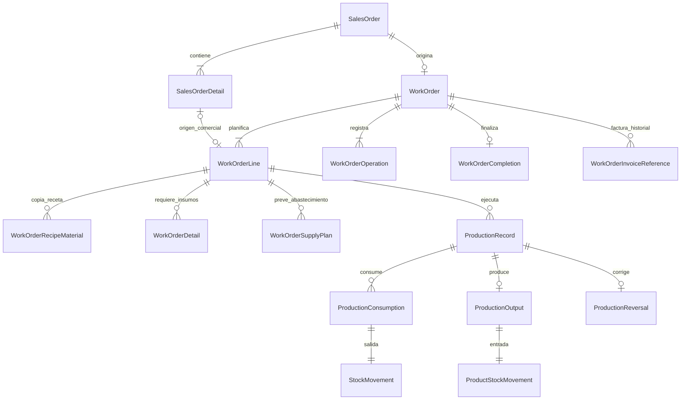

# Hito Orden de Trabajo y Producción

**Estado: M1/MR, planificación e inicio implementados; inicio validado por el usuario. OT5/M2 de fabricación parcial, avances, consumos y reserva del resultado implementado y migrado, con validación técnica. Revisión funcional de Producción pendiente. OT6/M3 de reversión completa y anulación de obra propia implementado y validado técnicamente; revisión funcional pendiente. Finalización/factura (OT7/M4) y PDF final aún pendientes. Cierre técnico de M3: 15-10-2026.**

Este documento define estructura, reglas, cambios, secuencia, pruebas y criterios de cierre. La entrega inicial fue exclusivamente documental. Posteriormente el usuario autorizó proceder con los cambios del plan; esa autorización permite avanzar en decisiones técnicas e implementación. Las decisiones comerciales señaladas como pendientes deben resolverse expresamente antes de sus bloques dependientes.

## 1. Objetivo, alcance y lectura del plan

Continuar el flujo **Cotización → Orden de Compra Cliente → Orden de Trabajo → Producción → Guía de Despacho**, conservando el compromiso aceptado, las existencias reales y los antecedentes financieros. La producción también debe admitir obras propias sin cliente ni orden comercial.

El hito anterior está cerrado y validado funcionalmente. Crear una Orden de Compra Cliente ya registra el detalle aceptado y su cuenta por cobrar; **crear un trabajo no vuelve a aprobar la cotización, no crea otra deuda y no consume materiales**. Registrar una fabricación sí debe documentar y confirmar conjuntamente sus consumos y su entrada de terminado.

Convenciones de este documento:

- **Vigente:** decisión previamente aprobada o comportamiento comprobado en archivos actuales.
- **Diseño propuesto:** recomendación técnica para desarrollar, condicionada a las decisiones indicadas.
- **Decisión Dxx:** regla de negocio todavía no confirmada; debe resolverse antes del bloque dependiente.
- `[x]` acredita una revisión documental realizada o una dependencia ya implementada; no significa que Producción esté desarrollada.
- `[ ]` identifica trabajo por hacer o aprobación aún pendiente. No marcar por silencio, por existir una tabla o por aprobar este documento en términos generales.

### 1.1 Entregas comprendidas en el plan

1. Orden de Trabajo única por orden comercial, con varias líneas, planificación propia y folio.
2. Obras propias, con la misma trazabilidad industrial y sin documentos comerciales ficticios.
3. Receta histórica y requerimientos por línea/lote, separados del consumo efectivamente registrado.
4. Registros parciales de fabricación y de ejecución, sujetos a D02–D05.
5. Stock/Kardex atómicos de materias primas y productos terminados.
6. Corrección documentada de registros, sin edición ni borrado de movimientos confirmados.
7. Inicio, avance y finalización; referencia externa de factura y vencimiento conforme a las reglas aprobadas.
8. Consulta del compromiso comercial y de abonos existentes desde el trabajo.
9. Contrato de integración con el futuro módulo de Despacho.
10. Migración conservadora, interfaz, pruebas de concurrencia/regresión y operación documentada.

### 1.2 Fuera de la primera implementación propuesta

El registro completo de pagos/sobrepagos, emisión tributaria electrónica, guías operativas, traslados de terminado, costeo contable/FIFO/promedio, lotes físicos/series, subcontratación, máquinas/turnos/operarios, planificación de capacidad, compras automáticas y reutilización de retazos requieren alcance adicional. Las reservas se incorporan al alcance por respuesta expresa del usuario a D08; sus reglas de operación se definen en la sección 8.4. Los consumos anticipados siguen fuera del flujo de fabricación conjunta.

PDF propio de OT y planos adjuntos se someten a D18. El correo de cotizaciones sigue esperando SMTP y contraseña de aplicación. No incorporar credenciales ni datos reales de clientes en este documento ni en fixtures.

## 2. Fuentes y alcance de la validación realizada

Se revisó el repositorio de trabajo con los cambios existentes del hito anterior. Se contrastaron modelos con servicios y restricciones SQL; **no se consultó la base de datos ni se ejecutaron validaciones de Prisma, migraciones, seed, build o pruebas de aplicación en esta entrega documental**. La ausencia de datos legados debe verificarse nuevamente antes de migrar; no se supone a partir de auditorías anteriores.

| Fuente | Uso en esta planificación |
| --- | --- |
| [schema.prisma](../prisma/schema.prisma) | Modelos, nulabilidad, relaciones, enums, precisión e índices reales |
| [AGENTS.md](../AGENTS.md) | Reglas del proyecto, protección de inventario, fechas, validación y operación |
| [HITO-ORDEN-COMPRA-CLIENTE.md](HITO-ORDEN-COMPRA-CLIENTE.md) | Compromiso aceptado, cuenta única, cardinalidad, anulación y contrato de trabajo |
| [HITO-COTIZACIONES.md](HITO-COTIZACIONES.md) | Consumo al fabricar, venta de terminado, obra a medida, factura/plazo y anticipos |
| [HITO-PRODUCTOS.md](HITO-PRODUCTOS.md) | Receta por unidad, clasificación, inventario inicial y ajustes de terminado |
| [HITO-INVENTARIO.md](HITO-INVENTARIO.md), [HITO-COMPRAS.md](HITO-COMPRAS.md) | Consumos posteriores, correcciones, orden de bloqueos y conservación del Kardex |
| [PROPUESTAS-DOMINIO.md](PROPUESTAS-DOMINIO.md) | Origen de cobranza y separación entre deuda y despacho; contrastar con decisiones posteriores |
| [GUIA-INTERFAZ.md](GUIA-INTERFAZ.md), [AVANCES-INTERFAZ.md](AVANCES-INTERFAZ.md) | Componentes, navegación y estado implementado de interfaz |
| [ordenes-compra-cliente.ts](../src/lib/servicios/ordenes-compra-cliente.ts) | `leerCompromisoParaTrabajo`, bloqueos y validación de orden única |
| [productos.ts](../src/lib/servicios/productos.ts), [stock-terminado.ts](../src/lib/servicios/stock-terminado.ts) | Edición de receta, versiones, bloqueo material → producto y operaciones de terminado |
| [compras.ts](../src/lib/servicios/compras.ts), [traslados-inventario.ts](../src/lib/servicios/traslados-inventario.ts) | Compatibilidad de consumo y reversión con inventario existente |
| [materiales.ts](../src/lib/servicios/materiales.ts), [bodegas.ts](../src/lib/servicios/bodegas.ts) | Referencias que bloquean unidad, baja y reclasificación |
| [numeracion.ts](../src/lib/servicios/numeracion.ts), [prisma.ts](../src/lib/prisma.ts), [prisma.config.ts](../prisma.config.ts) | Asignador transaccional, cliente compartido y configuración del entorno |

También se consultó la referencia local `prisma-client-api` de `.agents/skills/` para transacciones. Los contratos de este plan deben respetar las restricciones adicionales del adaptador y del repositorio: consultas secuenciales sobre el mismo cliente transaccional, sin instanciar otro PrismaClient.

### 2.1 Evidencia SQL que debe conservarse o ampliarse

| Migración existente | Restricción relevante |
| --- | --- |
| `20261013021125_cardinalidad_orden_compra_cliente` | Una orden por cotización y una OT por orden, múltiples obras propias con NULL |
| `20261013022726_registro_orden_compra_cliente` | `WorkOrder_customer_order`, orden confirmada y cuenta/operación completas |
| `20261013030000_integridad_orden_compra_cliente` | `WorkOrder_customer_order_keep`: no borrar/desvincular una OT de una orden nueva; protección de abonos |
| `20261013040000_vinculos_cobranza_orden_cliente` | Identidad/origen de cuenta y abonos inmutables |
| `20261011143500_catalogo_productos_recetas_imagenes` | Receta y protección de unidades; `ProductRecipe_lock` bloquea material → producto |
| `20261011164000_clasificacion_bodegas` | Bodegas compatibles; `WorkOrderDetail_classification` ya protege insumos |
| `20261011180000_stock_inicial_producto_terminado` | Kardex inmutable, saldo coherente, clasificación y versión de stock terminado |
| `20261011220000_ajustes_producto_terminado` | `ProductStockMovement_origin` admite únicamente inicial o ajuste; operación propia y corrección tipada |
| `20261008003000_ajustes_inventario`, `20261008010000_traslados_inventario` | Orígenes tipados/exclusiones de movimientos de materias primas |

No editar estas migraciones aplicadas. Una migración posterior debe ampliar los contratos preservando todos los orígenes anteriores. La documentación comercial conserva secciones históricas con pendientes ya resueltos: para cardinalidad y aceptación prevalece el cierre vigente de OCC.

### 2.2 Dependencias ya terminadas y reutilizables

Estos checks reflejan código y checkpoints previos, no pruebas repetidas durante esta planificación:

- [x] Orden de Compra Cliente: aceptación total/parcial, detalle/importes propios, folio, consulta y anulación; cierre funcional registrado.
- [x] Unicidad de orden por cotización y de OT por orden comercial; obra propia nullable conservada.
- [x] Cuenta única creada al aceptar, por el total contratado y sin vencimiento inventado.
- [x] Catálogo de productos, receta por unidad e imágenes; P5 de stock inicial y P6 de ajustes de terminado con aprobación funcional registrada.
- [x] Saldos/Kardex de materias primas, recepciones, ajustes y traslados implementados; esta lista no cierra revisiones funcionales pendientes de esos otros hitos.
- [x] Clasificación de bodegas, condiciones de pago y asignador documental disponibles.
- [x] Contrato `leerCompromisoParaTrabajo` preparado; crear/ejecutar OT sigue sin implementar.

## 3. Diagnóstico de suficiencia al planificar (antes de M1)

**Conclusión:** la base comercial y los inventarios son reutilizables, pero el esquema actual es insuficiente para desarrollar producción segura solamente agregando un formulario sobre `WorkOrder` y `WorkOrderDetail`.

| Elemento actual | Qué ya permite | Brecha concreta y cambio necesario |
| --- | --- | --- |
| `WorkOrder` | ID, nombre singular, descripción, estado, orden comercial opcional/única, fechas de registro | Falta folio, fecha documental, versión, UUID, alcance histórico, varias líneas, fechas de ejecución y operaciones |
| `WorkOrderStatus` | `PENDIENTE`, `EN_PROCESO`, `FINALIZADO` | Falta política de cancelación/reapertura y precondiciones; no añadir estados sin D10–D12 |
| `WorkOrderDetail` | Material, bodega y `quantityNeeded` con tres decimales | No identifica línea comercial, receta histórica, consumo real ni lote. No interpretar lo planificado como ya consumido |
| `SalesOrderDetail` | Tipo, cantidades/precios/unidad aceptados, referencias de origen e inmutabilidad | Debe ser origen de cada línea comercial de OT; falta relación a esas líneas |
| `leerCompromisoParaTrabajo` | Bloquea Quote → SalesOrder, exige confirmación/versión y ausencia de OT | Sólo sirve para **crear** la OT. Tras crear existe trabajo y el helper lo rechaza; ejecución necesita otro cargador. No devuelve folio/unidad textual/receta ni todos los snapshots |
| `ProductRecipe` | Composición actual por una unidad, única por producto/material | Se reemplaza al editar el catálogo; copiar contenido y versión, no depender de sus IDs como historia |
| `WarehouseStock` / `StockMovement` | Saldo y Kardex de materias primas; vínculo opcional a `WorkOrderDetail` | No hay documento inmutable de consumo, ni correspondencia compuesta garantizada entre consumo/material/bodega |
| `ProductWarehouseStock` | Saldo versionado por producto/bodega | Reutilizable; no crear otro saldo para Producción ni actualizarlo fuera de su Kardex |
| `ProductStockMovement` | Carga inicial y ajuste, fechas calendario, inmutabilidad | El CHECK vigente rechaza entradas de fabricación y salidas de despacho. Agregar orígenes específicos, no disfrazarlos de inventario inicial |
| `ProductInventoryOperation` | UUID/huella de inicial o ajuste | Su CHECK exige exactamente uno de esos orígenes. Producción necesita operación propia; no reutilizar esa tabla por conveniencia |
| `DocumentFolio` | Asignador y tipo `ORDEN_TRABAJO` existentes | Falta FK única desde OT y relación inversa; integrar asignación en primer guardado |
| `AccountReceivable` | Cuenta única por orden, importe, vencimiento opcional y abonos | Reutilizar cuenta, sin recalcular importe desde OT. Falta hecho fuente de factura/finalización y su protección |
| `DeliveryNote` | Cabecera vinculada a OT y datos heredados de pago | Sin líneas/cantidades/folios/salidas; todavía no acredita entregas ni permite calcular pendiente de despacho |
| `/trabajos/ordenes` | Ruta/menu existentes | Página `ModulePlaceholder`; no hay módulo operativo ni ruta `/trabajos/produccion` implementada |

### 3.1 Riesgos de una implementación incompleta

1. Consumir `quantityNeeded` al guardar el plan descontaría material antes de fabricar y podría repetirlo al editar.
2. Fabricar desde `QuoteDetail` reintroduciría cantidades excluidas al aceptar la oferta.
3. Usar receta actual para corregir una fabricación antigua cambiaría los materiales que realmente se consumieron.
4. Registrar un `AJUSTE` genérico como fabricación perdería la vinculación entre entrada, consumos y trabajo.
5. Revertir entrada sin comprobar movimientos posteriores podría devolver materias primas de un producto ya entregado.
6. Sumar productos/servicios con unidades distintas produciría porcentajes o faltantes sin significado físico.
7. Crear otra cuenta al iniciar/finalizar OT duplicaría deuda; cobrar cada guía también.
8. Tomar producto antes de material invertiría el orden de bloqueo vigente de recetas y cotizaciones.
9. Anular/borrar OT para crear otra violaría la unicidad permanente y la protección comercial existente.
10. Suponer que lo fabricado queda reservado al cliente prometería existencias que otro proceso puede consumir.

## 4. Reglas vigentes que el módulo debe conservar

- Una cotización tiene como máximo una Orden de Compra Cliente; una orden tiene como máximo una OT. Anulación/corrección no liberan las identidades anteriores.
- `salesOrderId = null` significa obra propia. No generar cliente, cotización, orden ni cuenta ficticios.
- La OT comercial hereda **todas y sólo** las líneas aceptadas y sus cantidades. La distribución operativa no modifica precios, descuentos, IVA, importe aceptado ni alcance comercial.
- `QuoteLineType` diferencia `MATERIA_PRIMA`, `PRODUCTO` y `SERVICIO`. Un ID de material nulo no identifica por sí solo un servicio.
- La receta de catálogo describe materiales por una unidad del producto; producir consume materiales y genera terminado. Entregar terminado no vuelve a consumir su receta.
- Venta directa de materia prima requiere su futura salida comercial; no simular una fabricación intermedia.
- Trabajos a medida pueden requerir consumo real; su representación operativa debe decidirse sin inventar un producto de catálogo.
- Cantidades almacenadas `Decimal(14,3)`, dinero `Decimal(14,2)`. Aritmética con Decimal; no convertir a `number` para cálculos del dominio.
- No convertir unidades. Todos los consumos de un material usan su unidad histórica compatible con el catálogo protegido.
- Todo cambio de saldo y su movimiento se confirman en la misma transacción. Preservar mínimos, historial, versiones y filas con saldo cero.
- `ENTRADA` positiva, `SALIDA` negativa y `AJUSTE` con signo. Fecha manual no define el orden histórico; los IDs de movimientos se asignan después de bloquear recursos.
- El plazo comercial está copiado en la orden. El vencimiento nace de **trabajo finalizado + folio y fecha de factura registrados**; se calcula desde la fecha de factura, con días calendario.
- Anticipos/abonos pertenecen a la cuenta de la orden. No modifican por sí solos el vencimiento, el plan ni el estado industrial.
- Folio al primer guardado confirmado, con UUID estable y contador dentro de la transacción. No reservar desde consultas o formularios.
- Históricos, snapshots y documentos físicos ya emitidos se conservan. No completar datos ausentes con información actual sin procedimiento expreso.

## 5. Decisiones comerciales previas a implementación

Las siguientes recomendaciones permiten discutir una solución concreta; la planificación por sí sola no las aprueba. Las respuestas posteriores y su estado se registran en la sección 5.2. Al iniciar cada bloque se deben resolver sus preguntas pendientes y registrar la respuesta exacta, fecha y alcance.

| ID | Pregunta a resolver | Recomendación para primera entrega | Impacto / etapa bloqueada |
| --- | --- | --- | --- |
| D01 | ¿Una OT puede abastecer un producto combinando stock existente y nueva fabricación? | Sí; cantidades planificadas separadas cuya suma iguala lo contratado, sin reservar implícitamente | Líneas y plan: OT2–OT4 |
| D02 | ¿Se registrará fabricación por lotes parciales o una sola fabricación total? | Lotes parciales; un registro corresponde a una línea y un producto/destino. Varias líneas requieren registros diferenciados | Registros/avance: OT2, OT5 |
| D03 | ¿El consumo real debe igualar receta o puede variar/agregar/sustituir materiales? | Proponer receta histórica y permitir diferencia documentada con motivo; nunca sustituir silenciosamente ni convertir unidades | Consumos y validaciones: OT2, OT5 |
| D04 | ¿Se entregan materiales a taller antes de completar el producto, quedando trabajo en proceso? | Primera versión: consumo y resultado juntos al registrar fabricación. Si el proceso exige entrega anticipada, agregar documentos de entrega/devolución y existencias en proceso antes de habilitar producción | Arquitectura de stock: OT2, OT5. Es decisión estructural |
| D05 | ¿Cómo representar fabricación a medida y servicios con materiales? | Mantener tipo comercial SERVICIO y añadir modo operativo A_MEDIDA con consumos y cantidad ejecutada, sin crear terminado ficticio; SERVICIO puro no consume | Tipos y ejecución: OT2, OT5 |
| D06 | ¿Cuándo se congela la receta y puede actualizarse antes/después de empezar? | Capturar al planificar; cambio explícito versionado sólo mientras la línea no tenga ejecución. El catálogo nunca actualiza planes automáticamente | Receta y versiones: OT2–OT4 |
| D07 | ¿Se permiten sobrantes de fabricación respecto a lo contratado? | No en la OT comercial; fabricar excedentes como obra propia. Cantidades fabricadas netas no superan su plan | Acumulados y controles: OT5 |
| D08 | ¿Se requieren reservas que impidan usar stock comprometido con otra OT? | **Aprobado: implementar reservas de stock.** Definir R01–R03 antes de sus bloques dependientes; ver sección 8.4 | OT2–OT5, escritores de inventario y Despacho |
| D09 | ¿Cómo corregir una fabricación equivocada o un producto dañado? | Error de registro: reversión completa vinculada y nuevo registro, sólo con dependencias compatibles. Daño físico: ajuste existente; no devolver materias primas que no se recuperaron | OT6 |
| D10 | ¿Qué anulaciones de OT se permiten y qué ocurre con la orden del cliente? | Anular sólo obras propias sin ejecución. OT comercial: corregir plan pendiente, conservar vínculo; no ofrecer anulación comercial hasta definir cancelación contractual. Reversión de producción no anula OT ni deuda | Estados: OT2, OT6 |
| D11 | ¿Qué exige finalizar una OT mixta y cuándo finalizan las ventas directas? | Completar fabricación/servicios previstos y revisión de preparación de líneas desde stock/directas; finalizar no equivale a despachar. La preparación se contrasta con reservas vigentes y existencias físicas; reservar no equivale a entregar | OT7 y contrato de Despacho |
| D12 | ¿Puede reabrirse una OT finalizada o cerrarse con cantidades faltantes? | Primera versión sin reapertura ni cierre incompleto; correcciones antes del cierre. Si se necesitan, definir efectos comerciales, facturas, pagos y guías antes | Estados, OT6–OT7 |
| D13 | ¿El requerimiento con más de tres decimales se redondea al más cercano, hacia arriba o debe ajustarse manualmente? | Mantener cálculo intermedio exacto; proponer consumo a tres decimales con HALF_UP y mostrar diferencia. Una necesidad positiva redondeada a cero exige intervención; no consumir cero silenciosamente | Cálculo, OT4–OT5 |
| D14 | ¿Finalización y factura se registran juntas o puede finalizarse y facturar después? | Permitir finalizar sin factura, con vencimiento nulo; registrar después folio+fecha en una sola operación. Sólo una factura vigente por OT en primera entrega | OT2 y OT7 |
| D15 | ¿Qué identifica una factura externa como única, y se permite fecha anterior a finalización? | **Aprobado:** único por RUT emisor, sin reinicio anual; conservar folio literal. Fecha válida no futura; sin relación temporal adicional con cierre/aceptación aprobada | Factura/migración OT7 |
| D16 | ¿Cómo se corrige una factura registrada y su vencimiento, especialmente con abonos o guías? | **Aprobado:** nueva revisión histórica con motivo, incluso con abonos; recalcular sólo vencimiento sin alterar importe ni pagos | OT7 |
| D17 | ¿La obra propia cubre stock de catálogo, fabricación interna a medida y servicios internos? ¿Exige responsable/plazo? | Catálogo y obra a medida; título, finalidad y fecha obligatorios, fecha objetivo opcional. Responsable autenticado queda para autenticación; no inventarlo | Creación propia OT2–OT3 |
| D18 | ¿La primera entrega necesita PDF de OT, planos/archivos nuevos o firma de recepción? | Primera versión: alcance heredado de sólo lectura e instrucciones internas de texto. PDF/archivos nuevos en entrega separada con almacenamiento/versionado | OT8; no bloquea cálculo/stock |
| D19 | ¿Se admite planificar/consumir desde bodegas heredadas sin clasificación explícita? | Para nuevas OT exigir clasificación compatible explícita; mantener comportamiento heredado de módulos existentes | Selectores/servidor/SQL OT4–OT5 |
| D20 | ¿Las fechas de ejecución pueden retroceder respecto de otros registros de la misma OT? | Fecha no futura ni anterior al inicio/OT; admitir registro tardío de hechos reales con aviso, conservando orden de registro por ID. Corrección no anterior al hecho corregido | Fechas OT3–OT7 |

### 5.1 Dependencias y consecuencias de respuestas alternativas

- D04 con consumo anticipado exige **otro diseño**: entrega de insumos a proceso, devolución no consumida, consumo real por lote, merma y saldo en proceso. No basta separar dos transacciones del diseño atómico; se deben extender modelos, invariantes y pruebas antes de implementar.
- D08 con reservas exige cantidad física/reservada/disponible por recurso, titular y vencimiento/liberación, más integración en Compras, ajustes, traslados, terminado y despachos. Un campo booleano en OT no reserva stock.
- D02 con varias salidas/coproducción por registro cambia la cardinalidad de `ProductionOutput`, reparto de consumos y reversión; este plan propone un resultado por registro.
- D03 con tolerancias porcentuales requiere acordar límites por unidad/material, aprobación y tratamiento de merma. No fijar tolerancia cero o porcentaje arbitrario.
- D10/D12 con cancelación contractual o cierre parcial requiere decidir qué ocurre con el importe de una orden inmutable y su cuenta. No reducir deuda por reducir producción ni reutilizar identidad de OT anulada.
- D14 con varias facturas requiere distribuir importe/plazo por factura y revisar el modelo de cuenta única; no guardar varios vencimientos incompatibles en un solo `dueDate`.

### 5.2 Respuestas del usuario — primer bloque

Respuesta recibida: «1, 2, 3, 5, 6, 7, 8: SI». Para D04 el usuario recuerda la regla de consumir materias primas al ingresar el producto fabricado a stock y evitar descontarlas dos veces. Se contrastó con el flujo comercial previamente aprobado y con el servicio actual de inventario inicial.

| Decisión | Estado | Regla registrada |
| --- | --- | --- |
| D01 | Aprobada | Combinar existencias y fabricación en una misma línea, con cantidades separadas |
| D02 | Aprobada | Registrar fabricaciones parciales, por línea y destino |
| D03 | Aprobada | Permitir diferencias/materiales adicionales/sustituciones con motivo obligatorio y unidad propia de cada material |
| D04 | Regla vigente ratificada en su finalidad | Consumo real de MP y entrada del producto al registrar fabricación, en la misma transacción; entrega posterior descuenta sólo terminado. No se ha solicitado un subsistema de entrega anticipada de insumos a proceso |
| D05 | Aprobada | A_MEDIDA con consumos/avance sin producto de catálogo ficticio; servicio puro sin movimientos |
| D06 | Aprobada | Capturar receta al planificar y actualizar expresamente sólo antes de ejecución; nunca refrescar automáticamente desde catálogo |
| D07 | Aprobada | Limitar fabricación comercial al plan y registrar excedentes como obra propia |
| D08 | Aprobada expresamente | El usuario precisa «Implementar reservas de stock, aunque imagino que esto a futuro se puede modificar». R01–R03 aprobadas después: ambos inventarios y resultado fabricado, reserva parcial al confirmar plan y sin vencimiento automático; sección 8.4 |

**Aclaración de D04:** la regla aprobada de fabricación en HITO-COTIZACIONES consume componentes al registrar el resultado fabricado. La carga inicial de terminado implementada en P5 registra existencias que ya estaban físicamente disponibles y no consume retrospectivamente materias primas; los ajustes de P6 tampoco consumen receta. Crear/editar producto o receta no altera stock. Estos procesos deben seguir diferenciados para evitar consumos duplicados o ficticios. La fabricación conjunta todavía está pendiente de implementar en este hito.

En este primer bloque D09–D20 seguían pendientes por etapa; la respuesta inicial no las aprobó. Las confirmaciones posteriores se registran abajo. No se ejecutaron migraciones ni escrituras de inventario al registrar estas decisiones.

### 5.3 Respuestas posteriores — D10, D17 y D13

El usuario confirma expresamente «D10: Si», «D17: Si» y «D13: Redonder al valor más cercano, con empates hacia arriba y revisión si necesidad positiva queda en cero».

| Decisión | Estado | Regla aprobada |
| --- | --- | --- |
| D10 | Aprobada | Anular sólo obras propias sin ejecución, liberando sus reservas con motivo e historial; OT comerciales mantienen vínculo y permiten corrección de plan sin ofrecer todavía cancelación contractual |
| D17 | Aprobada | Obra propia admite productos de catálogo y trabajo interno a medida; título, finalidad y fecha obligatorios, objetivo opcional y sin responsable autenticado obligatorio en esta entrega |
| D13 | Aprobada | Requerimiento al más cercano con HALF_UP a tres decimales, diferencia visible y revisión obligatoria si una necesidad positiva redondea a cero |

En ese checkpoint se consultaron tres grupos: D09/D12, D11/D14/D18 y D19/D20. Las respuestas posteriores están en 5.4 y 5.5; D11/D18 se resuelven en el checkpoint del 14-10-2026. El cierre de estos acuerdos no sustituye pruebas de migración ni validación funcional.

### 5.4 Respuestas posteriores — corrección, fechas y factura externa

El usuario aprueba el grupo D09/D12 («Me parece bien tu propuesta»): reversión completa vinculada y registro nuevo sólo antes del cierre y sin salidas/dependencias posteriores; daño físico mediante ajustes; primera entrega sin reapertura ni cierre incompleto. Confirma D19/D20 («Si»): clasificación compatible explícita y hechos no futuros/no anteriores al inicio/OT, admitiendo registro tardío con aviso y conservando orden histórico por ID.

Sobre el grupo de finalización explica que al finalizar se emite la Factura de Venta fuera del ERP y se guardan Folio/Fecha en OT, iniciando el plazo de pago. Se ratifica ese flujo: la aplicación referencia la factura externa, no la emite, y el vencimiento usa su fecha y el plazo histórico. Las respuestas específicas posteriores resuelven D14/D15/D16 en la sección 5.5. D11/D18 se precisan en la respuesta del 14-10-2026 registrada abajo.

### 5.5 Respuestas específicas de factura externa — 13-10-2026

- **D14 aprobada:** «Permitir finalizar y registrar factura después». Finalizar no exige folio/fecha; la cuenta conserva vencimiento nulo hasta registrar ambos. El plazo usa la fecha de factura y la condición histórica de la orden, nunca el cierre o la fecha de registro.
- **D15 aprobada:** «Único por RUT de empresa emisora, sin reinicio anual». Identidad por RUT emisor canónico y folio externo literal, sin año ni serie. Guardar el RUT histórico; no refrescarlo al editar Empresa. No se aprueban relaciones temporales adicionales con la fecha de finalización.
- **D16 aprobada:** «Sí, permitir corrección histórica con esas condiciones». Nueva revisión inmutable con motivo y vínculo a la vigente, incluso con abonos. Recalcular sólo vencimiento; conservar importe, pagos y promesa de pago.

D11 y D18 respondidas el 14-10-2026: «D11: Si» y «D18: Dejaremos este PDF para el final». D11 exige fabricación/servicios completos y preparación de las líneas para entregar respaldada por reservas completas. Finalizar no despacha ni descuenta stock. PDF propio de OT se realizará al final del desarrollo del módulo, después del flujo operativo; no se considera eliminado del alcance por esta respuesta. No habilitar nuevos uploads/firma sin su contrato de almacenamiento. El primer bloque de interfaz usa alcance heredado e instrucciones internas.

## 6. Casos de uso y comportamiento esperado

| Caso | Origen y operación | Efecto de inventario | Condición de cierre |
| --- | --- | --- | --- |
| Producto fabricado a pedido | Línea PRODUCTO aceptada, receta histórica, uno o varios lotes | SALIDA de insumos + ENTRADA de producto juntos | Fabricación neta prevista completada |
| Producto desde stock | Línea PRODUCTO con parte o toda cantidad desde existencias | Ninguno al crear/planificar OT; futura SALIDA de terminado al despachar | Preparación revisada según D11, sin fingir fabricación |
| Producto mixto | Parte de stock y parte fabricada | Sólo la parte fabricada consume receta | Suma de abastecimiento = contratado; despacho controla total |
| Materia prima directa | Línea MATERIA_PRIMA aceptada | Ningún consumo industrial; futura SALIDA comercial del material | Preparación, según D11 |
| Servicio puro | Línea SERVICIO, sin inventario | Registro de avance/ejecución; cero movimientos | Cantidad ejecutada neta alcanza contratada |
| Trabajo a medida | Línea comercial SERVICIO con modo operativo aprobado | Consumos reales; resultado ejecutado en la línea, sin producto ficticio | Ejecución contratada terminada |
| Obra propia a stock | Sin SalesOrder, producto real y receta | Consumos + terminado juntos | Plan propio completado; sin deuda ni factura comercial |
| Obra propia interna | Sin SalesOrder, alcance y materiales del trabajo | Consumos documentados sin entrada ficticia | Ejecución propia completada |

Una línea vendida como MATERIA_PRIMA no debe interpretarse automáticamente como insumo de otra línea. Los insumos internos son componentes del plan productivo; lo vendido directamente sigue siendo una obligación de entrega distinta.

### 6.1 Ejemplo integrado para validar con el usuario

Orden aceptada: 5 unidades de Portón XY, 12 metros de perfil para venta directa y 1 servicio de instalación. La cotización ofrecía más cantidades y otras líneas que quedaron excluidas.

Plan propuesto: 2 XY desde stock y 3 a fabricar. Receta por XY: 2,500 kg de material A y 0,750 m de material B. Necesidad teórica para fabricar: 7,500 kg A y 2,250 m B; los 12 metros de venta directa no se agregan a esa receta.

Primer registro: fabrica 2 XY, consume 5,000 kg A y 1,500 m B, ingresa 2 XY. Segundo registro: fabrica 1 XY y registra sus consumos. Si se acepta D03, cualquier diferencia real exige motivo. Instalación se registra como ejecución de servicio. Las entradas fabricadas no salen de stock hasta el despacho que corresponda; éste rebaja 5 XY y 12 metros directos, sin consumir nuevamente A/B. La cuenta conserva exactamente el importe de la orden aceptada.

## 7. Modelo de datos propuesto

**Estado actual por bloques:** WorkOrder ampliado, WorkOrderLine, WorkOrderRecipeMaterial, WorkOrderSupplyPlan, WorkOrderOperation, ampliación de WorkOrderDetail y vínculo a folio implementados en M1. Reservas Allocation/Event implementadas en MR y planificación/inicio públicos implementados después. ProductionRecord/Consumption/Output implementados en M2. ProductionReversal y Completion/InvoiceReference siguen siendo diseño futuro. Las tablas siguientes describen el contrato previsto completo; consultar los cierres técnicos M1/MR/OT5 para las restricciones realmente habilitadas. Cerrar las decisiones aplicables antes de desarrollar cada bloque.

La obligatoriedad «uno o varios» corresponde al documento nuevo completo al confirmar, no a legado incompleto. El diagrama omite relaciones de stock, reversión, unidades y claves compuestas por legibilidad; se especifican abajo. Obra propia no tiene `SalesOrderDetail`.

### 7.1 Cabecera `WorkOrder` — ampliar, no sustituir

| Campo / relación | Tipo propuesto | Regla |
| --- | --- | --- |
| `id`, `salesOrderId`, `productName`, `description`, timestamps | Conservar | `salesOrderId @unique` nullable; nombre existente sirve como título del trabajo, no como producto único |
| `folioId` | Int nullable legado, único | FK Restrict a DocumentFolio; obligatorio en nuevas OT y tipo ORDEN_TRABAJO |
| `creationKey` | UUID nullable legado, único | Clave estable del primer guardado, vinculada a operación CREAR |
| `version` | Int, inicial 1 | Incrementar por operación efectiva, nunca por consulta/reintento |
| `date` | DateTime `@db.Date`, nullable legado | Fecha documental nueva; no deducirla automáticamente de createdAt |
| `schemaVersion` | Int nullable legado | Versión de contrato del documento; nueva OT completa frente a registro anterior incompleto |
| `salesOrderVersion` | Int nullable | Obligatorio para OT comercial nueva; versión aceptada al crear |
| `sourceSnapshot` | Json nullable legado | Copia versionada de origen, alcance, cliente/sucursal y condiciones de la orden, sin refrescar mantenedores |
| `technicalDescription` | Json nullable | Alcance comercial copiado para consulta; validar formato/recursos existentes, sin aceptar URLs libres |
| `internalInstructions` | String opcional, límite definido | Instrucciones operativas, separadas del alcance contractual; cambios versionados |
| `targetDate` | DateTime `@db.Date` opcional | Fecha objetivo planificada; puede ser futura, a diferencia de hechos registrados |
| `startedDate` | DateTime `@db.Date` opcional | Hecho de inicio conforme D20 |
| `status` | WorkOrderStatus existente | Transiciones protegidas; ANULADO sólo si se aprueba D10, sin renombrar estados legados |
| `voidedAt`, `voidReason` | DateTime/String opcionales | Sólo si hay anulación aprobada; ambos o ninguno |
| `currentInvoiceReferenceId` | Int opcional, único | Puntero a revisión vigente de factura, con FK compuesta que exija la misma OT |
| `lines`, `operations`, `completion`, `invoiceReferences` | Relaciones nuevas | Documentos históricos con Restrict; no cascada destructiva |

No duplicar `AccountReceivable` en WorkOrder: resolverla por `salesOrderId`. No crear saldo de pagos ni total facturado mutable en la cabecera de trabajo. El importe comercial se consulta desde la orden o snapshot protegido y nunca se calcula desde insumos.

El estado comercial confirmado de SalesOrder no cambia a «en producción»; los estados de trabajo son otra dimensión.

### 7.2 `WorkOrderLine` — obligación y planificación operativa

Cada nueva OT comercial tendrá exactamente una línea por `SalesOrderDetail`; todas quedan representadas. Una línea puede ejecutarse mediante múltiples registros sin duplicar la obligación original.

| Campo | Tipo / obligación | Protección |
| --- | --- | --- |
| `id`, `workOrderId`, `position` | Int, obligatorios | Posición única por OT y FK Restrict |
| `salesOrderId`, `salesOrderDetailId` | Int opcionales conjuntamente | Nulos en obra propia, obligatorios en comercial; detalle comercial único en esta tabla |
| `kind` | QuoteLineType | Copia comercial inmutable; no sustituir por modo de ejecución |
| `executionMode` | Enum propuesto CATALOGO / VENTA_DIRECTA_MP / SERVICIO / A_MEDIDA | Matriz de compatibilidad y D05 |
| `description`, `code`, `unitName`, `unitAbbreviation` | Copias de texto | En comercial desde línea aceptada; en propia desde referencia validada al guardar |
| `unitMeasureId` | Int, FK Restrict | Unidad de cantidad de la línea; congelada tras guardar |
| `productId`, `rawMaterialId` | Int opcionales, FK Restrict | PRODUCTO sólo productId; MATERIA_PRIMA sólo rawMaterialId; SERVICIO ninguno |
| `quantity` | Decimal(14,3) positiva | Igual a aceptada en comercial. Propia editable sólo sin ejecución según plan |
| `quantityToProduce`, `quantityFromStock` | Decimal(14,3) opcionales | Sólo CATALOGO; ambos no negativos y suma = quantity |
| `productVersion` | Int opcional | Versión del producto al capturar receta, no prueba de identidad comercial |
| `recipeCapturedAt`, `recipeFingerprint` | Timestamp / String(64) opcionales | Identifican copia íntegra de receta; requeridos si hay fabricación de catálogo |
| `version`, `createdAt`, `updatedAt` | Entero/fechas | Versión de línea para plan y revisión; OT también incrementa versión |

Claves propuestas: `@@unique([workOrderId, position])`, `salesOrderDetailId @unique`, `@@unique([id, workOrderId])`, `@@unique([id, workOrderId, productId])` para resultados de producto, e índices de producto/material/unidad y FK comercial compuesta. Nullable en FK compuesta no garantiza todos los componentes: exigir presencia conjunta mediante CHECK.

Para garantizar pertenencia: añadir claves candidatas apropiadas a `WorkOrder(id, salesOrderId)` y `SalesOrderDetail(id, salesOrderId)`; enlazar línea a ambos mediante FK compuestas. Trigger valida tipo, cantidad y copias contra el detalle inmutable. No basta que los IDs existan por separado.

### 7.3 `WorkOrderRecipeMaterial` — composición histórica

Campos propuestos: `id`, `workOrderLineId`, `rawMaterialId`, `unitMeasureId`, `quantityPerUnit Decimal(14,3)`, `materialCode`, `materialName`, `unitName`, `unitAbbreviation`, `createdAt`, `updatedAt`.

- Única por línea/material; FK Restrict a línea/material/unidad e índices correspondientes.
- Copia completa de receta al planificar, con cantidades positivas y finitas. No usar FK obligatoria a `ProductRecipe.id`, porque el catálogo reemplaza filas al editar.
- Para producto a fabricar exigir receta no vacía; producto desde stock puede carecer de receta.
- Cambiar receta del catálogo no cambia esta copia. Actualizar receta pendiente requiere acción expresa, versión y snapshot anterior en operación; con ejecución se bloquea según D06.
- Para A_MEDIDA registrar requerimientos propios; no fingir que derivan de una receta de catálogo.

### 7.4 `WorkOrderDetail` — requerimiento previsto por bodega

Conservar el modelo y `quantityNeeded` como cantidad **planificada**, además de las referencias legadas. Añadir para documentos nuevos:

- `workOrderLineId`, `recipeMaterialId` opcional, `unitMeasureId` y copias de material/unidad.
- FK compuesta `(workOrderLineId, workOrderId)` a la línea; receta, si se indica, debe pertenecer a esa misma línea/material.
- `quantityNeeded > 0`, finita; reparto por material y bodega sin duplicados para una misma línea. Índice único parcial para `(workOrderLineId, rawMaterialId, warehouseId)` cuando la línea no sea nula.
- Planificación puede registrar faltantes; el saldo disponible no impide guardar un plan, pero sí confirmar un consumo insuficiente.
- Para catálogo, suma por material debe coincidir con requerimiento redondeado del plan, salvo variación de plan autorizada con motivo conforme D03/D13. Una distribución no puede duplicar la necesidad en cada bodega.
- No modificar filas usadas por registros confirmados. Cambios de plan antes de ejecución se conservan mediante operación y snapshot; nuevos consumos no dependen de filas editables para reconstruir historia.
- No reinterpretar filas legadas como consumidas ni repartirlas automáticamente entre nuevas líneas.

Si un plan aún no tiene bodegas asignadas, puede conservarse receta sin `WorkOrderDetail`; marcar planificación incompleta y bloquear ejecución hasta asignación/revisión. No crear bodega ficticia ni hacer nullable el `warehouseId` legado sólo para ocultar esa condición.

#### 7.4.1 `WorkOrderSupplyPlan` — abastecimiento directo por bodega

La cantidad `quantityFromStock` necesita una distribución propia; `WorkOrderDetail` describe insumos industriales y no debe reutilizarse para productos vendidos ni para materia prima de entrega directa.

Campos propuestos: `id`, `workOrderId`, `workOrderLineId`, `warehouseId`, `productId?`, `rawMaterialId?`, `quantity Decimal(14,3) > 0`, `createdAt`, `updatedAt`. FK compuesta línea/OT y validación de misma referencia/unidad que la línea; exactamente uno de producto/material. Única por línea/bodega; índices de bodega, producto/material y línea/OT.

- Línea CATALOGO: sólo producto; suma de estas filas = `quantityFromStock` al declarar plan completo. Línea VENTA_DIRECTA_MP: sólo material; suma = cantidad contratada. Otros modos no admiten filas aquí.
- Una cantidad desde stock igual a cero no requiere filas. Plan incompleto puede guardarse sin distribución, con aviso; iniciar/cerrar exige la completitud acordada.
- Estas filas describen el plan y no descuentan saldo. Sus reservas efectivas son documentos separados de la sección 8.4; el momento de crearlas depende de R02. La revisión de preparación al finalizar registra en `WorkOrderCompletion.progressSnapshot` las bodegas, cantidades, reservas y disponibilidad observadas, además de la confirmación exigida por D11.
- La bodega de resultado de fabricación se valida al registrar cada lote en `ProductionOutput`; puede proponerse desde el formulario, sin confundirla con stock ya disponible.
- La futura guía confirma sus propias bodegas y saldos; cambiar la bodega prevista para entregar exige validación explícita en Despacho, no editar el plan histórico de una OT finalizada.
- Incluir estas referencias en protección de baja/reclasificación de bodegas/productos/materiales, aun cuando todavía no exista stock. No crear filas de saldo al guardar esta distribución.

### 7.5 `ProductionRecord` — hecho confirmado de fabricación/ejecución

Propuesta: un registro inmutable por línea y hecho parcial. Campos: `id`, `workOrderId`, `workOrderLineId`, `type` (FABRICACION_PRODUCTO / EJECUCION_A_MEDIDA / SERVICIO), `date @db.Date`, `quantity Decimal(14,3) > 0`, `note`, `planVersion`, `recipeSnapshot Json`, `createdAt`, `updatedAt`.

- FK compuesta línea/OT, Restrict, índices por OT/fecha/id y línea.
- FABRICACION_PRODUCTO: exactamente una salida de producto (`ProductionOutput`) y los consumos reales del registro; se confirman juntos. El nombre «salida de producción» en el dominio de fabricación significa **entrada a bodega**, evitar ambigüedad en interfaz.
- A_MEDIDA: cantidad ejecutada con consumos definidos; sin `ProductStockMovement` ficticio.
- SERVICIO: cantidad ejecutada, sin consumos ni entrada a stock en esta propuesta.
- No permitir tipo incompatible con `executionMode` de línea.
- Copiar receta/plan realmente usado al registro; operación histórica conserva desvíos, motivos y datos anteriores. No recalcular este snapshot al consultar.
- No editar ni borrar el registro; su corrección se representa por `ProductionReversal`.
- Documento completo exige operación UUID, consistencia de hijos y movimientos mediante comprobación diferida.

### 7.6 `ProductionConsumption` — insumo real

Campos: `id`, `productionRecordId`, `workOrderId`, `workOrderLineId`, `plannedDetailId` opcional, `rawMaterialId`, `warehouseId`, `unitMeasureId`, `quantity Decimal(14,3) > 0`, `expectedQuantity Decimal(14,3)` no negativa, `deviationReason` opcional, copias de código/nombre/unidad, `createdAt`, `updatedAt`.

- Única por registro/material/bodega; cantidades siempre positivas aquí. Su `StockMovement` guarda el negativo.
- FK compuestas para registro/línea/OT y, cuando se indica `plannedDetailId`, misma línea/material/bodega. Un material adicional permitido por D03 puede no tener detalle planificado, pero requiere motivo y referencia válida.
- Sumar previamente por material/bodega antes de comprobar disponibilidad; no validar cada fila contra el mismo saldo inicial.
- `expectedQuantity` se calcula desde el plan histórico, no desde el navegador; para material adicional vale cero. La comparación global por material distingue cambio de bodega de cambio de cantidad.
- Desvío no crea una segunda merma automática. Material realmente desperdiciado ya forma parte del consumo real; si se requiere desglose de merma, D03 debe definir campos y evitar doble descuento.
- Un consumo tiene exactamente un movimiento original, con misma bodega/material y `quantity = -consumo.quantity`.

### 7.7 `ProductionOutput` — producto terminado obtenido

Campos: `id`, `productionRecordId @unique`, `workOrderId`, `workOrderLineId`, `productId`, `warehouseId`, `unitMeasureId`, `quantity Decimal(14,3) > 0`, copias de producto/código/unidad, `createdAt`, `updatedAt`.

FK compuestas garantizan registro y producto de la misma línea. Cantidad igual a `ProductionRecord.quantity` en fabricación de catálogo; bodega PRODUCTO_TERMINADO o MIXTA. Cada resultado tiene una sola entrada positiva de terminado. No crear resultado de producto para servicio o trabajo a medida sin catálogo.

### 7.8 Kardex: ampliar orígenes y conservar los anteriores

**Materias primas:** añadir a `StockMovement` un `productionConsumptionId` opcional único, con FK compuesta que incluya material/bodega, y un origen de reversión tipado. Mantener `workOrderDetailId` histórico; en movimientos nuevos de producción, preferir sólo el vínculo preciso al consumo para no registrar dos orígenes independientes. La consulta navega consumo → registro → línea → OT.

**Terminado:** añadir `productionOutputId` opcional único y origen de reversión tipado a `ProductStockMovement`. Ampliar `ProductStockMovement_origin` para admitir:

1. Inicial: condiciones actuales.
2. Ajuste: condiciones actuales.
3. Fabricación: exactamente un resultado, ENTRADA positiva y cantidades iguales.
4. Reversión de fabricación: exactamente un resultado revertido documentado, AJUSTE negativo e importe físico exacto.

No habilitar aún origen genérico «otro» ni salida de despacho sin su documento. Crear una futura migración de Despacho para ese origen. Para MP preservar combinaciones válidas existentes, como compra/detalle de recepción: la exclusión debe operar entre **familias de origen**, no con `num_nonnulls` sobre todos los campos legados indiscriminadamente.

Las fechas de MP son timestamp actualmente y las de terminado son `@db.Date`: para nuevos hechos productivos definir una conversión consistente de la fecha calendario a la convención de registro usada por inventario, manteniendo `createdAt` real. No cambiar fechas de movimientos anteriores ni usar el timestamp convertido para decidir posterioridad de consumo.

### 7.9 Correcciones: `ProductionReversal` y detalle de reversión

Propuesta condicionada a D09:

- `ProductionReversal`: `id`, `productionRecordId @unique`, `workOrderId`, `workOrderLineId`, `date @db.Date`, `reason` obligatorio, `createdAt`, `updatedAt`.
- `ProductionReversalConsumption`: una fila por consumo original, FK `productionConsumptionId @unique`, FK reversión, misma bodega/material/cantidad histórica y copias; movimiento AJUSTE positivo.
- `ProductionReversalOutput`: una fila por resultado original, FK `productionOutputId @unique`, FK reversión, misma bodega/producto/cantidad y copias; movimiento AJUSTE negativo.
- FK compuestas/triggers impiden corregir un consumo/resultado de otro registro, omitir hijos o devolver una cantidad distinta de la original.
- Nuevos campos de movimiento apuntan a estos detalles con claves compuestas y unicidad. Los detalles de reversión no se reutilizan como consumos originales.
- Una reversión directa por registro. No permitir cadenas de reversión de reversión en primera entrega; un registro nuevo correcto puede referenciar el original mediante `correctsProductionRecordId` opcional y no único, con validación de misma línea y original revertido.
- Un servicio revertido sólo revierte avance documental. Una reversión a medida devuelve materiales **sólo si realmente hubo un error de registro y se confirma la restitución física**; no confundir deshacer el registro con desarmar una estructura.
- La operación de reversión es única y atómica para todos los efectos. Un ajuste físico aislado no cuenta como reversión productiva.

### 7.10 `WorkOrderOperation` — idempotencia e historial

Campos: `idempotencyKey UUID` PK sin default, `fingerprint String(64)`, `workOrderId`, `type` enum en español, `version`, `beforeSnapshot Json?`, `afterSnapshot Json?`, `productionRecordId?`, `productionReversalId?`, `completionId?`, `invoiceReferenceId?`, `createdAt`, `updatedAt`.

Tipos propuestos: CREAR, EDITAR_PLAN, INICIAR, REGISTRAR_PRODUCCION, REVERTIR_PRODUCCION, FINALIZAR, REGISTRAR_FACTURA, CORREGIR_FACTURA y, si se aprueba, ANULAR. Los eventos de servicio/a medida pueden usar REGISTRAR_PRODUCCION con el tipo de registro explícito, o nombres diferenciados en interfaz.

Reglas: una operación por versión de OT; vínculos únicos al documento que origina cada evento; exclusión de orígenes según tipo; FK misma OT; inmutabilidad; UUID/huella reconocidos antes de comprobar versión actual. CREAR usa la misma clave estable de cabecera/folio dentro de su propio tipo documental. No reutilizar claves de aceptación de SalesOrder.

La huella se calcula sobre intención normalizada: IDs, versiones esperadas, cantidades canónicas, fecha, motivos, receta/revisión esperada y opciones. Totales/snapshots de servidor no se aceptan como autoridad del cliente. Si sólo una parte del DTO es relevante, definir exactamente qué campos se excluyen; no ignorar cantidades, bodegas o motivos en la huella.

Excepción explícita a la exclusión de orígenes: si D14 permite «Finalizar y registrar factura» como una acción, una sola operación FINALIZAR puede vincular simultáneamente `completionId` y `invoiceReferenceId`, ambos de la misma OT, y aumenta una sola vez su versión. FINALIZAR sin factura sólo tiene completion; REGISTRAR_FACTURA/CORREGIR_FACTURA sólo la revisión de factura. No imponer `num_nonnulls = 1` indiscriminadamente ni intentar insertar dos operaciones con la misma versión. Si se separan las acciones, cada una lleva UUID y versión propios.

### 7.11 Finalización y referencia de factura

**`WorkOrderCompletion`**: `id`, `workOrderId @unique`, `date @db.Date`, `note`, `progressSnapshot Json`, `createdAt`, `updatedAt`. Hecho inmutable bajo propuesta sin reapertura. `status = FINALIZADO` exige el documento y su operación. No duplicar fecha final en cabecera sin una regla SQL de igualdad.

**`WorkOrderInvoiceReference`**: `id`, `workOrderId`, `revision`, `invoiceNumber` literal, `invoiceDate @db.Date`, `paymentTermDays`, `dueDate @db.Date`, `replacesInvoiceReferenceId? @unique`, `correctionReason?`, `createdAt`, `updatedAt`. Sólo OT comercial finalizada, una referencia vigente mediante puntero en WorkOrder, historial inmutable y único `(workOrderId, revision)`.

La referencia reemplazada pertenece a la misma OT y debe ser la vigente al corregir. No permitir ramas, ciclos ni una corrección de una revisión arbitraria. El puntero, el evento y `AccountReceivable.dueDate` se actualizan juntos. D15 aprobada: guardar `issuerRut` histórico y canónico junto al folio literal; la identidad es `(issuerRut, invoiceNumber)`, sin año ni serie. No hacer único el folio globalmente ni `(workOrderId, invoiceNumber)`: ambas alternativas incumplen el ámbito del emisor. Usar una entidad de identidad permanente vinculada a la OT y referenciada por sus revisiones; una corrección de fecha puede reutilizar la misma identidad dentro de esa OT, pero otra OT no puede apropiársela. El historial conserva también las identidades reemplazadas; evitar que corregir un folio libere silenciosamente un documento anterior. Índices/FK Restrict y bloqueo de identidad coordinados con OT/cuenta. No refrescar RUT histórico desde Empresa en una corrección de fecha; corregir emisor requeriría otro acuerdo explícito.

No guardar monto de factura como nueva deuda. En primera propuesta se referencia una factura por el compromiso completo; si se requiere importe diferente, facturación parcial o notas de crédito, detener ese bloque y rediseñar según D14–D16.

### 7.12 Índices, nulabilidad y restricciones transversales

- Toda nueva FK debe tener índice con las columnas necesarias al inicio; documentar cuáles quedan cubiertas por índices únicos. Un índice `(workOrderId, date, id)` no reemplaza un índice por producto.
- Listados: OT `(status, date, id)`, fecha/id, vínculo comercial único; registros `(workOrderId, date, id)` y `(workOrderLineId, id)`; consumos `(rawMaterialId, warehouseId, id)` y registro; resultados `(productId, warehouseId, id)` y registro.
- No crear índices de búsqueda de texto sin revisar consultas/EXPLAIN con volumen representativo; contemplar trigram sólo si hay evidencia y se aprueba dependencia.
- CHECK de cantidades finitas, positivas/no negativas según campo, versiones > 0, motivos no vacíos, exclusión de tipos y presencia conjunta de campos. `CHECK` que retorna NULL puede aceptar fila inválida: usar presencia explícita o expresión `IS TRUE` donde corresponda.
- FK Restrict para historia. Unicidades y CHECK no bastan para sumas entre filas: comprobar bajo bloqueo y con trigger diferido de documento completo.
- Las restricciones cruzadas deben revisar **padre anterior y nuevo** si algún vínculo fuera mutable; la opción preferida es identidad y origen inmutables.
- Todos los nuevos documentos tienen `createdAt` y `updatedAt` aunque sean inmutables. Movimientos mantienen su contrato histórico sin edición.
- Campos nuevos nullable en legado no significan opcionales en nuevas inserciones: discriminador de contrato y trigger exigen documento nuevo completo; prohibir retirar el discriminador para eludir controles.

### 7.13 Matriz mínima de integridad SQL

| Invariante | Mecanismo exigido |
| --- | --- |
| Una OT comercial por orden, con vínculo permanente | Unique existente + triggers de conservación, ampliados sin debilitarlos |
| Todas y sólo las líneas aceptadas, una vez cada una | FK compuestas/unique + comprobación diferida de conjunto y copias al crear |
| Plan de stock/fabricación no altera cantidad contratada | CHECK local de reparto + comparación con SalesOrderDetail |
| Receta y detalle pertenecen a la misma línea/material | FK compuestas y trigger de contenido; impedir reasignación posterior |
| Registro no puede insertarse sobre OT terminal ni exceder pendiente | Lock de OT antes de validar acumulados + trigger de estado/cantidad en escritura; no sólo un count sin bloqueo |
| Consumo/movimiento idénticos en recurso, signo, cantidad y fecha | FK compuesta + unicidad del origen + comprobación diferida bidireccional |
| Resultado y entrada coinciden y existen exactamente una vez | FK compuesta/unique + comprobación diferida, sólo para tipo fabricación |
| Saldo de cada combinación afectada = suma de sus movimientos | Bloqueo de recurso/saldo, servicio y verificación diferida; ampliar MP en el alcance nuevo sin reinterpretar legado |
| Reversión devuelve exactamente todos los consumos y retira resultado original | Conjunto de hijos completo + cantidades/identidades originales + unique por original |
| No se corrige registro de otra OT ni se duplican reversiones | FK compuestas + inmutabilidad + unique y bloqueo del original |
| Estado finalizado tiene cierre y operación válidos | Comprobación diferida de cabecera/cierre/operación y transición protegida |
| Vencimiento coincide con factura vigente y plazo histórico | Comprobación diferida en OT, referencia y cuenta; fuente comercial inmutable |
| No se obtiene un nuevo documento sin operación o se cambia su origen | Operación/documento completos al commit; UPDATE/DELETE protegidos |

Los triggers diferidos comprueban el estado final de la transacción. Para varios consumos que afectan un mismo saldo, validar la suma por combinación y no exigir que cada saldo intermedio sea el saldo final. No reutilizar literalmente comprobaciones de una carga inicial o un ajuste único que comparan una cantidad aislada contra el saldo final. Trigger sobre hijos y operación evita que una inserción posterior eluda la comprobación que sólo se ejecutó al crear cabecera; registrar también guardas de momento de inserción para documentos ya confirmados.

Las invariantes de negocio entre tablas necesitan una estrategia de bloqueos también en escrituras SQL ajenas al servicio. Si un trigger no puede adquirir recursos en el orden común por ejecutarse demasiado tarde, rediseñar la frontera de escritura/función de dominio o restringir permisos de escritura directa antes de afirmar que la protección concurrente está completa. No considerar una FK por sí sola equivalente a todas las reglas anteriores.

## 8. Cálculos y disponibilidad

### 8.1 Requerimiento teórico

Para cada material de receta: `necesidadExacta = cantidadAFabricar.times(cantidadPorUnidad)`. Conservar precisión intermedia suficiente; dos cantidades de tres decimales pueden dar seis decimales. Redondear explícitamente en la frontera de persistencia según D13 y mostrar tanto necesidad como propuesta real revisable.

Ejemplo: 0,333 unidades × 0,333 kg/unidad = 0,110889 kg; a tres decimales con HALF_UP resulta 0,111 kg. No delegar a un redondeo silencioso de PostgreSQL. Para una necesidad positiva menor a 0,0005, no aceptar resultado cero sin revisión.

Registros parciales se redondean por hecho confirmado; su suma puede diferir del redondeo de todo el plan. Mostrar esa diferencia como variación, no reescribir lotes anteriores. Si se quiere compensar en el último lote, debe aprobarse y especificarse en D13.

### 8.2 Stock y acumulados

- `saldoFinalMP = saldoActual.minus(consumoRealAgrupado)`; debe ser no negativo y representar exactamente la suma histórica de movimientos después del cambio.
- `saldoFinalPT = saldoActual.plus(resultadoFabricado)`; validar límite de Decimal y no negativos.
- `fabricadoNeto = suma(registros FABRICACION_PRODUCTO sin reversión)` por línea; análogo para ejecución. No usar nombre/producto agregado entre órdenes como evidencia de avance.
- `pendienteFabricar = quantityToProduce.minus(fabricadoNeto)`; no negativo. Cantidad desde stock no suma avance fabricado.
- `disponibleLibre = stockFisico.minus(reservasActivasTotales)` por recurso/bodega. Para operar una línea, sumar sólo la reserva propia elegible al libre; nunca apropiarse de la reserva de otra línea de la misma OT. Un plan sin documento de reserva no resta disponibilidad.
- No persistir saldo de avance duplicado salvo necesidad medida y restricción de conciliación explícita. Preferir agregación en servidor sobre documentos.
- No sumar kg con metros ni cantidades de productos diferentes. Para progreso global usar, si hace falta, «líneas completas de N», con explicación; no porcentaje físico sumando unidades heterogéneas.
- Límites: `Decimal(14,3)` permite 11 dígitos enteros. Validar productos, sumas y reversión antes de escribir, además de la validación SQL. Rechazar NaN, Infinity, exponentes no permitidos, negativos y exceso de escala en entradas.

### 8.3 Plan de abastecimiento y reservas efectivas

Para una línea de 5 unidades con 2 desde stock y 3 a fabricar, distinguir cantidad planificada, reservada efectivamente y pendiente de reservar. Los 2 existentes sólo quedan comprometidos cuando se confirma su reserva; no reservar físicamente los 3 que aún no existen. Si R01 incluye terminado fabricado, al ingresar esos 3 se reserva su resultado para la misma línea comercial en la transacción de fabricación. La reserva identifica cantidades fungibles, no lotes o unidades físicas serializadas.

Los faltantes permiten guardar plan e impiden consumo insuficiente. No generan compras automáticamente. Una reasignación de fabricación/stock antes de ejecución requiere nueva revisión; después, como mínimo no puede dejar `quantityToProduce` por debajo de lo fabricado neto. La primera implementación propuesta bloquea cambios estructurales tras ejecución hasta definir excepciones expresas.

### 8.4 Reservas — D08 y R01–R03 aprobadas

El usuario exige reservas y confirma expresamente:

| Regla | Respuesta | Consecuencia |
| --- | --- | --- |
| R01 | Ambos inventarios y el producto fabricado | Reservar MP del plan productivo y terminado previsto desde stock; reservar el resultado fabricado para la línea comercial al ingresarlo |
| R02 | Reservar lo disponible al confirmar plan y dejar faltantes pendientes | Plan y reservas parciales juntos; informar cantidad solicitada/reservada/faltante sin exigir stock completo para guardar |
| R03 | Sin vencimiento automático | Mantener reserva hasta consumo o liberación explícita con motivo e historial; no liberar por antigüedad ni cambiar una política retroactivamente |

Las reservas no cambian stock físico ni generan Kardex. El Kardex conserva exclusivamente hechos físicos. Una orden aún no planificada no reserva implícitamente desde OCC; confirmar el plan de OT sí tiene el efecto aprobado por R02. El producto comercial recién fabricado se reserva dentro de la misma transacción que sus consumos y entrada, sin ventana en que otra OT pueda apropiárselo.

#### 8.4.1 Cantidades e identidad

- Identificar recurso por familia MP/PT, ID y bodega, y titular por OT/línea/finalidad. No agregar reservas sólo por producto omitiendo bodega o unidad.
- MP para fabricación y MP vendida directamente son finalidades diferentes. Su referencia corresponde al requerimiento productivo o a WorkOrderSupplyPlan, respectivamente.
- Para PT: abastecimiento desde stock y resultado fabricado conservan su origen; ambos satisfacen la misma obligación comercial de la línea y no pueden duplicarla.
- `reservadoActivo = suma(asignaciones originales) − suma(consumos de reserva) − suma(liberaciones)`; cada débito positivo refiere una asignación concreta y nunca supera su remanente.
- `libre = fisico − reservadoActivoTotal`, no negativo al confirmar. La operación puede usar su reserva elegible y stock libre; no puede usar reservas ajenas, incluidas otras líneas de la misma OT.
- No reservar producción futura que no existe. Un faltante del plan es demanda pendiente, no una reserva negativa ni un compromiso físico garantizado.
- No llamar «reservado» al simple reparto de bodegas o a una preview; mostrar cantidad respaldada por documentos efectivos.

#### 8.4.2 Modelos propuestos de historial

**StockReservationAllocation:** asignación inmutable, con `id`, `workOrderId`, `workOrderLineId`, `purpose` enum (CONSUMO_PRODUCCION / ENTREGA_DIRECTA_MP / ENTREGA_PRODUCTO), `warehouseId`, `rawMaterialId?`, `productId?`, `quantity Decimal(14,3) > 0`, unidad/copias históricas, `plannedDetailId?`, `supplyPlanId?`, `productionOutputId?`, referencia UUID a WorkOrderOperation y timestamps.

CHECK exige exactamente una familia de recurso; FK compuestas/triggers aseguran misma línea/material/producto/bodega/finalidad y mismo origen. Conservar asignaciones anteriores: ampliar reserva crea otra asignación, no incrementa retrospectivamente el documento inicial. Índices por recurso/bodega, titular y operación; no unique global por combinación que impida ampliaciones válidas.

**StockReservationEvent:** débito inmutable, con `id`, `allocationId`, `type` enum (CONSUMIR / LIBERAR), `quantity Decimal(14,3) > 0`, `reason`, `productionConsumptionId?`, `productionReversalOutputId?`, futura referencia de entrega, UUID a WorkOrderOperation y timestamps. Consumo requiere hecho físico ligado y cantidad correspondiente; liberación requiere motivo. Validar bajo bloqueo el remanente y conservar cadena de eventos.

Añadir tipos RESERVAR_STOCK/LIBERAR_RESERVA a WorkOrderOperation, además de eventos de reserva asociados a CREAR/EDITAR_PLAN/REGISTRAR_PRODUCCION/REVERTIR_PRODUCCION. Una operación puede afectar varias asignaciones; UUID/huella/versiones garantizan reintento estable. Las cantidades activas se derivan del historial; no almacenar además un saldo reservado mutable sin una necesidad medida y mecanismo de conciliación.

Si un consumo usa varias asignaciones, sus débitos suman la parte cubierta por reserva propia, sin superar el consumo real. El resto debe estar disponible libre. Múltiples ampliaciones de reserva son legítimas, pero reintentar la misma operación no duplica asignaciones.

#### 8.4.3 Confirmación de plan y posteriores faltantes

1. Validar el plan bajo locks de OT y recursos, reunir demanda por línea/finalidad/bodega y agrupar por recurso.
2. Leer stock físico, reservas activas y cobertura vigente del titular bajo esos mismos locks.
3. Para cada necesidad todavía no cubierta, asignar como máximo el libre real; repartir de forma determinista por posición de línea y recurso, sin reservar dos veces el mismo saldo libre.
4. Guardar plan, asignaciones y operación juntos. Si el libre es cero, guardar faltante explícito sin asignación cero.
5. Cambios de plan pendientes deben liberar cobertura que deje de corresponder con motivo e intentar nueva reserva en la misma transacción; no eliminar la asignación anterior ni reservar antes de liberar su exceso dentro del cálculo final.
6. Después de una recepción/reposición, no apropiarse automáticamente del stock a favor de una OT arbitraria. Propuesta técnica: acción «Completar reservas» sobre el plan vigente que asigna lo disponible con UUID; cualquier priorización automática exige política adicional.

Obra propia reserva los insumos que necesite según el plan, pero no retiene terminado fabricado como obligación de entrega a cliente ficticio. Si se necesita reservar su resultado para uso interno, definir titular/finalidad interna antes de habilitar esa opción.

#### 8.4.4 Consumo, fabricación y corrección

- Producción consume reserva propia de MP y descuenta stock físico en la misma transacción. Variaciones de consumo pueden exigir libre adicional; no usar MP de otra OT para cubrirlas.
- Ingreso de PT comercial incrementa stock y crea reserva de ese resultado para su línea simultáneamente. Validar que cobertura total de PT de la línea no exceda cantidad contratada; si se había aumentado cobertura desde stock, revisar plan antes de fabricar.
- Revertir resultado libera primero sus reservas propias elegibles y retira físicamente el producto en la misma transacción. Si la reserva fue utilizada/liberada y el stock o las dependencias ya no permiten revertir, bloquear según política D09.
- Devolver MP mediante reversión repone stock físico; propuesta técnica: reconstruir reserva para el requerimiento pendiente vigente sólo hasta la demanda restante, dejando el resto libre. No reactivar un evento consumido ni duplicar asignaciones antiguas. Ratificar junto con D09.
- El futuro despacho descuenta PT o MP directa y consume sus reservas en una sola operación. Finalizar OT no libera reservas de entrega: siguen hasta despachar o liberar explícitamente conforme al acuerdo comercial.

#### 8.4.5 Integración obligatoria con escritores existentes

| Escritor | Regla con reservas |
| --- | --- |
| Ajuste negativo/conteo MP o PT | No dejar físico por debajo de reservas activas; una pérdida real exige conciliación explícita de reservas, sin falsear el conteo físico |
| Traslado MP | Sólo stock libre; trasladar reservas requiere flujo adicional con cambio documentado de bodega/titular, no liberación silenciosa |
| Anulación de Compra | Mantener todos los bloqueos históricos; además no retirar existencias comprometidas con reservas ajenas |
| Recepción/ingreso/ajuste positivo | Incrementar físico sin cambiar ni liberar reservas; libre se recalcula |
| Consumo de producción | Puede usar reservas de su finalidad/línea y libre adicional validado; reduce reserva y físico conjuntamente |
| Reversión | Coordinar reservas y efectos físicos sin apropiarse de titulares ajenos |
| Despacho futuro | Usar reserva propia y validar stock físico; consumirla junto con salida |

En un conteo real inferior a lo reservado no basta recomendar un número mayor para que el formulario pase: explicar la incidencia, registrar qué reservas deben liberarse/replanificarse con motivo y coordinar la corrección autorizada. La conciliación física y la cancelación contractual son hechos distintos. No habilitar liberaciones automáticas que oculten incumplimientos; sus reglas comerciales quedan vinculadas a D09/D10.

Reservas y stock comparten locks de material/producto y saldos. Acciones multi-OT que concilien reservas deben adquirir todas las OT afectadas en orden antes de recursos; no introducir material → OT inverso. Verificar también triggers SQL y carreras con escritores anteriores. Sólo habilitar reservas cuando todos esos escritores protejan la cobertura activa; una reserva que el módulo de Ajustes puede consumir libremente no cumple D08.

#### 8.4.6 Cambio futuro de política

La política podrá evolucionar mediante versión y migración de servicios, preservando documentos/eventos. Desactivar reservas no borra ni libera las activas: requiere conciliación explícita y motivo para cada titular. No se añade ahora un interruptor que anule los controles mientras haya compromisos pendientes. R03 fija ausencia de vencimiento automático para esta entrega; una política posterior de vencimiento deberá definir efecto sobre reservas existentes antes de activarse.

## 9. Estados y fechas

### 9.1 Transiciones propuestas

| Acción | Estado previo | Estado posterior | Condición |
| --- | --- | --- | --- |
| Crear | No existe | PENDIENTE | Origen válido, folio y documento completo |
| Editar plan | PENDIENTE | PENDIENTE | Sin ejecución y versión vigente; no cambiar compromiso comercial |
| Iniciar | PENDIENTE | EN_PROCESO | Plan revisado; fecha válida; no mueve stock |
| Registrar producción/servicio | EN_PROCESO | EN_PROCESO | Cantidad pendiente, referencias y saldos válidos |
| Revertir registro | EN_PROCESO | EN_PROCESO | D09 y dependencias cumplidas; se recalcula avance |
| Finalizar | EN_PROCESO | FINALIZADO | D11, hechos completos, sin pendientes industriales incompatibles |
| Registrar/corregir factura | FINALIZADO | FINALIZADO | Comercial, cuenta vigente, D14–D16 |
| Anular propia | PENDIENTE | ANULADO propuesto | D10 aprobado, sin ejecución ni dependencias; folio conservado |

Propuesta: exigir inicio explícito, incluso cuando el trabajo contiene sólo ventas directas; no producir como efecto oculto de «Finalizar». Si se desea combinar Inicio + primer registro, deben ser una misma operación transaccional y la UI debe explicarlo; confirmar antes de cambiar este contrato.

Anulación de OT comercial, reapertura y cierre parcial no están definidos por los enums existentes. Tampoco se consideran resueltos por revertir todos los registros: la OT sigue conservando historial y vínculo permanente.

### 9.2 Fechas

- Fecha de OT, inicio, registro, reversión, finalización y factura son calendario; `createdAt`/`updatedAt` son instantes de registro.
- Propuesta: OT comercial no anterior a aceptación; inicio no anterior a OT; ejecución no anterior a inicio; reversión no anterior al registro corregido; finalización no anterior a hechos vigentes. Ratificar D20.
- Fechas de hechos no futuras según Santiago; fecha objetivo sí puede ser futura. No aplicar un desplazamiento UTC fijo ni sumar 24 horas por día.
- Identificar explícitamente fechas de negocio y timestamps en DTO y formato `es-CL`; usar utilidades existentes de fechas.
- Vencimiento = fecha calendario de factura + plazo histórico. No sustituir por fecha de finalización/aceptación/registro del pago.
- D15 fija identidad por RUT emisor/folio sin año. Fecha de factura válida no futura; no añadir una relación temporal con cierre/aceptación que no ha sido aprobada.

## 10. Transacciones, concurrencia e idempotencia

### 10.1 Disciplina general

Cada escritura pública valida esquema estricto, prepara huella y abre una única transacción con el cliente compartido. Helpers reciben `Prisma.TransactionClient`; no abren otra transacción ni usan `prisma` global para escribir desde dentro. Lecturas escalares y lotes secuenciales sobre ese cliente.

UUID de operación estable → buscar operación previa → si misma huella, devolver resultado ya confirmado → si otra huella, conflicto. Esto ocurre antes de exigir versión, estado, receta, fecha actual o saldo. Después de esperar bloqueos se vuelve a comprobar la operación si el mecanismo de serialización lo requiere.

Reintentar automáticamente sólo fallos transitorios identificados, con límite y misma intención/UUID. Un timeout o respuesta perdida no significa rollback: consultar UUID antes de proponer una operación nueva. No reintentar errores de stock/versión como si fueran transitorios ni modificar cantidades silenciosamente.

### 10.2 Orden global propuesto de bloqueos

Validar contra todos los triggers y servicios durante OT1; no considerar demostrado que está libre de interbloqueos sólo por escribir esta secuencia.

1. Advisory lock de UUID del módulo en espacio de claves propio, distinto de los existentes; identificador a elegir al implementar.
2. En trabajo comercial: Quote → SalesOrder, en el mismo orden que OCC. Para OT existente, leer IDs de origen y validarlos nuevamente bajo bloqueo.
3. WorkOrder → líneas/documentos implicados en orden ascendente; la fila OT serializa acumulados de esa orden.
4. AccountReceivable cuando haya evento financiero. Una operación de pago no debe adquirir después un bloqueo previo de esta secuencia; coordinar con el futuro servicio de cobranza.
5. RawMaterial por ID ascendente, incluyendo todos los componentes antiguos/nuevos afectados.
6. Product por ID ascendente, con modo compatible con los triggers existentes que toman FOR UPDATE.
7. Warehouse por ID ascendente, FOR SHARE para clasificación estable durante el hecho.
8. WarehouseStock existentes por ID ascendente; después ProductWarehouseStock por ID ascendente. Crear filas ausentes únicamente después de bloquear su recurso padre y revalidar ausencia.
9. Folio/secuencia sólo al crear documento que usa numeración, después de validar contenido. Ningún camino puede tomar la secuencia y luego esperar recursos anteriores.

No bloquear primero todos los saldos y después sus materiales. No insertar movimientos antes de bloquear materiales/productos/saldos: Compras utiliza IDs de Kardex para reconocer consumo posterior, incluso con fecha manual anterior.

### 10.3 Receta mutable y descubrimiento de recursos

Para capturar receta: leer preliminarmente IDs/versiones, reunir materiales y bloquearlos en orden → bloquear producto → releer versión y receta. Si aparece un material no incluido en el conjunto bloqueado o cambió la versión esperada, **abortar y recargar**, o reintentar toda la transacción con conjunto actualizado. No adquirir el material recién descubierto después de producto, porque invierte el orden con `ProductRecipe_lock`.

Una receta histórica congelada simplifica ejecución: los consumos enviados y la copia identifican recursos; aun así validar que IDs/unidades existen y que catálogo no cambió de forma incompatible. Edición de receta de catálogo no debe bloquear ejecución por mera diferencia de versión actual si el plan histórico sigue válido.

### 10.4 Crear OT comercial — secuencia exacta

1. Validar UUID y referencia de orden/versiones; normalizar título, fecha y configuración operativa.
2. Bajo lock de UUID, reconocer CREAR anterior antes de verificar ausencia de trabajo.
3. Llamar `leerCompromisoParaTrabajo(tx, referencia)`; no utilizarlo para posteriores eventos.
4. Completar lectura de snapshots/folio/unidades desde la orden y sus detalles inmutables; ampliar helper o crear DTO dedicado bajo los mismos bloqueos.
5. Verificar cuenta única activa por el importe aceptado, sin crear una nueva ni bloquear creación sólo por existir anticipos.
6. Construir todas las líneas aceptadas; validar modos, distribución, recetas seleccionadas y datos históricos completos.
7. Capturar plan/receta con el orden de recursos anterior; pueden existir faltantes de stock informativos.
   Al confirmar el plan, calcular y registrar reservas parciales de lo disponible conforme a R02; incluirlas en la operación CREAR/EDITAR_PLAN, sin descuento físico.
8. Llamar `asignarFolio(tx, ORDEN_TRABAJO, UUID_CREAR)`; numeración ausente/agotada produce rollback.
9. Insertar cabecera, líneas, receta/plan y operación CREAR. Triggers diferidos exigen completitud y correspondencia exacta con aceptación.
10. Confirmar todo; revalidar rutas y devolver ID/folio/versiones. No tocar stock, cuenta, pago, PDF ni estado de cotización.

Dos UUID diferentes para una misma orden no crean dos trabajos: bloqueo de origen y unique garantizan un único resultado. La segunda solicitud recibe conflicto y vínculo al trabajo existente, no un éxito fingido con contenido distinto.

### 10.5 Registrar fabricación/ejecución

1. Validar referencia OT/línea/versiones, fecha, cantidad, destino y consumos propuestos; establecer huella.
2. Reconocer reintento por UUID; cargar origen/OT existente con bloqueos y validar estado.
3. Leer producción neta de la línea y verificar límite de plan; para servicio/a medida usar su cantidad contratada.
4. Capturar plan histórico; agrupar consumos por material/bodega y exigir motivos de desvío. No recalcular con receta actual.
5. Bloquear materiales, producto, bodegas y saldos; releer existencias/versiones/Kardex.
6. Validar clasificación, unidad, disponibilidad, saldo coherente, límites y fecha. Fila MP ausente equivale a insuficiencia, no autoriza stock negativo.
7. Insertar registro, consumos y resultado cuando corresponde.
8. Por cada combinación de MP, decrementar saldo y crear SALIDA negativa vinculada. Preservar mínimo; varios consumos de una misma combinación pueden tener movimientos separados, pero el saldo se calcula sobre su suma.
9. Para catálogo, crear saldo de terminado si falta o incrementar el existente y su versión; registrar ENTRADA ligada al resultado. Crear primer saldo por fabricación debe impedir después una carga inicial en esa combinación.
10. Registrar operación y aumentar versión de OT; comprobar sumas/efectos diferidos.
11. Commit único. Si falla la entrada de terminado, ninguna materia prima queda descontada; si falla un consumo, no aparece producto.

No llamar a los servicios públicos de ajuste/carga inicial para simular estos pasos. Reutilizar helpers de validación/bloqueos sólo si reciben el mismo `tx` y conservan el contrato.

### 10.6 Reversión propuesta

1. Reconocer UUID, bloquear OT y registro, exigir que no tenga reversión y que estado/dependencias permitan corregir.
2. Leer **consumos y resultado originales**, sin receta actual; reunir recursos completos.
3. Bloquear recursos/saldos y validar concordancia Kardex, límites de retorno y suficiencia de terminado.
4. Propuesta conservadora a ratificar con D09: bloquear reversión de fabricación si hay salidas o ajustes negativos posteriores a la entrada original del mismo producto/bodega, aunque haya reposición posterior. Sin trazabilidad por lotes no se puede afirmar que el producto original sigue disponible.
5. Además bloquear por vínculos explícitos de despacho, finalización/factura o transformación futura; consultar bajo los bloqueos compartidos con esos módulos. Un ajuste positivo posterior no demuestra restitución del producto original.
6. Insertar reversión y todos sus detalles; devolver cantidades exactas de MP mediante AJUSTE positivo y retirar resultado mediante AJUSTE negativo, con saldo/versión/movimientos juntos.
7. Insertar operación, incrementar versión de OT y validar completitud. El original queda intacto; avance neto se deriva excluyendo registros revertidos.

Reponer MP mediante reversión no desbloquea una anulación de Compra impedida por el consumo histórico posterior. No borrar sus SALIDA ni cambiar fechas/IDs para eludir la regla.

## 11. Finalización, factura y cobranza

### 11.1 Finalizar sin registrar factura

Bajo versión y bloqueo de OT, comprobar todas las líneas según D11, capturar resumen de avance y crear `WorkOrderCompletion` + operación + estado FINALIZADO. No mover stock como efecto secundario; no inventar ejecución restante. Si no se registra factura vigente, la cuenta mantiene `dueDate = null` y puede tener anticipos.

La finalización industrial no prueba entrega al cliente ni pago. Las líneas desde stock/directas deben mostrar explícitamente su situación de preparación, sin fabricar para alcanzar un porcentaje artificial.

### 11.2 Registrar factura

Bloquear Quote → SalesOrder → WorkOrder → AccountReceivable; validar OT comercial finalizada, cuenta no anulada y condición histórica disponible. Registrar folio y fecha juntos, calcular vencimiento con el plazo de SalesOrder, insertar referencia/operación y actualizar puntero + dueDate en la misma transacción.

Si UI combina finalizar y facturar, ambos hechos se confirman o revierten juntos. No puede quedar fecha tope sin referencia ni referencia vigente desligada del trabajo. La base debe proteger la igualdad con la factura vigente de nuevas OT y admitir nulo antes del evento completo; no reescribir cuentas legadas con supuestos.

### 11.3 Corregir factura

D16 aprobada: misma disciplina de UUID/versiones, revisión inmutable nueva con motivo y vínculo a vigente, puntero actualizado y dueDate recalculado atómicamente. Conservar fecha/folio/vencimiento anteriores en historial. Admitir abonos existentes, incluso saldo cero, sin alterar pagos ni importe acordado. No cambiar promesa de pago ni documentos de despacho históricos. Mantener bloqueos y rechazar cuenta anulada o conflicto de identidad; corregir fecha/folio no reabre OT ni acredita un pago.

### 11.4 Consulta financiera desde OT

Mostrar total aceptado, suma de abonos no anulados, saldo, fecha de factura, vencimiento y promesa de pago por separado. Cuenta anulada se muestra como tal, excluida de por cobrar; no convertirla automáticamente en cuenta saldada. Obra propia muestra «Sin cuenta comercial».

El registro/anulación de pagos y control de sobrepago siguen en el hito de Cobranza. Esta etapa sólo consulta abonos existentes; no ofrece botones que simulen un servicio aún ausente. El módulo futuro debe respetar identidad de cuenta/Payment, UUID estable y bloqueo coherente con factura/anulación.

## 12. Contrato con Despacho y otros módulos

### 12.1 Guías futuras

Cada futura línea de guía debe referenciar `WorkOrderLine` y conservar su `SalesOrderDetail` cuando exista. La cantidad entregable máxima es la aceptada menos entregas netas anteriores, no la cantidad ofrecida ni sólo la fabricada.

- PRODUCTO: salida de `ProductWarehouseStock` de la bodega escogida, sin consumir receta.
- MATERIA_PRIMA directa: salida de `WarehouseStock` comercial, separada de consumos industriales.
- A_MEDIDA: entrega documentada de unidades ejecutadas sin descontar terminado ficticio; conservar relación con ejecución y límites.
- SERVICIO: definir si se certifica ejecución en guía o documento distinto; no generar movimiento de stock.
- Despacho deberá serializar contra reversión/finalización/reapertura y validar disponibilidad al confirmar.
- No usar `DeliveryNote.paymentStatus`, `paymentPromiseDate` o `voucherUrl` para inferir pagos históricos; la deuda está en AccountReceivable.
- No añadir ahora un motor de guías incompleto dentro del servicio de producción. Documentar DTO de consulta de entregables y dependencias futuras.

### 12.2 Mantenedores e inventarios

Actualizar, al implementar, conteos y protecciones en servicio **y SQL**:

| Módulo | Cambio requerido |
| --- | --- |
| Materias primas | Nuevas referencias de receta histórica/plan/consumo impiden cambiar unidad/eliminar incluso sin saldo o tras borrar receta actual |
| Unidades | FK Restrict y mensajes por nuevas referencias; no eliminar unidad de documento histórico |
| Productos | Nuevas líneas/recetas históricas/resultados bloquean cambio de unidad y baja incompatible, incluidas obras propias aún sin stock |
| Bodegas | Planes/consumos/resultados/historia bloquean reclasificación incompatible y eliminación; considerar bodega planificada aunque no haya saldo |
| Stock/Kardex MP | Mostrar origen producción/reversión y navegación OT/registro, sin inferir por texto de nota; seguir leyendo legados con workOrderDetailId |
| Stock/Kardex PT | Mostrar fabricación/reversión con nombres históricos; conservar filtros, paginación, readonly y saldo = Kardex |
| Inventario inicial PT | Fabricación previa invalida elegibilidad de carga inicial aunque el saldo vuelva a cero |
| Ajustes PT | Permitir ajuste después de primera fabricación: validación actual mira existencia de movimientos, aunque algunos mensajes dicen «inventario inicial»; adaptar mensajes sin exigir carga inicial ficticia |
| Compras/anulación | Consumos de producción son salidas posteriores y deben impedir anulación según reglas vigentes |
| Cotizaciones/OCC/PDF | Contenido e importes protegidos; sólo nuevos vínculos de navegación a OT, sin reemitir PDF ni alterar revisión aceptada |

## 13. Servicios, DTO y organización de archivos propuesta

Los siguientes archivos nuevos son entregables futuros; no se crean con esta planificación.

| Archivo / área | Responsabilidad |
| --- | --- |
| `src/lib/validaciones/orden-trabajo.ts` | Crear/editar/iniciar/finalizar, referencias/versiones, fechas, modos y discriminación comercial/propia |
| `src/lib/validaciones/produccion.ts` | Cantidades, consumos, destino, motivos y reversión; entradas estrictas |
| `src/lib/validaciones/factura-trabajo.ts` | Referencia de factura y corrección, conforme decisiones |
| `src/lib/tipos/orden-trabajo.ts`, `produccion.ts` | DTO serializable, resultados/códigos de error y resúmenes de impacto |
| `src/lib/servicios/requerimientos-produccion.ts` | Funciones puras Decimal de receta, reparto, redondeo, faltantes y avance |
| `src/lib/servicios/ordenes-trabajo.ts` | Crear comercial/propia, plan, inicio y carga de OT existente bajo tx |
| `src/lib/servicios/produccion.ts` | Registro atómico, reversión y helpers de recursos/saldos |
| `src/lib/servicios/finalizacion-trabajo.ts` | Cierre, referencia de factura y coherencia de vencimiento |
| `src/lib/consultas/ordenes-trabajo.ts` | Listado, detalle histórico, opciones elegibles y resúmenes |
| `src/lib/consultas/produccion.ts` | Historial paginado, requerimientos/stock y detalle de registro |
| `src/app/(app)/trabajos/ordenes/page.tsx`, `actions.ts` | Server Component/Server Actions, serialización y revalidación |
| `src/components/ordenes-trabajo/` | Tabla, formularios/dialogs y consulta readonly |
| `src/config/navegacion.ts` | Mantener ruta existente y ayudas; decidir si Producción necesita vista propia según uso |
| Consultas/componentes existentes de inventario/OCC | Añadir orígenes y vínculos sin cambiar importes ni cálculos anteriores |

### 13.1 Operaciones públicas previstas

| Operación | Entrada principal | Resultado / efectos |
| --- | --- | --- |
| `previsualizarOrdenTrabajo` | Origen/versiones y propuesta de plan | DTO revisable; cero escrituras/folios |
| `crearOrdenTrabajo` | UUID, origen/versiones, fecha/título/plan | ID/folio/versiones; sólo documento/plan/operación |
| `editarPlanTrabajo` | UUID, OT/versiones, cambios/motivo | Nueva revisión; cero stock |
| `iniciarTrabajo` | UUID, OT/version, fecha | Estado/evento; cero stock |
| `previsualizarProduccion` | Línea/versión, cantidad, consumos/destino | Consumo/entrada/saldos propuestos y conflictos; no reserva |
| `registrarProduccion` | Mismo contenido revisado + UUID estable | Documento, consumos, resultado y stock atómicos |
| `previsualizarReversionProduccion` | Registro y OT/version | Impacto y dependencias; cero escritura |
| `revertirProduccion` | UUID, versiones, registro, fecha/motivo | Documento de reversión y efectos coordinados |
| `finalizarTrabajo` | UUID, OT/version, fecha/nota, factura opcional aprobada | Cierre y, cuando corresponda, factura/vencimiento atómicos |
| `registrarFacturaTrabajo` / `corregirFacturaTrabajo` | UUID, OT/version, referencia previa y datos | Historial/puntero/vencimiento; sin nueva cuenta ni abonos |

Decimal y BigInt viajan como texto; fechas de calendario como `YYYY-MM-DD`, timestamps en ISO. Resultado con error de negocio específico, campos implicados y datos necesarios para recargar, sin filtrar SQL, secretos o datos ajenos. Una preview nunca garantiza saldo futuro; confirmar vuelve a validar todo.

## 14. Interfaz propuesta

Leer la guía visual y reutilizar componentes existentes; no instalar otra biblioteca ni usar diálogos nativos. Listados/consultas en servidor, formularios interactivos con componentes cliente limitados, textos en español y formato chileno.

### 14.1 Listado de OT

Columnas: folio, fecha, origen Comercial/Obra propia, cliente/sucursal o finalidad, título, estado, líneas completas/total, fecha objetivo y acciones. Filtros por texto, estado, origen, fechas, orden cliente y producto cuando sea útil; orden/paginación/count en PostgreSQL con desempate por ID.

Acciones visibles según estado: Crear, Ver, Planificar, Iniciar, Registrar producción/avance, Finalizar, Factura y Anular sólo donde se haya aprobado. Botones bloqueados explican motivo. Desde OCC, «Crear trabajo» sólo si no existe; después «Ver trabajo». No crear automáticamente al consultar.

### 14.2 Creación y planificación

- Formulario sobre listado, con origen explícito; selector buscable de órdenes confirmadas sin trabajo y no legadas incompletas.
- Cabecera comercial readonly con folios, cliente/sucursal, aceptación, alcance y vínculo a oferta archivada.
- Grilla con cada línea aceptada, modo operativo y cantidad; no casillas que excluyan obligaciones del trabajo único.
- Producto: cantidades desde stock/a fabricar, receta histórica y detalle de requerimientos. Mostrar receta ausente y camino al mantenedor.
- Bodegas mediante selectores buscables y unidades visibles junto a cantidades. Distribuir necesidad entre varias bodegas, mostrando suma y faltante.
- Separar planificación, reserva efectiva y fabricación. Guardar plan no descuenta stock; R02 define si confirma reservas simultáneamente o exige una acción separada. Mostrar ese efecto antes de confirmar.
- Instrucciones internas independientes del texto contractual. D18 determina adjuntos/PDF; no habilitar uploads sin contrato de almacenamiento.
- Obra propia pide finalidad/título y líneas; oculta cliente/deuda/factura, sin crear entidades ficticias.

### 14.3 Registro productivo

Sobre una línea: fecha, cantidad pendiente, receta prevista, consumos reales por material/bodega, variaciones/motivos y bodega destino cuando corresponda. «Revisar» consulta el servidor y muestra saldo antes/después; «Confirmar fabricación» enumera consumos y entrada.

Cantidad inválida se marca en la fila con `aria-invalid`/`aria-describedby`, conservando valores. Si cambió stock/versión, mostrar conflicto y exigir revisar nuevamente; no sobrescribir ni confirmar con cantidades ajustadas silenciosamente. Cancelar no escribe y conserva contexto del trabajo.

### 14.4 Consulta histórica y corrección

Secciones: compromiso, plan/receta capturada, ejecución, movimientos, correcciones, cierre/factura y cuenta. Ver es readonly real. Cada registro muestra plan usado, real, variación, fechas y vínculos a sus movimientos; uno revertido conserva ambos hechos y su motivo.

Corrección propone impacto del registro original, restricciones/dependencias y confirmación. Nunca ofrecer «Editar fabricación» para alterar historia. Distinguir error documental de conteo/daño físico y enlazar a los ajustes existentes cuando corresponda.

### 14.5 Accesibilidad y límites

Selectores con búsqueda/teclado/vacío, foco inicial y retorno, Escape/descarte, ayudas no invasivas, contraste computado, cifras `tabular-nums`, unidades y signos visibles. Probar 320/375/768/1440 px; tablas grandes con presentación móvil usable, sin desbordamiento global. Evitar que Enter en un subdiálogo guarde la cabecera. Si se reutiliza editor de alcance, conservar la corrección `setEditable(..., false)` para que bloquearlo no emita cambios falsos.

## 15. Migración, auditoría y recuperación

### 15.1 Precondiciones antes de escribir

1. Leer `git status --short`, esquema, migraciones y código vigente otra vez; esta planificación puede preceder cambios del usuario.
2. Confirmar entorno de destino por host/base sin mostrar credenciales. Revisar configuración de Prisma; no suponer que `.env` apunta a copia.
3. Respaldar archivos afectados, dump PostgreSQL y recursos locales relacionados. Registrar ruta, fecha, versión del repositorio y procedimiento de restauración verificable.
4. Auditar en sólo lectura: cantidades de OT/detalles/guías/movimientos con origen OT, estados, fechas, duplicados, referencias, órdenes incompletas, cuentas/facturas previas y numeración.
5. Conciliar saldos MP/PT con Kardex, negativos/NaN, unidades y clasificación. Una inconsistencia es incidencia para conciliar, no dato a corregir automáticamente durante migración.
6. Inventariar funciones/triggers reales instalados y drift respecto a migraciones. Tener el archivo SQL no prueba su aplicación en el destino.
7. Repetir el análisis de dependencias y definir elegibilidad de legados. No ejecutar seed general para probar ni iniciar numeración con valores inventados.

### 15.2 Política de legados

- Conservar `WorkOrder.productName`, estados, IDs, timestamps, vínculos comerciales, detalles y guías existentes.
- Nuevos campos nullable para registros previos; marcar visualmente «Histórico sin detalle productivo completo» por condición verificable. No generar recetas, lotes, consumos, facturas ni folios retrospectivos.
- Una OT FINALIZADO anterior no implica nueva factura ni vencimiento. Un movimiento con `workOrderDetailId` no demuestra que coincida exactamente con quantityNeeded ni que haya producido terminado.
- Primera propuesta: históricos incompletos sólo consulta; habilitación mediante proceso manual separado, con respaldo y evidencia, nunca desde un guardado genérico.
- No reemplazar relaciones legadas por cascadas ni reinterpretar `salesOrderId = null` como error.
- Si se encuentra cualquier dato incompatible, detener migración con informe identificable y sin datos sensibles; diseñar conciliación expresa antes de reintentar.

### 15.3 Secuencia de migraciones propuesta

| Migración lógica futura | Contenido | Condición para aplicar |
| --- | --- | --- |
| M1 — OT y planificación | Cabecera ampliada, líneas, receta histórica, detalle previsto, operaciones/folios e integridad comercial | D01/D05/D06/D10/D17 resueltas, auditoría y pruebas de legado |
| MR — Reservas e integración | Asignaciones/eventos, locks/invariantes, reserva parcial de planes y adaptación de escritores existentes | D08/R01–R03 aprobadas; validar antes de habilitar reservas en cualquier OT |
| M2 — Registros productivos | ProductionRecord/Consumption/Output, nuevos orígenes Kardex, restricciones y protecciones de mantenedores | D02–D04/D07/D08/D13/D19/D20 resueltas |
| M3 — Correcciones | Reversión y detalles tipados, exclusión de duplicados, completitud y movimientos | D09/D12 resueltas; producción ya validada |
| M4 — Finalización/factura | Completion, identidad emisor/folio, referencias históricas, puntero, condiciones de dueDate y eventos | D11 y D14–D16 resueltas |

Los nombres y timestamps exactos se asignan al implementar. Si dependencias SQL requieren agrupar M1/M2, documentar por qué; no desplegar interfaz de producción antes de todos sus CHECK/triggers. Nuevos valores enum utilizados por SQL posterior pueden necesitar migraciones separadas según PostgreSQL; verificar en copia, no asumir que son utilizables dentro de la misma transacción de creación.

Cada migración debe ser autocontenida respecto a sus dependencias: en M1, `WorkOrderOperation` sólo incorpora tipos/columnas/FK de documentos existentes en M1; M2–M4 añaden sus respectivos vínculos y amplían el CHECK de tipos. Lo mismo aplica al puntero de factura de WorkOrder, que se añade junto con su tabla en M4. No generar FK hacia tablas que recién se crearán en una migración posterior.

Flujo autorizado futuro: editar esquema → generar migración con `pnpm prisma migrate dev --name <descripcion>` sobre entorno de desarrollo verificado (preparar/revisar SQL antes de destino) → probar en copia → `pnpm prisma generate` → validate/status y comprobaciones de aplicación. No `db push`, reset ni modificación de migraciones aplicadas. Consultar skill prisma-cli al ejecutar esa etapa.

### 15.4 Validación de conservación y recuperación

Crear copia descartable específica `mtx_validacion_produccion_*` con salvaguarda de nombre/host en scripts. Comparar conteos/huellas de tablas anteriores antes/después, excluyendo sólo columnas nuevas justificadas; no inventar un número fijo de tablas. Probar también copia con fixtures legados que tengan OT, consumos y guías, aunque destino real esté vacío.

Verificar restauración de dump y recursos en base separada. Antes de escrituras reales nuevas, una migración fallida debe revertir o quedar diagnosticada sin reset. Después de uso real, preferir corrección hacia adelante; quitar modelos o restaurar un dump viejo puede perder fabricación/abonos y requiere procedimiento específico. No eliminar triggers para «hacer pasar» registros productivos.

Pruebas de una misma copia se ejecutan secuencialmente. Paralelizar sólo con copias diferentes. Al terminar retirar copias/fixtures y servidores propios, verificar puertos, preservar procesos del usuario y registrar evidencia. GitHub/push a cargo del usuario.

## 16. Plan de implementación por hitos y criterios de salida

### OT0 — planificación documental (esta entrega)

- [x] Revisar estado de archivos y preservar cambios previos.
- [x] Contrastar esquema, servicios y SQL de los módulos precedentes.
- [x] Identificar brechas entre estructura actual y producción requerida.
- [x] Separar reglas aprobadas de decisiones D01–D20.
- [x] Definir diseño condicionado, transacciones, interfaz, migración y matriz de pruebas.
- [x] Crear únicamente este documento de planificación.
- [ ] Usuario revisa decisiones comerciales y delimita primera entrega.

**Salida:** plan revisable, sin cambios de sistema. Los checks documentales no acreditan pruebas de funcionamiento.

### OT1 — acuerdos, auditoría y diseño ejecutable

- [ ] Registrar respuestas D01–D20 por bloque, sin asumir aprobación general de recomendaciones.
- [ ] Ajustar modelos/estados/alcance del plan a las respuestas y cerrar alternativas incompatibles.
- [x] Auditar datos/legados, restricciones instaladas de las tablas revisadas, numeración y stock en sólo lectura; evidencia y límites en la continuación de OT1.
- [ ] Trazar locks de servicios y triggers, incluidos recursos descubiertos en receta.
- [ ] Definir catálogo de errores, límites de formulario, política de reintentos y matriz de permisos futuros.
- [x] Preparar respaldo y copia descartable; comprobar restauración (M1).
- [ ] Convertir modelo propuesto en diseño Prisma/SQL con mapa completo de FK/índices/checks.

**Salida:** cero decisiones bloqueantes del siguiente bloque, auditoría sin incidencias abiertas para migrar y contrato de legados explícito.

### OT2 — estructura y protecciones

- [x] Preparar, probar y aplicar M1 de estructura/plan; sin modificar migraciones históricas.
- [x] Preparar y aplicar la base MR de reservas de planificación, sin modificar M1 aplicada.
- [x] Preparar y aplicar M2 de registros, consumo y reserva del resultado.
- [x] Ampliar con reversión física vinculada mediante M3.
- [x] Incorporar OT/folio/UUID/versiones/líneas/receta/plan y FK compuestas.
- [x] Incorporar asignaciones y liberaciones históricas de reserva MP/PT del plan; proteger cobertura en los escritores existentes.
- [x] Integrar reservas al registro público de plan, conciliando liberaciones con motivo e historial.
- [x] Integrar consumo y reserva del resultado fabricado con documentos físicos tipados.
- [x] Incorporar registros productivos/orígenes de stock y operaciones propias.
- [x] Proteger completitud de OT/plan, origen comercial, operaciones/snapshots, pertenencia y conservación histórica de M1.
- [x] Proteger operación, snapshot exacto, origen/remanente y cobertura física de reservas de planificación.
- [x] Proteger completitud de consumos/producción y su operación física atómica.
- [x] Proteger completitud de reversión en M3 con restricciones y triggers diferidos.
- [x] Actualizar restricciones/conteos y validaciones de materiales, productos, unidades y bodegas para referencias de planificación actual e histórica.
- [x] Probar migración M1, rollback y legados en copias descartables.
- [x] Probar precondiciones MR y migración de revisiones del plan, incluido trabajo/detalle legado sin inferencias.
- [x] Probar migración M2 sobre copia restaurada y compatibilidad de OT previa, sin fabricar historia.
- [x] Validar Prisma, generar cliente y comprobar estado/índices de M1.
- [x] Validar Prisma/drift de MR y revisiones del plan.
- [x] Validar Prisma/drift para M2.
- [x] Aplicar M1 a entorno local verificado y comprobar conservación de las 49 tablas previas.
- [x] Aplicar MR y revisiones del plan después de sus pruebas; comprobar huellas de tablas previas.
- [x] Aplicar M2 después de sus pruebas y repetir huellas de las 55 tablas anteriores.

**Salida:** esquema apto para operaciones sin debilitar Compras/Inventario/OCC; todavía no declarar producción utilizable.

### OT3 — crear, consultar y planificar trabajo

- [x] Crear OT comercial con fuente aceptada, folio e idempotencia sin cuenta nueva.
- [x] Crear obra propia sin cliente/orden ficticios.
- [x] Listar/consultar históricamente, filtrar/paginar/ordenar en servidor.
- [x] Editar plan pendiente con versión e historial; conservar alcance y cantidades comerciales.
- [x] Integrar Crear/Ver trabajo desde OCC y menú/ruta existente.
- [x] Probar carreras de creación, cancelación de formulario, numeración ausente y rollback.
- [ ] Usuario valida creación comercial, parcial aceptada y obra propia.

**Salida:** OT documental operativa; guardar borrador no reserva. Confirmar plan reserva explícitamente lo disponible, sin movimientos físicos.

### OT4 — recetas, requerimientos y preparación

- [x] Implementar cálculo puro Decimal desde receta histórica con HALF_UP a tres decimales y revisión de necesidad positiva que queda en cero; pruebas puras correctas. Integración con plan y registro productivo validada técnicamente.
- [x] Capturar/consultar receta histórica, impedir cambios automáticos por catálogo.
- [x] Distribuir requerimientos entre bodegas y mostrar disponibilidad/faltantes.
- [x] Reservar parcialmente al confirmar plan, completar reservas explícitamente y consultar cobertura propia/ajena/libre sin vencimiento automático.
- [x] Diferenciar producción, stock, materia prima directa, servicio y a medida.
- [x] Revisar plan/iniciar con fecha, estado y versión; no consumir al iniciar.
- [ ] Probar cambio concurrente de receta/unidad/clasificación y conjunto de locks.
- [ ] Usuario valida cantidades, unidades, faltantes, reservas propias/ajenas y disponibilidad libre.

**Salida:** plan reproducible, con insumos claros y sin efectos físicos anticipados.

### OT5 — producción y ejecución atómicas

- [x] Preview sólo lectura y validación repetida al confirmar.
- [x] Registrar fabricación parcial con consumos reales y entrada de producto.
- [x] Registrar avance de servicio/a medida según decisiones, sin producto ficticio.
- [x] Validar acumulados, stock, Kardex, versiones, motivos y límites.
- [x] Añadir historial/orígenes/navegación en ambos inventarios.
- [x] Probar inyección de fallos por etapa y recuperación de respuesta perdida.
- [x] Probar dos OT compitiendo por el mismo stock y producción vs inventario/Compras.
- [ ] Usuario valida fabricación completa/parcial y casos sin fabricación.

**Salida:** cada hecho deja exactamente sus efectos físicos y documentales; stock nunca queda parcialmente actualizado.

### OT6 — correcciones y cancelaciones permitidas

- [x] Implementar M3 y reversión completa tipada con UUID/motivo.
- [x] Exigir cantidades originales, disponibilidad y ausencia de dependencias incompatibles.
- [x] Diferenciar error de registro de daño/conteo físico.
- [x] Conservar original y mostrar avance neto sin borrar movimientos.
- [x] Habilitar únicamente anulaciones aprobadas; mantener folio y unicidad comercial.
- [x] Probar doble reversión, fallos, reposición posterior y bloqueos por hechos posteriores.
- [ ] Usuario valida procedimiento y límites de corrección.

**Salida:** errores corregibles de forma trazable dentro del alcance aprobado; casos bloqueados explicados.

### OT7 — cierre, factura y consulta financiera

- [ ] Implementar M4 y condiciones de cierre por modo de línea.
- [ ] Finalizar con hecho/estado/operación coherentes, sin movimientos ocultos.
- [ ] Registrar factura y calcular vencimiento desde plazo histórico.
- [ ] Implementar corrección de referencia conforme D16 aprobada, incluso con abonos, preservando importe/pagos.
- [ ] Probar identidad por RUT emisor/folio: duplicados entre OT rechazados aun en años distintos; mismo folio de otro RUT permitido; corregir sólo fecha mantiene identidad y revisiones; folio previo conserva vínculo histórico.
- [ ] Mostrar cuenta/abonos/saldo/promesa sin duplicar cuentas o inferir pagos.
- [ ] Probar cierre incompleto, factura parcial de datos, concurrencia con pagos y cambios de condición.
- [ ] Usuario valida finalización, factura/vencimiento y consulta de anticipos.

**Salida:** estado industrial y vencimiento tienen fuentes auditables e independientes de entregas/pagos.

### OT8 — experiencia de uso y regresión integral

- [ ] Validar flujo completo desde OCC a OT y producción/corrección/cierre.
- [ ] Revisar accesibilidad, teclado, readonly, búsquedas, errores, confirmaciones y pantallas pequeñas.
- [x] Registrar D18: PDF propio de OT al final del desarrollo, después del flujo operativo.
- [ ] Implementar PDF propio en ese bloque final y validar su almacenamiento/historia.
- [ ] Regresiones de Compras, inventarios, catálogo, numeración, Cotizaciones/OCC/PDF.
- [ ] Ejecutar `pnpm lint`, `pnpm build` y comprobaciones específicas de dominio.
- [ ] Revisar diff, migraciones, tipos serializados, datos preservados y recursos locales.
- [ ] Retirar copias/servidores propios y verificar puertos.

**Salida:** evidencias reproducibles y sin regresiones conocidas en los flujos comprobados.

### OT9 — cierre funcional y continuación

- [ ] Documentar uso, límites, recuperación y resultados en este hito.
- [ ] Registrar cambios reales de esquema/arquitectura en `docs/CAMBIOS.md` al implementar.
- [ ] Actualizar instrucciones y checkpoints de módulos relacionados sólo por funciones implementadas/validadas.
- [ ] Usuario aprueba funcionamiento de la entrega completa.
- [ ] Registrar contrato final para Guías de Despacho y Cobranza, sin declararlos implementados.

**Salida:** hito cerrado por validación funcional expresa, no sólo por build correcto.

## 17. Matriz de pruebas obligatorias

Crear scripts dedicados según patrón del repositorio, sin inventar un script `pnpm test` inexistente. Propuestos: `tests/requerimientos-produccion.ts` (puro), `tests/ordenes-trabajo.integration.ts`, `tests/produccion.integration.ts`, `tests/produccion-correcciones.integration.ts`, `tests/finalizacion-trabajo.integration.ts` y pruebas de migración/legado. Cada integración debe comprobar destino descartable antes de escribir.

| ID | Escenario | Resultado exigido |
| --- | --- | --- |
| T01 | Crear desde orden con aceptación parcial | Exactamente líneas/cantidades aceptadas; nada de lo excluido |
| T02 | Misma orden, dos UUID simultáneos | Una OT/folio; segundo conflicto sin cambios |
| T03 | Mismo UUID/mismos datos tras crear y avanzar OT | Resultado original reconocido antes de versión/estado actuales |
| T04 | Mismo UUID con otra línea, bodega, fecha o cantidad | Rechazo sin escritura |
| T05 | Fallo después de asignar folio | Sin OT/líneas/operación ni avance definitivo del contador |
| T06 | Crear vs anular OCC | Una transición válida; nunca OT nueva sobre orden anulada |
| T07 | Orden legada incompleta / rechazada / sin cuenta coherente | Bloqueo explicativo; no completar con catálogo actual |
| T08 | Dos obras propias con salesOrderId NULL | Ambas válidas; no cliente/orden/cuenta ficticios |
| T09 | Una línea comercial ajena o repetida | FK/trigger/servidor rechazan |
| T10 | Producto sin receta: stock existente vs fabricación | Venta desde stock permitida según plan; fabricación bloqueada |
| T11 | Editar receta tras guardar plan | Plan/registro anteriores idénticos; actualización sólo expresa permitida |
| T12 | Carrera editar receta/capturar plan | Copia íntegra de una versión, sin mezcla ni inversión de locks |
| T13 | 0,333 × 0,333; positivos que redondean a cero | Política aprobada explícita; sin pérdida silenciosa |
| T14 | Repartir material entre bodegas | Suma correcta sin duplicar requerimiento |
| T15 | Mismo material/bodega repetido en payload | Normalización/rechazo definido; disponibilidad comparada contra total |
| T16 | Stock MP exacto para consumo | Saldo cero válido, mínimo/fila/historial intactos |
| T17 | Stock insuficiente en último insumo | Ningún insumo descontado, cero producto/documento confirmado |
| T18 | Dos OT consumen saldo insuficiente para ambas | Sólo cantidad físicamente disponible; sin negativos |
| T19 | Fabricación concurrente con ajuste/traslado/recepción | Saldo/Kardex exactos, conflicto/reintento controlado |
| T20 | Primera entrada de producto por fabricación | Crea saldo+entrada; posterior carga inicial rechazada |
| T21 | Ajustar producto cuyo primer ingreso fue fabricación | Ajuste válido con historial, sin exigir inventario inicial ficticio |
| T22 | Fabricación en destino no clasificado/incompatible | Bloqueo según D19; ningún consumo |
| T23 | Reclasificar bodega/cambiar unidad/bajar producto vs plan/registro | Referencias protegidas y resultado serializado |
| T24 | Dos lotes que exceden pendiente conjuntamente | Acumulado bajo lock; exceso rechazado |
| T25 | Cambio de stock desde preview hasta confirmar | Revalidación y error claro; no aplicar preview obsoleta |
| T26 | Fallos después de documento, primer consumo, último consumo, entrada y operación | Rollback de todas las tablas/saldos/versiones |
| T27 | Commit exitoso con respuesta perdida | Mismo UUID recupera documento; sin efectos duplicados |
| T28 | SQL directo altera/borrar registro/movimiento/origen | Restricciones rechazan, incluso con IDs válidos de otra OT |
| T29 | Registro sin movimiento/hijos/operación o con cantidades discordantes | Trigger diferido impide commit |
| T30 | Servicio puro | Avance sin StockMovement/ProductStockMovement |
| T31 | A_MEDIDA con consumos | Salida MP y avance, sin producto de catálogo inventado |
| T32 | Venta directa MP y producto desde stock | Guardar/iniciar/finalizar no consume receta ni adelanta despacho |
| T33 | Reversión válida con receta actual cambiada | Devuelve exactamente consumos originales; retiro exacto de terminado |
| T34 | Reversión duplicada y simultánea | Una reversión; mismo UUID recuperable y otro conflicto |
| T35 | Salida posterior y reposición de terminado | No habilita reversión prohibida por historia según D09 |
| T36 | Reversión de producción vs salida/ajuste de terminado | Serialización por producto/saldo; sin doble disponibilidad |
| T37 | Reversión MP desborda Decimal o PT insuficiente | Rollback completo, sin devolución parcial |
| T38 | Producción consumió entrada de Compra y luego restituyó MP | Anulación de Compra sigue bloqueada por consumo histórico |
| T39 | Daño físico de producto | Ajuste de terminado no devuelve MP ni borra avance productivo |
| T40 | Finalizar con fabricación/servicio pendiente | Bloqueo según D11; no crear avance implícito |
| T41 | Finalizar vs registrar/revertir lote | Estado/avance consistentes, ninguna escritura después de terminal |
| T42 | Finalizar sin factura | Cuenta sin vencimiento; anticipos conservados |
| T43 | Factura sólo folio o sólo fecha | Rechazo, sin dueDate parcial |
| T44 | Factura 10-10-2026, plazo 30 días | Vencimiento 09-11-2026; Al día suma cero |
| T45 | Cambio de condición en mantenedor tras aceptación | Vencimiento usa plazo histórico de SalesOrder |
| T46 | Fecha bisiesta, cambio de mes/año/DST Santiago | Días calendario correctos sin desplazamiento fijo |
| T47 | Corrección de factura y reintento | Nueva revisión una vez; dueDate coincide con vigente, abonos intactos |
| T48 | Factura vs pago/anulación futura | Cuenta coherente bajo locks; sin deuda duplicada o identidad movida |
| T49 | Intento de factura sobre obra propia | Rechazo sin crear cuenta comercial |
| T50 | Migrar OT antigua con detalles/movimientos/guías | Datos preservados, sin fabricación/folio/factura inferidos |
| T51 | Consultar/listar/abrir/cancelar | Cero escrituras, reservas, folios o archivos nuevos |
| T52 | Filtros/orden/páginas y múltiples unidades | Totales de filas coherentes, no sumar unidades distintas |
| T53 | Móvil/teclado/readonly/Enter en subdiálogo | Sin envíos accidentales, foco y lectura accesibles |
| T54 | Regresión de inicial/ajuste PT y MP, mínimos/traslados | Mismos contratos y protecciones anteriores |
| T55 | Regresión OCC/Cotización/PDF/numeración | Copias/importes/emisiones/folios previos intactos |
| T56 | Datos NaN/Infinity, escalas/extremos y payload extra | Rechazo explícito en servidor y SQL aplicable |
| T57 | Actualizar FK de hijo de padre A a B para eludir comprobación | Origen inmutable o validación de ambos padres impide fuga |
| T58 | Una operación afecta varias líneas/saldos de mismo recurso | Orden de locks estable y suma correcta; sin carreras por orden invertido |
| T59 | Dos planes reservan simultáneamente el mismo saldo | Suma activa no supera físico; cobertura/faltantes coherentes |
| T60 | Plan requiere 10, sólo hay 6 libres | Reserva 6 y registra faltante 4; stock/Kardex físicos intactos |
| T61 | Reintentar confirmación/completar reservas | No duplica asignaciones ni cobertura; UUID/huella reconocidos |
| T62 | Stock físico 10, reserva ajena 7, consumo propio 4 sin reserva | Rechazo: sólo 3 libres; no usa compromiso ajeno |
| T63 | Fabricar producto comercial | Consumos MP, débitos de reserva, entrada PT y reserva del resultado juntos |
| T64 | Fallo al crear reserva del producto fabricado | Rollback también de producto, consumos MP y eventos de reserva |
| T65 | Ajuste/traslado/anulación de Compra afectan stock reservado | Protegen cobertura sin debilitar reglas históricas |
| T66 | Liberar parcialmente con motivo y reintentar | Historial conservado, disponible libre exacto, no doble liberación |
| T67 | Finalizar OT sin despachar | Reserva de entrega permanece; no vencimiento/liberación automática |
| T68 | Revertir fabricación con reserva o uso posterior | Coordina liberación/restitución o bloquea, sin afectar titulares ajenos |
| T69 | Cambiar plan/bodega/material con reservas vigentes | Libera/reasigna documentadamente en misma tx; nunca elimina asignaciones |
| T70 | Conteo real inferior a reservas | Expone incidencia y exige conciliación autorizada; no falsea físico ni libera silenciosamente |
| T71 | Consultar stock MP/PT con reservas | Muestra físico/reservado/libre, sin sumar unidades distintas ni escribir |
| T72 | Cambio de política con reservas activas | Conserva historial y cobertura hasta conciliación explícita |

Las expectativas sujetas a Dxx deben ajustarse al acuerdo antes de convertirlas en pruebas; no utilizar el resultado de una prueba escrita con una suposición para afirmar aprobación comercial.

### 17.1 Evidencias de cierre técnico

Guardar comandos/salidas, versión de migraciones, fixtures reproducibles, escenarios concurrentes, huellas/conteos anteriores y capturas de interfaz en respaldo de validación. No basta informar «pruebas correctas»: identificar casos y límites comprobados. Inyecciones de fallo/triggers temporales sólo en copia; retirarlos al terminar. No iniciar servidor para revisar documentación.

## 18. Mapa de cambios y trazabilidad de requisitos

| Requisito | Estructura / servicio | Hitos | Pruebas mínimas |
| --- | --- | --- | --- |
| Sólo compromiso aceptado y una OT | WorkOrderLine, FK compuestas, helper OCC y CREAR | OT2–OT3 | T01–T09 |
| Obra propia sin deuda | Cabecera nullable comercial, líneas propias | OT2–OT3 | T08, T49 |
| Receta histórica y plan distinto de consumo | RecipeMaterial, WorkOrderDetail, ProductionConsumption | OT2/OT4/OT5 | T10–T15, T33 |
| Consumos y terminado juntos | ProductionRecord/Output, Kardex, transacción | OT5 | T16–T29 |
| Mixto/directo/servicio/a medida | kind + executionMode, reglas de línea | OT3–OT5 | T30–T32 |
| Reservas MP/PT parciales y sin vencimiento | Allocation/Event, operaciones OT y guards de todos los escritores | OT2–OT5/OT8 | T59–T72 |
| Corrección sin borrar historia | ProductionReversal y orígenes AJUSTE | OT6 | T33–T39 |
| Cierre y factura/vencimiento | Completion, InvoiceReference, cuenta existente | OT7 | T40–T49 |
| Legado y módulos anteriores conservados | Migraciones aditivas, guards y consultas actualizadas | OT1/OT2/OT8 | T50, T54–T58 |
| Interfaz sin efectos al consultar | Server queries, preview, formularios | OT3–OT8 | T25, T51–T53 |

## 19. Riesgos abiertos y condiciones para no avanzar

| Riesgo | Señal de bloqueo | Resolución requerida |
| --- | --- | --- |
| Proceso real entrega material antes de fabricar | D04 pide trabajo en proceso | Rediseñar con documentos/saldo de proceso antes de OT2/M2 |
| Reservas aprobadas sin integración completa | Algún escritor usa stock comprometido o modifica su política sin conciliación | Resolver R01–R03, diseñar historial y adaptar todos los escritores antes de habilitar reservas |
| Trabajo a medida no cabe en tipo comercial actual | D05 no coincide con propuesta | Definir clasificación operativa sin alterar históricos comerciales |
| Cancelar trabajo debe reducir deuda | D10/D12 requieren cancelación contractual | Hito comercial/financiero explícito; no editar cuenta por avance |
| Facturación parcial o múltiples documentos | D14/D16 no acepta referencia única | Modelo de vencimientos/facturas adicional antes de M4 |
| Datos legados inconsistentes | Auditoría encuentra vínculos/saldos incompletos | Conciliación aprobada y documentada, sin reset ni adivinación |
| Locks descubiertos en orden inverso | Carrera reproducible con receta/stock/trigger | Corregir secuencia y volver a probar módulos afectados |
| Reversión físicamente falsa | Se intenta devolver insumos de producto dañado/entregado | Usar flujo de daño/reproceso definido; no reversión automática |

Las dudas bloquean el bloque dependiente, no la preparación documental o las comprobaciones independientes. No pedir de nuevo autorización técnica que ya exista; sí esperar respuesta cuando cambie el significado comercial del proceso.

## 20. Criterio final y próximo paso

El módulo estará terminado cuando el usuario pueda crear su única OT desde lo aceptado, planificar correctamente, registrar/corregir hechos permitidos, consultar materiales y productos históricos y finalizar con factura/vencimiento coherentes; todo ello con conservación del stock, la deuda, los folios y los módulos previos. Las exclusiones de primera entrega deben quedar expresas y la aprobación funcional debe registrarse al final, sin confundirla con la aprobación de este plan.

**Paso actual de implementación: OT1.** Resolver primero D01–D08 por su impacto estructural; después D09–D20 antes de los bloques correspondientes. La entrega inicial creó únicamente este documento; la estructura se evaluó estáticamente, sin declararla validada por ejecución ni suficiente para producir sin sus ampliaciones.

### Inicio de OT1 — autorización posterior del usuario

El usuario indica «Me parece muy bien, procede con los cambios indicados en el documento». Se revisaron nuevamente el estado de archivos, las cardinalidades actuales y el contrato comercial antes de comenzar. Se conserva todo el trabajo previo. D01–D08 se presentan como preguntas concretas para fijar el proceso productivo antes de modificar modelos que dependan de ellas; no se registran respuestas por aprobación general del plan. Esta revisión no ejecutó migraciones, consultas a PostgreSQL ni pruebas de aplicación.

### Continuación de OT1 — reservas y auditoría de sólo lectura

D08/R01–R03 aprobadas: reservas de ambos inventarios y del producto fabricado para OT comercial, cobertura parcial al confirmar plan y sin vencimiento automático. Se amplía el diseño de datos y de integración de escritores; reservas todavía no implementadas ni migradas. D10, D17 y D13 se consultan para cerrar los bloques dependientes. Las demás decisiones pendientes conservan su estado.

Se ejecutaron dos transacciones PostgreSQL de sólo lectura con RepeatableRead, mediante la auditoría existente de OCC y consultas adicionales de inventario/catálogos del sistema. Resultado: una orden comercial completa, una cuenta, cero trabajos/detalles/movimientos de trabajo/guías/abonos, sin duplicados ni órdenes legadas; importe de cuenta coincide con orden. Ambos inventarios sin diferencias saldo/Kardex ni saldos negativos/NaN detectados. Un producto activo con receta y cero bodegas sin clasificar. Cuatro índices únicos esperados presentes y 14 triggers de las tablas revisadas habilitados; 23 migraciones terminadas. La numeración ORDEN_TRABAJO tiene inicio y dígitos sin configurar; no se inventan valores ni se configura automáticamente.

Límites: auditoría de instantáneas; no sustituye validación completa de todos los cuerpos de triggers, restauración de respaldo, análisis de interbloqueos ni pruebas de migración. Debe repetirse inmediatamente antes de escribir/migrar. No se realizaron escrituras de base, migraciones, seed ni arranque de servidores de aplicación. La primera lectura adicional del catálogo se corrigió para convertir sus tipos internos a texto compatible con Prisma y se volvió a ejecutar correctamente.

Evidencias JSON conservadas en `backups/20261013_145519_auditoria_preproduccion/`. Los archivos sólo contienen la información de auditoría prevista; no se guardan URLs de conexión ni credenciales. Esta actualización de documentación se revisa por contenido, enlaces y formato; no requiere build.

### Base de cálculo implementada — 13-10-2026

`src/lib/servicios/requerimientos-produccion.ts` incorpora `calcularRequerimientosProduccion`: receta por unidad y cantidad positiva de lote, referencias/duplicados/unidades, precisión Decimal propia de 40 dígitos, producto exacto hasta seis decimales, HALF_UP a tres, diferencia de redondeo y señal `requiresReview` cuando una necesidad positiva queda en cero. Requerimiento que desborda Decimal(14,3) se rechaza. La señal no autoriza consumo cero: el futuro servicio debe impedir confirmar sin una revisión resuelta.

`calcularCoberturaReserva` calcula cobertura propia, libre, asignación nueva máxima y faltante desde una instantánea coherente del recurso/bodega. Rechaza reservas mayores al físico, cobertura propia incoherente y cambios de plan que requieren liberar exceso con historial. No consulta datos ni crea asignaciones; el futuro servicio debe obtener datos bajo bloqueo y restar cada asignación del libre antes de procesar la siguiente línea.

Pruebas ejecutadas con `node --import tsx tests/requerimientos-produccion.ts`: lotes enteros/fraccionarios, materias de distintas unidades sin agregación física, producto exacto, empates, revisión de cero, extremos/desbordes, entradas inválidas, precisión independiente de la configuración global y cobertura parcial/secuencial sin usar reservas ajenas. `pnpm lint` y `pnpm build` correctos, incluidos tipos. No hubo cambios de esquema, migraciones, escrituras de stock ni servidor de validación iniciado. Respaldo documental previo en `backups/20261013_151121_calculos_produccion/`.

Esta entrega completa exclusivamente la base pura de OT4; no cierra OT1/OT2 ni presenta la ruta provisional de trabajos o las reservas como operativas. Se esperan las respuestas comerciales pendientes antes de sus bloques dependientes.

### M1 — estructura de OT/plan implementada y migrada (13-10-2026)

Migración `20261013184612_estructura_orden_trabajo`: cabecera nueva con contrato schemaVersion/folio/UUID/version/fecha/snapshots/propósito propio, estado ANULADO, cuatro modelos de líneas/receta histórica/abastecimiento/operación y ampliación nullable del requerimiento legado. Precisión Decimal, claves compuestas/índices/FK Restrict, comprobación diferida de conjunto aceptado y operación/snapshot completos. Las copias tipadas permiten Decimal como texto y fechas ISO sin recalcular datos comerciales.

El plan puede estar incompleto por bodegas aún sin asignar, pero no puede incluir ítems comerciales ajenos ni omitir líneas aceptadas. Receta capturada debe ser completa y pertenecer a una revisión vigente; luego se conserva al cambiar catálogo. Cambiar metadatos de captura exige volver a cotejar composición/revisión. Las revisiones de operación mantienen referencias históricas aun después de reemplazar componentes o abastecimiento; SQL y servicios protegen unidades, baja y reclasificación. Snapshot SQL serializa cantidades como texto, sin convertirlas a number.

En M1 sólo quedan admitidos documentos pendientes, edición coordinada de plan y anulación de obra propia sin ejecución. Inicio, producción y cierre no se habilitan hasta integrar sus servicios y reservas. El vínculo legado StockMovement.workOrderDetailId no puede utilizarse para consumir un requerimiento nuevo sin documento real de Producción. La ruta `/trabajos/ordenes` sigue provisional; no se presenta creación pública ni reservas como operativas.

Los trabajos/detalles legados conservan campos previos, con nuevos snapshots/fechas/folios nulos; quedan en consulta hasta conciliación expresa. Fixture con dos obras propias, trabajo finalizado, insumo/consumo y guía con campos de pago heredados mantiene huellas sin generar deuda, folio, líneas o fabricación inventados.

Corrección adicional de restauración: `normalizar_referencia_orden_cliente` llama ahora a `public.referencia_orden_cliente_espacios`, conservando literalmente su algoritmo. La restauración anterior fallaba bajo search_path vacío por referencia sin esquema. Se verificó restauración por etapas del respaldo antiguo y restauración directa de dump posterior con la corrección. Procedimiento/evidencias en el respaldo; no se modifican las migraciones OCC ya aplicadas.

Pruebas M1 en copia limpia: fuente aceptada y única, obra propia, copia completa, fallos que revierten folio/contador/documento, referencia/versión/snapshots incoherentes rechazados, receta parcial/adulterada bloqueada, historia conservada al editar catálogo/reemplazar plan, restricciones de mantenedores y ausencia de cambios físicos/financieros. `tests/ordenes-trabajo-estructura.integration.ts` exige copia `mtx_validacion_trabajo_*`. Helper `tests/fixtures/trabajo-comercial.ts` es exclusivo de fixtures; adapta los dos tests OCC que antes insertaban un trabajo vacío al contrato M1, sin implementar servicio público.

Regresiones completas de OCC comercial e integridad, carga inicial y ajustes de terminado correctas en copias separadas y secuenciales por copia. Prisma validate/generate/migrate status correctos; 24 migraciones aplicadas. Huellas/conteos de las 49 tablas previas iguales en copia y base real, comparando columnas originales; cuatro tablas nuevas sin fixtures en la base real. No se configura inicio de numeración ni se crean documentos por migrar.

Respaldo de archivos/dump/almacenes locales y configurados, huellas, logs de restauración/pruebas y dump corregido en `backups/20261013_153522_estructura_orden_trabajo/`. Las seis copias descartables de esta validación se retiraron y se verificó su ausencia. `pnpm lint` y la compilación final `pnpm build` pasaron después de migrar; consultas de mantenedores verificadas. No se inició servidor de aplicación propio; el servidor previo del usuario en 3030 se conservó y 3031 quedó libre. No hay push. Reservas MR y M2–M4 siguen pendientes; los checks de OT2 reflejan sólo M1 cuando así lo indican.

### MR — reservas de planificación y protección del stock (14-10-2026)

D11 aprobada: finalizar sólo con fabricación/servicios completos y preparación de líneas para entrega respaldada por reservas completas; cierre sin salida de stock. D18 precisa PDF propio al final del desarrollo del módulo, después del flujo operativo. Estas decisiones no se marcan como funcionalidad ejecutada.

Migración `20261014183729_reservas_stock` aplicada tras probar copias: `StockReservationAllocation` y `StockReservationEvent`, finalidades MP productiva/MP directa/entrega PT, tipos RESERVAR_STOCK/LIBERAR_RESERVA y `WorkOrderOperation.reservationSnapshot` nullable sólo para historia M1 previa. FK Restrict e índices cubren titular, recurso/bodega, unidad, origen y UUID. FK a operación diferidas permiten escribir filas y capturar snapshot antes de insertar la operación inmutable; el commit exige el conjunto completo.

La cantidad activa deriva de asignaciones menos eventos; no se guarda saldo reservado mutable. Asignaciones/ampliaciones y liberaciones son inmutables, positivas, sin NaN y con motivo de liberación no vacío. El snapshot canónico SQL conserva cantidades como texto y se compara con igualdad JSON exacta: ni una variación inferior a 0,001 puede quedar encubierta por la conversión a Decimal(14,3). No existe vencimiento automático.

`completarReservasTrabajo` usa UUID/huella/versiones, reconoce reintentos antes de verificar versión, bloquea OT → materiales ascendentes → productos ascendentes → bodegas → saldos y asigna libre parcialmente por posición/recurso/bodega de forma determinista. Verifica saldo contra Kardex y resta la cobertura propia del origen concreto. Sin libre no crea asignación cero ni fila de stock. `liberarReservaTrabajo` registra débito parcial con motivo, sin modificar físico/Kardex. `reservarPlanTrabajoEnTransaccion` permite integrar CREAR/EDITAR_PLAN en su misma transacción; el futuro servicio público debe validar idempotencia, revisar liberaciones por cambio de plan y registrar operación/snapshots coordinados. Las funciones de completar/liberar admiten planes pendientes en esta etapa; estados productivos se ampliarán con sus documentos.

La OT propia reserva insumos, sin obligación de entrega a cliente ficticio. Las referencias a requerimiento/abastecimiento no se borran tras liberar; pueden revisarse conservando identidad/historia. Una revisión que reduzca demanda por debajo de cobertura activa se rechaza hasta liberar/replanificar con motivo. Anular propia exige liberar todas sus reservas en la misma transacción. Operaciones sólo de reserva no pueden alterar el plan.

Ajustes/conteos MP y PT, Traslados y anulación de Compra verifican cobertura activa bajo los locks ya usados, con errores de dominio visibles. Triggers de ambas tablas de existencias también protegen SQL directo. El guard contempla INSERT provisional de UPSERT sobre combinación existente: el saldo efectivo se valida en el UPDATE posterior, para permitir recepciones positivas sin validar como físico una cantidad candidata descartada. No se debilitan controles históricos de Compra ni mínimos/versiones de stock.

**Límite de esta etapa:** CONSUMIR permanece rechazado hasta contar con documento físico tipado. Las asignaciones actuales refieren requerimiento o abastecimiento; M2 añadirá origen `ProductionOutput`, consumo tipado y reserva del resultado comercial atómicos con stock/Kardex. MR de planificación no acredita esas operaciones. `/trabajos/ordenes` sigue provisional: creación/edición/confirmación pública del plan, lectura físico/reservado/libre y botones de reserva requieren su bloque de interfaz. No se cerró OT2/OT4 ni revisión funcional global.

Pruebas `tests/reservas-stock.integration.ts` sólo sobre `mtx_validacion_reservas_*`: competencia de OT por mismo saldo, parcial/faltante/cero libre, reintentos y UUID con contenido distinto, versiones antiguas, liberación parcial/ajena/excesiva/concurrente, inmutabilidad, snapshots adulterados, reducción de plan incompatible, anulación con/sin liberación, rollback inducido después de crear asignaciones y conservación de físico/Kardex. Se comprobaron ajustes MP/PT, Traslados, recepción positiva de compra con stock reservado, bloqueo de anulación y anulación válida después de liberar. Terminado comercial desde stock se reserva parcialmente sin consumir receta.

Regresiones en copias separadas, secuenciales por copia: estructura M1, OCC comercial/integridad, stock inicial/ajustes de terminado, cierre/anulación de Compras y Traslados. Se corrigió también el contrato TypeScript de previsualización OCC: errores de línea opcionales explícitos y comprobados antes de usarlos, sin cambiar importes ni operación comercial. Prisma validate/generate/status, lint, TypeScript y build correctos; 25 migraciones al día. Las 53 tablas previas conservan conteos/huellas de sus datos originales antes/después de migrar la base local. Ninguna OT, reserva o evento de prueba se creó en la base real.

Respaldo restaurado, huellas y logs en `backups/20261014_reservas_stock/`. Las seis copias descartables se retiraron y se comprobó su ausencia; no se inició servidor de aplicación y los puertos 3030/3031 quedaron libres. Sin push.

### OT3 y planificación de OT4 — entrega técnica del 15-10-2026

**Alcance entregado:** creación comercial y propia, consulta/listado y edición del plan pendiente, captura histórica de receta, distribución de materiales/abastecimiento, confirmación con reserva parcial, ampliación y liberación parcial con motivo. Todas estas operaciones conservan existencias físicas, Kardex, importe comercial y cuentas existentes. No habilita todavía inicio, fabricación, avances, reversión, anulación pública de OT, cierre, factura ni PDF.

#### Estructura y garantías

Migración `20261014191938_revisiones_plan_trabajo` aplicada en PostgreSQL local, después de validar copias y legado. Añade `retiredAt` nullable a receta/requerimiento/abastecimiento, `roundingReview` a línea y decisión explícita `planConfirmed`/motivo a operación. No crea tablas, reescribe documentos anteriores ni completa datos legados. Se conservaron las migraciones M1/MR ya aplicadas.

Los orígenes reemplazados se archivan, conservando sus referencias y cantidades mientras estén retirados; reusar una combinación permite reactivarla con nueva revisión y snapshots históricos intactos. Una receta retirada no habilita nuevos requerimientos. Los triggers diferidos verifican al confirmar la distribución completa, las necesidades HALF_UP y la revisión justificada de un positivo que redondea a cero. CREAR/EDITAR_PLAN nuevos requieren decisión explícita y la edición exige motivo; las operaciones anteriores sin este campo conservan su historia. Guardar borrador exige cero reservas activas y libera las anteriores dentro de la misma transacción.

`guardarPlanTrabajo` valida contrato, fuente aceptada completa y versiones bajo bloqueo; asigna folio y escribe documento/plan/reservas/operación juntos. Reconoce UUID/huella antes de comprobar versión y rechaza reutilizar una clave con contenido distinto. Las líneas comerciales mantienen origen, cantidades, unidades y alcance; no crea otra cuenta. Obras propias admiten catálogo o a medida, título/finalidad/fecha y objetivo opcional; catálogo propio fabrica toda su cantidad. En esta primera interfaz las líneas de un documento guardado se conservan: se revisan sus cantidades propias y distribución, sin añadir/eliminar líneas después del primer guardado.

Orden de locks: origen comercial Quote → SalesOrder → WorkOrder; recursos de receta se descubren antes de bloquear materiales ascendentes → productos ascendentes → bodegas → saldos. Se relee composición después de bloquear y se aborta si aparece un material no bloqueado. La receta histórica no cambia por editar catálogo; su actualización exige acción explícita y revisión de producto. Reducciones/cambios de bodega liberan sólo exceso u orígenes retirados con motivo, preservando cobertura válida y reservando luego el faltante disponible. Sin stock, confirma el plan completo y deja cobertura pendiente; no crea asignaciones cero.

#### Uso y revisión funcional pendiente

1. Configurar **Orden de Trabajo** en Configuración → Numeración antes de crear la primera OT. En la base local revisada aún faltan inicio y dígitos; no se inventaron ni se trasladaron los valores de prueba.
2. En OCC usar **Crear trabajo**, o en Trabajos → Órdenes de Trabajo → **Crear OT** seleccionar orden confirmada sin trabajo. Alternativamente elegir **Crear obra propia** y añadir productos/trabajos a medida.
3. Revisar título, fecha, finalidad propia, instrucciones y objetivo opcional. La fecha comercial no puede preceder la aceptación. El alcance comercial se consulta en modo de sólo lectura.
4. Para productos comerciales, repartir cantidad entre fabricar y stock. Para materia prima directa distribuir abastecimiento; servicio puro no admite materiales; a medida permite requerimientos sin fabricar un producto ficticio.
5. Distribuir necesidades por bodegas compatibles usando selectores buscables. Revisar exacto de seis decimales, redondeo/diferencia y, cuando corresponda, cantidad positiva y motivo del caso cero. Los valores de disponibilidad del formulario son orientativos y se vuelven a validar bajo bloqueo al guardar.
6. **Guardar borrador** admite distribución incompleta sin reservas. **Confirmar y reservar plan** exige distribución completa e intenta cubrir parcialmente con stock libre; requiere confirmación visible. Ninguno consume ni fabrica.
7. En **Ver OT** revisar receta, previsto, reserva propia, faltante, físico, reserva ajena y libre, obtenidos con instantánea coherente. Consultar historial de operaciones, reservas/liberaciones y requerimientos archivados.
8. Usar **Completar reservas** explícitamente después de reponer, o **Liberar reserva** indicando cantidad y motivo. Liberar no reduce la obligación ni modifica físico. Editar plan pendiente exige motivo y nueva versión; si se vuelve a borrador se liberan reservas.
9. Ante respuesta incierta, reintentar la misma solicitud/UUID sin editar datos. No cerrar y crear otra OT suponiendo que falló. La interfaz bloquea cambios mientras intenta reconocer el resultado.
10. Validar funcionalmente creación comercial (incluida aceptación parcial), propia, distribución, confirmación, faltantes, liberación y receta histórica. Esta revisión del usuario sigue pendiente y no se marca por las pruebas técnicas.

Los legados permanecen en consulta y no se completan ficticiamente. La lista filtra/pagina/ordena en PostgreSQL; abrir una OT o preparar una orden para creación no escribe documentos ni folios. Consulta/edición se muestran sobre el listado, con descarte confirmado, control de teclado y selectores buscables. No se han incorporado nuevos componentes mediante CLI ni dependencias.

#### Verificación y evidencia

- `tests/ordenes-trabajo-plan.integration.ts` exige copia local `mtx_validacion_plan_*`: borrador/confirmación, fuente completa y aceptación parcial, obra propia, UUID repetido/concurrente, versiones, receta histórica/actualizada, cambio de componentes/bodegas, archivo de orígenes, cobertura parcial, revisión de cero, distribución incompleta y decisión nula rechazadas por SQL, rollback inducido de documento/folio/contador/reservas y consultas sin escrituras. Ejecución final correcta.
- Regresiones de estructura M1, reservas MR y OCC comercial/integridad correctas, secuenciales por copia. Fixtures adaptados a decisión explícita/motivo; no se cargaron fixtures reales. La prueba pura de requerimientos/cobertura también pasó tras compartir su cálculo con el navegador.
- Copia con trabajo/detalle legado: migración conserva las columnas y datos previos sin folio, receta o reservas inventadas; huellas anteriores/posteriores iguales. El respaldo PostgreSQL se restauró en las copias antes de las pruebas.
- Chromium: creación, edición, confirmación, completar reservas, descarte sin documentos/folios y enlace desde OCC verificados; liberación parcial con coma decimal y motivo también comprobada. Stock/Kardex anteriores y posteriores a la liberación idénticos. Formularios y consulta comprobados a 320/768/1440 sin desbordamiento de página ni errores JavaScript. No sustituye una auditoría formal de accesibilidad ni aprobación funcional.
- Prisma validate/generate correctos; comparación de esquema en copia y base local sin diferencias. `pnpm lint` y `pnpm build` correctos, con comprobación TypeScript incluida. 26 migraciones aplicadas; las 55 tablas previas conservan conteos y huellas de sus columnas originales comparadas inmediatamente antes/después de esta migración. Sin OT/reservas de prueba en base real.
- Respaldo actualizado, huellas, logs y capturas en `backups/20261014_planificacion_trabajo/`; el dump de retoma del 15-10 queda separado del respaldo original del 14-10. Evidencia de liberación en `ui-liberacion.json`. El servidor de desarrollo del usuario en 3030 se preserva.

**Siguiente bloque:** inicio controlado de OT y M2 de registros parciales de fabricación/ejecución, con consumo MP + entrada PT + débito de reserva + reserva del resultado comercial atómicos. Luego reversión, cierre/factura y PDF al final, respetando las decisiones aprobadas. No marcar OT2, OT4 ni el módulo completo como cerrados por esta entrega.

Cierre de esta validación: las cinco copias descartables de planificación se retiraron y se comprobó su ausencia. Se detuvo el servidor propio de 3031 y se verificó el puerto libre; el proceso previo del usuario en 3030 se conservó. Las consultas OT/catálogos de sólo lectura en la base local migrada funcionan. Los checksums de las 26 migraciones coinciden con sus archivos; base real con cero OT, asignaciones y eventos de reserva de prueba. Diff sin errores de espacios. Sin push.

### Ajuste de claridad de reservas — 15-10-2026

El usuario comprobó creación/guardado de borrador y posterior confirmación con reservas, sin incidencias observadas; deja la validación funcional completa al usuario final. Se mantiene pendiente ese checklist.

Por su aprobación posterior, «Completar reservas» sólo se habilita en una OT pendiente con plan confirmado y cantidades todavía sin reservar. La cobertura se compara con Decimal por cada origen activo de material o abastecimiento, sumando sus reservas activas; no se compensan faltantes de una línea/bodega con reservas de otra y se ignoran orígenes archivados. Un plan sin requerimientos de stock tampoco habilita la acción. La consulta indica si hay cantidades pendientes o si no queda ninguna. Al liberar reservas y volver a consultar, se recalcula la condición con los datos recibidos. No exige que haya stock libre: con faltantes puede intentarse completar, conservando los controles del servidor.

Validación del ajuste de habilitación: `pnpm lint` y `pnpm build` correctos, con comprobación TypeScript incluida; diff sin errores de espacios. La primera compilación restringida se canceló al quedar en Turbopack; la ejecución posterior fuera de ese entorno terminó correctamente. No se realizaron migraciones, escrituras de base ni se iniciaron servidores para este ajuste.

### OT4 — inicio explícito y reservas en proceso (15-10-2026)

**Implementado y validado técnicamente:** acción Iniciar OT, fecha calendario y transición PENDIENTE → EN_PROCESO con historial/UUID/versiones. Este bloque habilita preparación/inicio, no registra todavía fabricación o ejecución. OT5/M2 sigue pendiente; no se presenta una OT en proceso como producto fabricado ni como consumo de materias primas.

#### Revisión de estructura y migración

La estructura vigente ya contiene `WorkOrder.startedDate`, estado `EN_PROCESO` y operación `INICIAR`; no requiere nuevos modelos, campos, índices ni relleno de datos. Se agrega exclusivamente la migración SQL versionada `20261015200647_inicio_orden_trabajo`, sin editar las anteriores, para ampliar las funciones de protección de cabecera/operación/estado y admitir reservas en proceso. No se usa db push, reset ni seed. Legados siguen en consulta; no se les asigna inicio ficticio.

El inicio exige última decisión de plan confirmada explícitamente y distribución completa conforme los triggers existentes; acepta reservas parciales. La cobertura completa se exigirá en las acciones que la requieran, no se inventa consumo ni disponibilidad para permitir el inicio. Sólo cambian estado, fecha de inicio, versión y timestamp de actualización. Los snapshots de líneas/recetas/distribución/reservas se conservan exactamente. El servicio no crea folio, cuenta, asignaciones ni movimientos físicos al iniciar.

El guard de cabecera valida fecha no anterior a OT ni futura respecto de Santiago y versión consecutiva. La operación INICIAR debe conservar snapshot anterior y transición exacta; insertar otro tipo de operación para encubrir un inicio, cambiar el plan simultáneamente o actualizar sin operación se rechaza. En proceso sólo quedan habilitadas revisiones de reservas, con cabecera/plan/fecha fijos. No se habilitan aún finalización, anulación, vuelta a pendiente ni cambios de receta después de iniciar.

`iniciarTrabajo` valida un DTO estricto y reconoce reintento por UUID/huella antes de revisar versión, estado o fecha actual. Advisory UUID compartido con plan/reservas → bloqueo de OT → nueva lectura de estado/versión → cambio y operación en una transacción. No adquiere locks de origen comercial o recursos porque no cambia esas referencias ni las existencias. La PK global y el reconocimiento previo no permiten reutilizar una clave para otra intención. Se incorpora el mismo advisory lock y UUID canónico a completar/liberar para serializar su identidad con crear/editar/iniciar, conservando el orden de locks de recursos existente.

Completar/liberar reservas admite PENDIENTE y EN_PROCESO; conserva sus validaciones de versión, cobertura, origen, historial y saldo/Kardex. `CONSUMIR` sigue bloqueado hasta el documento físico de M2. Esta ampliación evita dejar sin posibilidad de reservar una OT iniciada con faltantes, sin habilitar todavía efectos productivos.

#### Uso y validación funcional pendiente

1. Abrir Ver OT de un documento pendiente y confirmar antes su plan/distribución. Iniciar OT está deshabilitado en borrador; los legados no ofrecen la acción.
2. Pulsar **Iniciar OT**, revisar fecha entre la del documento y hoy, y comprobar aviso de faltantes si los hay. Una fecha pasada muestra **Registro tardío** y conserva el timestamp real del registro en el historial.
3. Revisar y confirmar la transición. El aviso explica que el plan quedará fijo y no se consume ni fabrica. Cancelar no registra fecha/estado/operación.
4. Consultar estado EN_PROCESO, fecha de inicio e historial. Ya no se ofrecen Editar plan ni otro Inicio. Completar/liberar reservas continúa disponible conforme faltantes y cobertura activa.
5. Ante resultado incierto, conservar datos/UUID y reintentar; no crear una intención distinta suponiendo que el inicio falló. La confirmación conserva los datos mientras reconoce el resultado.
6. Queda pendiente la revisión funcional del usuario final de este bloque y el flujo productivo posterior. La numeración OT ya aparece configurada en la base local; este bloque no cambió sus valores.

#### Verificación y cierre técnico

- Nuevo `tests/ordenes-trabajo-inicio.integration.ts`, guardado para copia local `mtx_validacion_inicio_*`. Prueba plan sin confirmar, fechas inválidas/anteriores/futuras, falta de operación, inicio encubierto como reserva, modificación simultánea de plan por SQL, versión obsoleta, UUID repetido/en mayúsculas/con otra intención, carreras con mismo y distintos UUID, rollback inducido al insertar operación y reintento de la misma solicitud. Prueba propia con reservas parciales y servicio comercial sin stock; iniciar no cambia físico, Kardex, cuentas o folios. Plan/fecha quedan fijos y completar/liberar/recompletar funciona en proceso. Reintentar el inicio original funciona incluso después de revisiones posteriores de reserva.
- Regresiones de planificación OT3/OT4, reservas MR y estructura M1 correctas sobre copias separadas, secuenciales por copia. El cambio del contrato de estado no debilita validaciones previas de origen, catálogo, reservas o snapshots.
- Chromium: cancelar sin escritura, aviso de fecha tardía y faltantes, confirmación de inicio, consulta EN_PROCESO, desaparición de edición/nuevo inicio y completar reservas en proceso. Comparación de existencias/Kardex MP/PT, cuentas, pagos, folios y reservas antes/después del inicio sin cambios. Diálogo verificado a 320/768/1440 sin desbordamiento ni errores JavaScript; captura de móvil inspeccionada. No equivale a auditoría formal de accesibilidad.
- Prisma validate/generate correctos; migración probada en copias restauradas y aplicada localmente. 27 migraciones al día, checksums coinciden y diff Prisma sin diferencias en copia/local. `pnpm lint`, comprobación TypeScript y `pnpm build` correctos. Las 55 tablas de negocio conservan huellas/conteos antes/después de migrar; la OT real permanece pendiente en su versión anterior, sin fecha de inicio asignada por la migración.
- Respaldo PostgreSQL restaurado, auditorías OCC previas, huellas, logs y capturas en `backups/20261015_inicio_trabajo/`. Las cuatro copias descartables se retiraron y se verificó su ausencia; el servidor propio de 3031 se detuvo y se comprobó el puerto libre, conservando el servidor previo del usuario en 3030. Sin push.

**Siguiente entrega:** OT5/M2, registros parciales de fabricación/servicio/a medida y consumos reales. Debe ampliar demanda/reserva pendiente para descontar lo ya consumido, registrar consumo MP + entrada PT + débitos de reserva + reserva del resultado comercial atómicos y respetar receta histórica/desvíos con motivo. No basta con permitir SALIDA o editar stock desde el inicio. Las correcciones M3, finalización/factura M4 y PDF final conservan su orden posterior.

### Revisión funcional de inicio y acceso a OT — 15-10-2026

El usuario confirma «Listo, validado el cambio» para el inicio de OT. Esta aprobación acredita la transición entregada, sin cerrar fabricación/avance ni la validación global del usuario final. A su solicitud, la acción Ver OT del listado usa botón delineado con acento azul suave e ícono de ojo, conservando texto, estado ocupado, foco y apertura existentes.

### OT5/M2 — fabricación parcial y avances (15-10-2026)

**Entrega implementada y validada técnicamente:** registrar fabricación por línea/lote y bodega de resultado; registrar avance de servicio o trabajo a medida; consumos reales, resultado de terminado, débitos y liberaciones de reservas y operación/versiones atómicos. La migración no registra fabricación para documentos anteriores. La revisión funcional del usuario final de este bloque sigue pendiente; no se cierra el módulo por esta entrega.

#### Estructura definitiva de esta entrega

Migración `20261015211304_registros_produccion`, creada con Prisma Migrate en copia local y completada/revisada en SQL antes de aplicarla a la base real. Incorpora:

- `ProductionRecord`: línea/OT, tipo FABRICACION_PRODUCTO / EJECUCION_A_MEDIDA / SERVICIO, fecha calendario, cantidad positiva, observación, motivo global de diferencias, versión del plan y `expectedSnapshot`. No usa un saldo o avance mutable: se obtiene sumando registros confirmados de la línea. Sin reversión implementada todavía, no hay registros que descontar de esa suma.
- `ProductionConsumption`: material/bodega/unidad y cantidad real positiva; requerimiento planificado opcional del mismo origen, cantidad prevista por combinación y copias históricas de material/unidad. Un material/bodega por registro; no se permite repetir filas contra el mismo saldo. El motivo de diferencias se guarda en el registro que agrupa sus consumos, en lugar de duplicarlo por hijo.
- `ProductionOutput`: un resultado por registro de catálogo, producto de la misma línea, bodega compatible, cantidad idéntica a la fabricada y copias de código/denominación histórica de línea/unidad. Obra propia deja resultado disponible; la comercial lo reserva para su propia línea.
- `StockMovement.productionConsumptionId` y `ProductStockMovement.productionOutputId` opcionales y únicos, con FK compuestas de recurso/bodega. Cada consumo tiene una SALIDA negativa exacta; cada resultado tiene una ENTRADA positiva exacta. No se utiliza `workOrderDetailId` previsto como sustituto del consumo físico ni se simula producción mediante Ajustar/Inventario inicial.
- `WorkOrderOperation.productionRecordId` opcional, único y de la misma OT; obligatorio exclusivamente para REGISTRAR_PRODUCCION. Se conserva UUID, huella, versión y snapshots anterior/posterior. Folio y deuda no se vuelven a crear.
- `StockReservationEvent.productionConsumptionId` sólo para CONSUMIR, con validación de mismo registro/operación/línea/material/bodega/unidad. LIBERAR no representa consumo.
- `StockReservationAllocation.productionOutputId` como tercer origen, exclusivo de los otros dos, para resultado comercial. Cobertura por resultado no supera lo fabricado; cobertura de entrega de la línea no supera el compromiso contratado. Completar reservas puede reponer una reserva del resultado previamente liberada, usando únicamente libre disponible.

CHECK rechazan cantidades inválidas/NaN y familias de origen incompatibles. Se mantienen FK Restrict, unicidades e índices de nuevas referencias. Los triggers impiden editar/borrar registros, hijos y movimientos; agregar hijos o movimientos después de confirmar un registro tampoco está permitido. La comprobación diferida exige documento, operación, hijos, movimientos y reservas coherentes al commit. Los orígenes anteriores de Compras, ajustes, traslados e inventario inicial permanecen válidos.

`expectedSnapshot` conserva previsión del lote, materiales/unidades, exactos/redondeados, distribución por origen y revisiones de cero. La receta y el plan completos usados quedan además en el snapshot anterior de la operación, correspondiente a `planVersion`; no se consultan recetas actuales para reconstruir hechos pasados. La función SQL `necesidades_produccion` calcula y valida la previsión canónica; una copia adulterada se rechaza incluso por SQL directo.

La función de snapshot de reservas omite las nuevas referencias cuando son nulas, conservando la forma JSON histórica de asignaciones/eventos previos. No se reescriben operaciones antiguas para introducir claves nuevas. Se probó una operación de reserva de una OT previa sobre la copia migrada.

#### Cálculos, fechas y reservas pendientes

1. Catálogo: previsión por lote = receta histórica por unidad × cantidad del lote, con HALF_UP a tres decimales y exacto de seis visible. A medida: proporción del total previsto de cada material según cantidad de avance/cantidad total de la línea; conserva entradas del cálculo y representación de seis decimales para consulta. No hay conversión de unidades.
2. Si una necesidad positiva queda en cero, se exige para ese lote cantidad revisada positiva y motivo. No basta con la revisión del plan general: un lote parcial puede producir otro caso de redondeo. El cálculo inicial puede mostrar el caso sin resolver, pero el registro no se confirma hasta revisarlo.
3. La cantidad prevista del lote se reparte entre los orígenes planificados por su proporción: redondeo a tres, limitado al remanente, y último origen recibe la diferencia. El total por material coincide con su previsión. Cada consumo conserva lo previsto para su material/bodega; un origen adicional tiene previsión cero.
4. Cambiar cantidad, omitir/agregar/sustituir material o cambiar bodega exige motivo global de diferencias. Para consumo cero se quita la fila, conservando el motivo de omisión; no se crean movimientos cero ni merma duplicada.
5. La suma registrada por línea no supera `quantityToProduce` de catálogo o `quantity` de servicio/a medida. Las cantidades desde stock/venta directa no son fabricación. Las líneas sin cantidad que fabricar no ofrecen formulario productivo.
6. Disponibilidad elegible = físico − reservas totales + reservas propias de consumo de **esa línea y ese material/bodega**. No se usan reservas de otra OT, de otra línea ni de entrega directa. Primero se debita reserva propia elegible en orden de asignación; sólo el exceso real puede usar libre. Luego se descuenta físico y se crea Kardex en la misma transacción.
7. Pendiente de requerimiento = menor entre (previsto original menos consumo real vinculado, limitado a cero) y (previsto proporcional al avance que aún falta, HALF_UP a tres y limitado a cero). La función `demanda_pendiente_requerimiento` lo deriva sin guardar saldo duplicado. Al terminar la línea, el pendiente de sus insumos es cero, incluso si hubo sustituciones o consumos menores.
8. El registro libera con motivo automático sólo la cobertura que exceda ese pendiente. No se vuelve a reservar por defecto lo ya consumido ni se asigna automáticamente stock nuevo a faltantes futuros. Completar reservas utiliza la demanda restante y, en una OT comercial, sus resultados producidos aún no cubiertos. La consulta y habilitación del botón usan esos mismos pendientes.
9. Fecha del registro entre inicio de OT y hoy de Santiago; fecha/objetivo/inicio no se cambian al fabricar. `ProductionRecord.date` y movimiento PT son calendario UTC para campos Date. La SALIDA MP usa `inicioDiaChile`, igual que Inventario: primer instante del día local, incluyendo cambio de hora. SQL verifica el mismo día de Santiago; `createdAt` sigue siendo el instante real y el orden de dependencia se basa en IDs de movimientos, no en la fecha manual.

#### Transacción e idempotencia

`registrarProduccion` valida DTO estricto y normaliza cantidades/fechas/motivos/UUID. Advisory UUID 91357 → reconocer operación previa antes de revisar estado/versión/stock → bloquear OT → validar línea, límite y fecha → reunir recursos de consumos y requerimientos de la línea → materiales ascendentes → producto → bodegas → saldos MP por ID y saldo PT correspondiente. Las consultas sobre el cliente de transacción son secuenciales.

Se relee disponibilidad y saldo/Kardex bajo los locks. Registro e hijos se insertan juntos; se consumen reservas propias, se libera exceso derivado del avance y se escriben SALIDA MP/saldos. Para catálogo se escribe resultado + saldo/Kardex PT y, si es comercial, reserva completa del nuevo resultado. Se incrementa una vez la versión de OT y se inserta su operación/snapshots. Un fallo en cualquiera de estos pasos revierte todo. Mínimos MP y referencias físicas anteriores se conservan.

La previsualización usa RepeatableRead sin escribir documentos, filas de stock, reservas ni movimientos. Se vuelve a validar al confirmar; no constituye una garantía de disponibilidad futura. Un UUID repetido con la misma intención devuelve el registro existente incluso tras avanzar la versión; cambiar datos con esa clave se rechaza. Ante resultado incierto, el formulario conserva datos/UUID y bloquea edición/cierre mientras permite reintentar. Las validaciones de dominio permiten corregir los datos; los errores técnicos no se confunden con rollback confirmado.

#### Uso paso a paso y revisión funcional pendiente

1. Abrir **Ver OT** con estado En proceso. En la línea pendiente elegir **Registrar fabricación** o **Registrar avance**. Materia prima directa y líneas abastecidas enteramente desde stock no requieren registro productivo.
2. Indicar fecha del hecho y cantidad del lote/avance en la unidad de la línea. Catálogo exige bodega de terminado o mixta; servicio/a medida no selecciona resultado ficticio.
3. Usar **Cargar consumos previstos** para proponer filas desde el plan/receta históricos. Esta acción reemplaza las filas de propuesta y no escribe inventario. Si aparece revisión de cero, completar cantidad positiva/motivo y volver a cargar la previsión antes de ajustar los consumos reales.
4. Revisar consumos reales por material/bodega/unidad. Se pueden quitar o añadir materiales mediante selector buscable y repartir por varias bodegas sin duplicar una combinación. Justificar diferencias/sustituciones/omisiones y completar observación si corresponde. Servicio puro sólo registra cantidad de avance y observación.
5. **Previsualizar registro**: revisar avance anterior/posterior, consumo, físico anterior/final, reserva propia/ajena/libre y entrada de terminado; se indica si el resultado quedará reservado para la OT comercial. No se mezclan cantidades de unidades diferentes.
6. **Confirmar registro → Registrar** confirma todos los efectos juntos. Cancelar o descartar antes de confirmar no genera documentos ni folios. No se ofrece editar/borrar el registro confirmado; la reversión corresponde al siguiente bloque OT6/M3.
7. En **Ver OT** revisar acumulados, previsión histórica, revisiones de redondeo, consumos, resultado, motivo y operación. En Kardex MP o Movimientos de terminado usar el enlace a la OT para rastrear el registro. Una fabricación no se presenta como inventario inicial ni se ofrece su corrección mediante el botón de documentos iniciales/ajustes.
8. Probar dos lotes parciales, consumo distinto con motivo, obra propia, resultado comercial reservado y servicio/a medida. Comprobar que ni la creación ni el inicio de la OT consumieron materiales y que al producir se descontaron una sola vez. La revisión del usuario final de estos casos sigue pendiente.

#### Validación técnica y evidencias

- `tests/produccion.integration.ts` sólo acepta copia local `mtx_validacion_produccion_*`. Fabricación propia/comercial mixta, lotes parciales y límite, receta histórica tras cambiar catálogo, demanda restante/completar reservas sin volver a reservar consumo, variaciones/omisiones/adicionales con motivo, servicio puro y a medida sin producto ficticio, revisión positiva de cero, unidad/destino/fecha inválidos y snapshot adulterado por SQL.
- UUID repetido, mayúsculas, misma clave con otra intención y dos registros concurrentes sobre la misma versión. Dos OT compitiendo por un saldo reservado: sólo una consume. Producción concurrente con conteo negativo y anulación de Compra: el consumo se confirma y la operación incompatible se rechaza, manteniendo saldo/Kardex coherentes.
- Fallos inducidos al escribir SALIDA MP, ENTRADA PT y WorkOrderOperation: registro, hijos, reservas, saldos y movimientos idénticos a la instantánea anterior; reintento con la misma solicitud/UUID funciona. SQL rechaza registro incompleto, modificación de documento y modificación de movimiento productivo. Una entrada por fabricación impide después carga inicial en esa combinación.
- Regresiones de planificación, reservas e inicio, más inventario inicial/ajustes de terminado correctas. La prueba MR que intentaba CONSUMIR sin documento sigue rechazándose; su aserción admite el nuevo mensaje del origen físico propio obligatorio.
- Chromium: cálculo y preview sin escrituras, coma decimal, motivo, descarte sin registro, confirmación de un único registro ante doble clic, efectos físicos exactos y cuentas/pagos/folios sin cambios. Enlaces de Kardex MP/PT hacia OT e historia comprobados, incluida fecha visible de Santiago. Formulario a 320/768/1440 sin desbordamiento de página ni errores JavaScript; captura móvil inspeccionada. No constituye auditoría formal de accesibilidad.
- Prisma validate/generate correctos; esquema de copia/local sin diferencias. Lint, tipos y build final correctos. Migración aplicada localmente: 28 al día. Las 55 tablas previas conservaron huellas/conteos de sus columnas originales antes/después; tres tablas productivas nuevas sin fixtures en base real. Consulta de la OT real en proceso conserva versión 3 y cero registros productivos: no se fabricó automáticamente ni se usó para pruebas.
- Respaldo PostgreSQL restaurado en las copias, dump inmediatamente anterior a migrar, auditorías, huellas, logs y capturas en `backups/20261015_produccion/`. El primer rechazo automático por límite de uso ocurrió después de migrar/verificar los datos y antes de cerrar consulta/recursos; la reanudación completó el trabajo pendiente sin eludir esa revisión.

**Límites y siguiente entrega:** M2 permite registrar hechos, no revertirlos ni finalizar/facturar. OT6/M3 debe implementar reversión completa vinculada, efectos físicos inversos, reserva/restauración según pendientes y bloqueo por dependencias posteriores. Debe ampliar el cálculo de avance/demanda para usar producción neta de reversiones, sin editar registros originales. Después sigue OT7/M4 de cierre/factura y PDF de OT al final. No se habilitan despacho, cobros ni nuevas cargas de archivos como efecto de esta entrega.

Cierre de M2 tras la reanudación: compilación final y lint terminaron con código 0. Consultas locales de OT/catálogos/terminado correctas; checksums de las 28 migraciones coinciden. Las tres tablas productivas reales tienen cero registros de prueba. Las cinco copias descartables se retiraron y se comprobó su ausencia. Servidor propio de 3031 detenido y puerto libre; servidor previo del usuario en 3030 conservado. Diff revisado sin errores de espacios, sin push.

### OT6/M3 — reversión completa y anulación propia (15-10-2026)

**Alcance:** corrección de un error de registro de producción/avance, antes del cierre y dentro de las dependencias admitidas por D09. No representa desarme, recuperación ficticia de materias primas, daño ni cancelación contractual. La revisión funcional de M2 y M3 sigue pendiente del usuario.

#### Estructura y contratos

- Migración `20261016004629_reversiones_produccion` (fecha UTC; implementación del 15-10 en Chile): `ProductionReversal`, `ProductionReversalConsumption` y `ProductionReversalOutput`. Original único, detalles únicos por consumo/resultado, cantidades exactas y copias históricas; FK compuestas, índices, Restrict y documentos inmutables.
- `WorkOrderOperation.REVERTIR_PRODUCCION` apunta exclusivamente a su reversión y misma OT; versión previa, motivo, snapshots y UUID estable. `productionRecordId` sigue exclusivo de REGISTRAR_PRODUCCION. No se reutilizan operaciones de ajustes o Compras.
- `StockMovement.productionReversalConsumptionId` identifica AJUSTE positivo de restitución; `ProductStockMovement.productionReversalOutputId` identifica AJUSTE negativo de retiro. Una sola fuente tipada por movimiento. Originales y sus SALIDA/ENTRADA permanecen intactos.
- `ProductionRecord.correctsProductionRecordId` opcional permite enlazar un registro nuevo a uno revertido de la misma línea/OT. No es único: admite ejecución correcta en varios registros parciales. Se conserva la huella de idempotencia de M2 cuando el vínculo es nulo.
- Los triggers comprueban hijos completos, copias/cantidades originales, fecha y signo de movimientos, saldo = Kardex, operación propia y liberación completa de las reservas del resultado. No se admiten hijos/movimientos añadidos a documentos ya confirmados ni reversión de reversión.

#### Servicio transaccional y límites

1. Validar entrada estricta, motivo no vacío, fecha calendario y UUID; normalizar UUID a minúsculas. Recuperar resultado de la misma intención antes de evaluar la versión o estado actual.
2. Bloquear UUID → OT → registro original → materias primas ascendentes → producto → bodegas → saldos MP por ID → saldo PT. Todos los escritores de inventario conservan locks de recurso/saldo compatibles y las consultas en `tx` son secuenciales.
3. Exigir OT EN_PROCESO, registro propio sin reversión y versión vigente. Fecha entre el hecho original y hoy en Santiago. No admitir OT legada, finalizada, anulada ni con despacho asociado.
4. Para fabricación/a medida exigir confirmación explícita de restitución física por error de registro. Servicio puro revierte sólo avance; no produce materiales ni PT ficticios.
5. Leer consumos/resultado originales, nunca la receta actual. Verificar saldo/Kardex y capacidad de devolución. Bloquear retiro de PT si no conserva stock para las reservas ajenas. Liberar únicamente las reservas del resultado corregido; no apropiarse de otras asignaciones.
6. Cualquier SALIDA o AJUSTE negativo posterior a la entrada original del mismo producto/bodega bloquea la reversión, incluso con reposición o fecha manual anterior. El orden histórico se obtiene del ID de Kardex. También bloquea un resultado con reserva consumida.
7. Crear reversión e hijos exactos; devolver MP y registrar AJUSTE positivo con inicio de día de Santiago; retirar PT y registrar AJUSTE negativo con fecha calendario. Preservar mínimos, incrementar versión de stock PT y no crear otros documentos financieros ni folios.
8. Recalcular demanda desde consumo/avance netos, excluyendo originales revertidos. Crear asignaciones nuevas para faltantes de los requerimientos de la misma línea hasta donde alcance el libre; preservar débitos y liberaciones anteriores. Sustitutos sin requerimiento quedan libres. Nunca volver a reservar el resultado revertido al pulsar Completar reservas.
9. Incrementar versión e insertar operación/snapshots en la misma transacción. Fallo en cualquier paso revierte documentos, stock, movimientos, reservas e historial juntos. Respuesta incierta conserva contenido/UUID para reintento.

**Anulación de OT:** únicamente obra propia PENDIENTE, sin inicio, producción, movimientos heredados ni despacho. Exige motivo, libera todas sus reservas y conserva plan, folio e historial sin mover existencias. SQL impide cambiar el plan al anular. Inicio y anulación compiten por una única revisión. No se habilita anulación comercial, borrado, reciclaje de folio ni anulación de una OT iniciada aunque luego se hayan revertido sus registros.

**Compras:** restituir materia prima no borra el consumo histórico posterior ni desbloquea una anulación de compra prohibida por ese hecho.

#### Uso de la interfaz

1. En **Ver OT → Registros de producción y avances**, elegir **Revertir registro #…** en un registro vigente de una OT en proceso.
2. Indicar fecha y motivo. Si corresponde, confirmar que la devolución de materiales y retiro del producto son hechos físicos reales de una corrección de registro.
3. Pulsar **Previsualizar reversión**: muestra cantidades originales y saldos antes/después, reserva del resultado a liberar y el efecto sobre el avance. No escribe datos.
4. Revisar y confirmar **Revertir registro**. Cancelar/descartar no genera documentos. La validación de stock/dependencias se repite al confirmar.
5. El original queda marcado **Revertido**, con número/fecha/motivo/registro de la reversión. El avance neto permite registrar la ejecución correcta; el formulario ofrece enlazarla al registro revertido. Los Kardex MP/PT identifican la reversión y enlazan Ver OT.
6. En obra propia pendiente, **Anular obra propia** pide motivo y confirmación. La OT anulada continúa visible con fecha/motivo y sus reservas liberadas.

#### Verificación técnica

- `tests/produccion-reversiones.integration.ts`: fabricación propia/comercial, servicio/a medida, consumos sustituidos y exactos, preview sin escrituras, fechas/motivo/confirmación/versiones, UUID/huella de M2, doble reversión, concurrencia, corrección posterior y avance/demanda netos.
- Reservas del resultado liberadas, reconstrucción de MP sin reactivar historia, Completar reservas excluye resultado revertido, reservas ajenas protegidas y finanzas sin alteraciones.
- Bloqueos por salida negativa con reposición posterior, despacho, capacidad de saldo y contratos de anulación. Reversión no desbloquea anulación de compra consumida.
- Fallos inducidos en AJUSTE MP, AJUSTE PT y operación: rollback completo y reintento. SQL rechaza cantidades falsas, documentos incompletos, omisión de resultado/movimientos y edición/borrado de historia.
- Carreras de la misma intención/intenciones distintas, producción vs reversión, conteo MP vs reversión, anulación concurrente y anulación vs inicio.
- Regresiones M2, reservas/escritores de inventario, planificación e inicio en copias separadas. No se ejecutan fixtures ni triggers de prueba sobre la base de uso real.
- Chromium a 320/768/1440: formato chileno, previsualización/descarte sin escrituras, confirmación única, efectos físicos, cuenta/pagos/folios intactos, navegación en ambos Kardex y anulación propia. Sin errores de página ni desbordamientos tras estabilizar el viewport.
- Evidencias y respaldos locales ignorados por git: `backups/20261015_reversiones/`. La validación funcional del usuario queda sin marcar.

**Siguiente hito:** OT7/M4 de finalización, referencia de factura externa y vencimiento. Despachos, cobros y PDF final no se habilitan por esta entrega.

**Cierre técnico de M3:** migración aplicada a `mtx_metal_erp`, cliente regenerado y 29 migraciones al día, con checksums comprobados y sin diferencias Prisma. Respaldo actualizado previo y comparación de las 58 tablas anteriores por sus columnas originales: mismos conteos/huellas antes y después. La OT local #3 conserva EN_PROCESO, versión 3; las tres tablas nuevas de reversión están vacías y no contienen fixtures. Consultas locales de OT/catálogos/Kardex MP/PT correctas. ESLint y compilación de producción final correctos. Las cuatro copias descartables fueron retiradas y se verificó su ausencia; servidor temporal 3031 detenido y puerto libre, servidor previo del usuario 3030 conservado. Sin push. Estos resultados no sustituyen la validación funcional pendiente.
